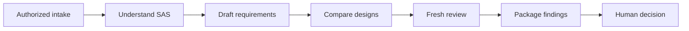

# Why this design

## The problem we are solving

A SAS workload may contain the right business rules but the wrong structure for a modern platform. Translating every statement into Python can preserve repeated reads, serial scheduling and expensive intermediate work. Optimizing before understanding the rules can break state, ordering or row multiplicity.

Our goal is to **understand first, redesign second, prove later**. The team should be able to read the resulting requirements and design—not learn an internal parser and command framework before making an architecture decision.

## One request, five drafting steps

The orchestrate skill drives these steps in your AI assistant and records progress. It is a skill, not a Python workflow service. Only load the specialist skill needed for the current step.

**Understand** recovers source-declared behavior, attributable run observations and unknowns. It writes one factual record with source pointers. Missing includes and unresolved macros stay visible. A log from one run does not prove every possible path.

**Specify** derives draft business rules and module contracts from those facts. It includes a capability map in PRD.md. Business intent that the code cannot establish becomes an owner question, not an invented requirement.

**Design** proposes a better execution structure while preserving the required invariants. ARCHITECTURE.md explains the high-level design and the low-level implementation outline. Candidate ADRs compare viable options and state what evidence each needs; the agent recommends and the human chooses.

**Review** rereads original input and challenges the claims. The reviewer writes findings only. The author may correct a requirement/design draft once, followed by fresh review; unresolved findings remain PARTIAL or BLOCKED. Factual errors require a new linked run, not silent edits to the factual record.

**Package** gives the team a one-page reading guide, the supporting drafts and the unresolved decisions. It does not approve implementation or release.

## Who owns what

- **Orchestrator:** next skill, progress, stop and correction limits.
- **Author:** source understanding, requirement/design drafts and author corrections.
- **Reviewer:** findings from original input in a fresh context where the host supports it; no repairs or approvals.
- **Human:** business intent, architecture/runtime choice, evidence/tolerances, execution and downstream release.

Separate agent profiles alone do not create independence. If the host cannot provide a fresh reviewer context, the package records that limitation and remains PARTIAL.

## Where optimization belongs

Suppose three scenarios process 1,000, 2,000 and 3,000 records. Those sizes do not prove the scenarios can run in parallel. First check producer/consumer dependencies, shared state, side effects, ordering and join multiplicity. Then compare shared preparation, native Python, vectorized processing or a distributed runtime with explicit resource and data-transfer costs.

A design may change the execution plan, but must preserve required business behavior. Stateful `BY`, `RETAIN`, sum statements and conditional `LAG` need special attention. A missing dependency in an incomplete reading is not proof of independence. Keep doubtful stages sequential or conditional in the proposal.

The design names two separate proof obligations:

1. **Correctness:** compare the eventual implementation with independently attributable SAS inputs/outputs under human-approved keys, coverage and tolerances.
2. **Efficiency:** benchmark representative workloads and the selected runtime, including memory and data movement. A local sample tie-out does not prove distributed performance.

The validation plan offers a governed 50-record sample, full population, phased 50-then-full or a custom sample when tie-out is requested. It may recommend, but the human selects the scope. Sampling never silently satisfies a full-population obligation.

## Why only one script

`scripts/input_snapshot.py` computes input-file hashes and checks for changes. This is an exact mechanical task, so a deterministic helper is useful. It does not parse SAS, call an LLM, approve a decision or control the workflow. If it cannot run, source integrity is marked NOT_CHECKED; the agent must not invent hashes.

No application package, runtime launcher, stored oracle, accepted evidence or historical demo is required for this drafting workflow. Instruction-led checks are not tamper-proof enforcement. Downstream migration needs its own implementation, approval and executable validation controls.

## Jim Thompson practices, applied simply

We adapt selected guidance from Jim Thompson's [planning](https://github.com/jimthompson5802/coding-assistant-practices/blob/abdf5661855dae25e002578fe25c961a6200db5d/coding-assistant-planning-practices.md), [feedback-loop](https://github.com/jimthompson5802/coding-assistant-practices/blob/abdf5661855dae25e002578fe25c961a6200db5d/open-vs-closed-loop-practices.md) and [subagent](https://github.com/jimthompson5802/coding-assistant-practices/blob/abdf5661855dae25e002578fe25c961a6200db5d/subagent-practices.md) guidance. These are adaptations, not full compliance or endorsement.

- **Understand before planning:** understand runs before specify/design and retains source citations.
- **Keep context focused:** orchestrate loads one relevant skill instead of every historical document.
- **Close the loop:** review returns cited findings; the author owns one bounded correction and re-review.
- **Separate roles:** a fresh reviewer checks originals, while humans retain the actual decisions.
- **Persist progress:** each run records its next action in PROGRESS.md outside chat.

These are the operating instructions of this branch, not proof that every host will obey them. Skill loading, isolation and permission behavior depend on your configured assistant; report actual checks instead of assuming them.

## How this branch relates to the existing work

This skills-first tree was created from `design/team-handoff` at `eb9794167339d1991800c290a2b24ac10a57edf8`. It adapts the small drafting workflow from [SASInsight](https://github.com/keshavnath1/SASInsight/tree/4954da22e12cdd858ae0b2378c1f8730fd090544). The original shared branch and Git history retain the engineering implementation and evidence.

The current tree deliberately does not ship those engines, tests or archived runs. This is a clean team workspace with a narrower purpose—not a claim that the engineering controls were unnecessary or that their guarantees exist here. Branch cleanup is not removal of data from Git history. The draft handoff still needs receiving-side review and human approval; no automatic downstream importer is implemented.
