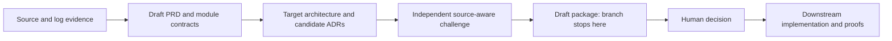
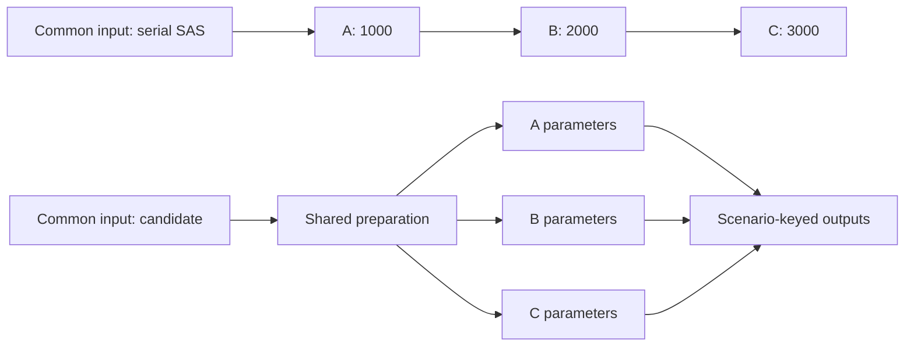

# Core design: recover behavior, redesign execution, prove the result

## The central idea

A SAS workload can contain valuable business rules inside an inefficient execution structure. Modernization should preserve required behavior, not reproduce every SAS block, intermediate dataset or serial step in Python.

The sequence is **reverse-engineer the as-is source and attributable logs → derive an evidence-backed draft PRD, capabilities and module specifications → propose a better target architecture and source-backed ADRs → independently challenge the design against original evidence → human decision → downstream implementation and separate correctness/performance proof**.

This branch implements the drafting portion through focused instructions for an existing AI assistant, not a migration service. [README.md](README.md) lists the package; [AGENTS.md](AGENTS.md) defines its authority and stop rules.

It **stops at the reviewed draft package**. It does not generate semantic IR, a scorer, approved YAML or a downstream gate engine; execute SAS or target jobs; select a runtime; or grant approvals. `READY_FOR_HUMAN_REVIEW` describes document readiness, not a completed migration.

## Start with facts, not a preferred framework

The [understand skill](.agents/skills/understand/SKILL.md) reads authorized source, includes, macros and supplied logs/LST to recover operations, inputs/outputs, dependencies, state, order, missing-value behavior and uncertainties. Computation-critical missing includes or unresolved macros limit the affected conclusions.

`SOURCE_EVIDENCE.md` is the **single factual record**, with F/O/D/U IDs and original relative paths/line ranges. It distinguishes source declarations, attributable run observations, inference, supplied assumptions, proposals, unknowns and contradictions.

A log proves only the paths and conditions of its attributable run. A matching dataset name does not establish producer-consumer version continuity. A missing dependency edge does not establish independence. Optional file hashes establish byte consistency, not semantic correctness.

Requirements, module contracts, diagrams and ADRs are derived views that cite this record; they do not replace it or create competing facts. Completed facts remain unchanged. Source changes or factual corrections require a new linked run and review, rather than rewriting evidence to fit the proposal.

## Each document answers a different question

**PRD — product requirements document: why?** `PRD.md` explains the business outcome, scope, stakeholders, constraints and candidate success criteria. Source behavior supplies evidence for draft requirements, but cannot settle why the business wants a rule or whether a legacy quirk is intentional. Missing intent becomes an owner question.

**Capabilities — what?** The capability map inside `PRD.md` names the useful functions recovered from evidence, such as preparation, scenario computation and reporting. It maps current invariants, proposed improvements, dependencies and proof obligations; capability grouping remains a proposal until confirmed.

**Module specification — exactly which rules?** `MODULES.md` defines proposed capability-based boundaries, inputs/outputs, keys and known schemas, filters/formulas, coefficient versions, missing values, multiplicity, ordering/state, side effects and inter-module dependencies. Unknown contracts remain explicit, not invented. The [specify skill](.agents/skills/specify/SKILL.md) separates preservation from proposed behavior changes.

**HLD — high-level design: which components and data flow?** `ARCHITECTURE.md` presents the as-is workload and candidate to-be components, ownership, interfaces and data flow. It explains shared preparation, computation and output reconciliation without pretending the proposed components are deployed.

**LLD — low-level design: how would execution preserve the rules?** Its concise low-level outline specifies algorithms, scenario/group/partition keys, ordering and tie handling, state ownership and resets, materialization, scheduling, retries and output contracts. A logical branch diagram alone is not an execution strategy.

**ADR — architecture decision record: why this alternative rather than another?** Candidate ADRs link material design choices to source evidence, alternatives, preconditions, semantic risks, cost hypotheses, integration impact and reversal triggers. The [design skill](.agents/skills/design/SKILL.md) compares native Python, PySpark, Ray and Dask, including reasoned exclusions; recommendations remain unselected drafts.

**Validation plan — how will we know?** `VALIDATION_PLAN.md` separately defines future correctness checks and representative performance measurements. Writing a plan performs neither. Oracle, keys, tolerances, coverage, population and benchmark criteria remain proposed/open for human decision.

## Semantics are not a SAS-to-Python mirror

In this branch, `MODULES.md` expresses backend-neutral semantics in readable contracts. One SAS block may require several target expressions; several SAS blocks may become one fused operation. Module boundaries follow capabilities and dependencies, not automatically source-file or procedure boundaries.

A downstream semantic IR, if the receiving implementation workflow uses one, should encode approved behavior and invariants—not a SAS-block/Python-block mirror. It is also **not a comparator**: describing behavior does not run the target or compare its results with SAS.

Keep the as-is evidence trace distinct from the to-be execution plan. Reordering, fusion, partitioning or shared preparation must satisfy the preserved rules; none is justified merely because the target code looks cleaner.

## Concrete example: three scenarios, one common input

**SYNTHETIC EXAMPLE ONLY:** assume a common loan input and three parameter sets, A/B/C, each with its own selection rule and frozen coefficients. A selects 1,000 records, B 2,000 and C 3,000. These counts are illustrative, not measured findings, and may include the same loan in multiple scenarios.

For this example, the required business result is the scenario-specific default probability for every selected loan, using that scenario's frozen coefficients and defined missing/numeric rules. This is an invented example contract, not a claim about an inspected SAS workload.

The illustrative SAS flow reads/prepares input and scores/exports A, then B, then C. A candidate target could read once, share equivalent preparation, then compute scenario-specific results without carrying forward unnecessary serial boundaries.

The serial arrows show illustrative execution order, not evidence that B consumes A. The candidate branches are **logical**, not proof of concurrent scheduling. A sensible native baseline may use shared preparation plus vectorized expressions on one node. Another candidate is a scenario-keyed distributed plan. Independent tasks are an option only if independence and safe isolation are positively demonstrated.

Before proposing any of these, check whether B consumes A's results; whether preparation is genuinely identical; whether coefficients, retained state, random state, files or tables are shared; and whether ordering, group continuity or export side effects constrain execution. Missing source evidence leaves those questions open.

If a loan appears in several scenarios, a candidate output key is `(scenario_id, loan_id)`, provided the source output grain supports uniqueness. Where duplicates are meaningful, preserve the actual multiplicity and define reconciliation accordingly; do not deduplicate for convenience.

The LLD must isolate scenario parameters and mutable state, specify group keys/state resets and required order, and prevent output collisions or retry duplication. If equivalence or independence cannot be established, keep the affected work sequential or explicitly conditional.

Preserve the selected population, filters, formulas, coefficients, missing-value rules, output grain and required numerical/business outputs. Propose isolated-versus-combined scenario checks and partition/state-boundary tests; do not silently loosen tolerances to accommodate a new execution plan.

The ADR asks whether avoiding repeated scans outweighs memory/materialization costs, scenario expansion, serialization, scheduling, data movement, shuffle/skew and recovery overhead. Small counts alone favor neither distribution nor parallelism; expensive computation or larger representative workloads may change the trade-off.

There is no guarantee of a globally optimal design, and Spark is not always better. The defensible outcome later is a design that meets the agreed correctness and performance criteria on the documented workload and environment—not an unmeasured claim that parallel branches are faster.

## Optimization is not a business-rule fix

Optimization changes **how** required behavior executes: for example, shared scans, native expressions or safe scenario-keyed processing. It must not silently change filters, event definitions, coefficients, duplicates, missing values, output keys or order-dependent state.

A suspicious legacy formula is a question for the business owner, not permission to repair it during redesign. A business-rule correction needs a separately recorded behavior decision and corresponding reference-output/validation changes. Refitting a model instead of using frozen scoring coefficients is a semantic change, not merely an optimization.

## Challenge the design before implementation

The [review skill](.agents/skills/review/SKILL.md) rereads original authorized intake and checks whether cited evidence actually supports requirements and design claims. It challenges coverage, hidden dependencies, shared state, ordering, numerical behavior, runtime-fit arguments and proposed proof obligations before implementation.

A reviewer writes findings, not repairs or approvals. Genuine fresh-context review matters; another profile name or a same-context self-check is not independence. If isolation is unavailable, disclose it and retain `PARTIAL` readiness. One bounded author correction may receive fresh re-review; unresolved issues remain visible.

Humans then confirm intent and make architecture, runtime and validation decisions. The branch supplies an informed draft package for that decision; it does not implement an executable approval gate or automatically authorize downstream generation.

## Fit the module into the supplied platform

A module proposal must fit supplied existing-module contracts and platform constraints: schemas/API versions, shared preparation/libraries, data locality, scheduling, resources, deployment/security limits, coexistence and rollback. Assess resource contention and integration/regression obligations, not just isolated module speed.

Use supplied platform ADRs, approved infrastructure constraints and existing target contracts where available. If they are absent, state the missing context and conditional fit; do not invent a platform registry or assume automatic cross-module discovery. This branch has no automatic registry or downstream importer.

## Downstream proof is a separate responsibility

Correctness must exercise the **actual intended target implementation**, including any optimized/distributed path, against independently attributable SAS reference inputs/outputs under human-approved keys, coverage and tolerances. A local reference or sample tie-out cannot establish full-population or target-cluster correctness.

Performance requires representative end-to-end benchmarks against a named baseline, with input/code/runtime versions, resources, cache conditions, repetitions, I/O and relevant memory/data-movement costs recorded. Different baseline infrastructure must be disclosed. A correct result does not prove improvement; a fast wrong result is unacceptable.

The handoff therefore connects source facts → draft requirements/contracts → candidate design decisions → review findings → future tests and evidence. Its value is a clear, source-backed modernization proposal with explicit unknowns—not generated code, automatic approval or claimed production readiness.

## Why the repository stays small

The original engineering branch is preserved. This team branch removes its runtime, candidate implementations, archived documents, tests and stored evidence from the current tree so the design is the entry point. Generated source findings are still necessary for traceability, but they stay private in output/<run-id>/ rather than being shipped as accepted examples.

The tree was created from design/team-handoff at eb9794167339d1991800c290a2b24ac10a57edf8 and adapts the focused drafting approach from [SASInsight](https://github.com/keshavnath1/SASInsight/tree/4954da22e12cdd858ae0b2378c1f8730fd090544). Git history and existing branches remain intact; cleanup is not history deletion. The handoff requires receiving-side review, not automatic import or inherited engineering guarantees.

## Jim Thompson's practices: how to use them here

We adapt Jim Thompson's guidance on repository-aware planning, feedback loops and focused subagents.[1] [2] [3] The goal is not to add another framework. It is to make the assistant's work understandable, reviewable and bounded.

### 1. Understand before proposing a solution

Jim recommends inspecting the actual repository and separating facts from assumptions before planning.[1] Here, [AGENTS.md](AGENTS.md) defines the read order; [understand](.agents/skills/understand/SKILL.md) examines the authorized input and writes `SOURCE_EVIDENCE.md` before requirements or design.

**Use it:** start with “Inspect intake/ and explain the behavior and dependencies before proposing a target design.” Read the factual record when the result looks surprising. A missing include should appear as an unknown, not an invented explanation. Do not start with “make everything parallel in Spark.”

### 2. Define success before implementation

Jim asks for observable acceptance criteria, not just a list of activities.[1] Our [specify](.agents/skills/specify/SKILL.md) skill puts outcomes and capabilities in `PRD.md` and exact behavior in `MODULES.md`. The [design](.agents/skills/design/SKILL.md) skill puts proposed correctness and performance checks in `VALIDATION_PLAN.md`.

**Use it:** ask “Which outputs and business rules must stay the same, and how would we test that?” For scenario scoring, preserve the scenario/loan result grain and approved coefficients. Treat the numeric tolerance, population and runtime objective as human decisions, not convenient agent-generated defaults. No code is implemented by this branch.

### 3. Use focused skills; delegate only when context separation helps

Jim's subagent guidance divides work by responsibility and context, not by maximizing parallel agent count.[3] [orchestrate](.agents/skills/orchestrate/SKILL.md) loads the relevant skill at each step. The same author can do the dependent understand/specify/design work sequentially. A fresh reviewer is useful because it challenges the author's conclusions.

**Use it:** give review a bounded request: “Read the original authorized source and these candidate ADRs. Check dependencies, preserved behavior and unsupported claims; write findings only.” Optional [author](.github/agents/designer.agent.md) and [reviewer](.github/agents/reviewer.agent.md) profiles help select instructions. They do not launch workers or prove isolation. Use the host's actual fresh-context mechanism; if unavailable, the package must say so and remain PARTIAL.

### 4. Keep the author and reviewer responsibilities separate

Jim recommends separating implementation from review while keeping coordination with the primary agent.[3] In this drafting repo, the author owns PRD/module/architecture/ADR drafts. The [review](.agents/skills/review/SKILL.md) skill rereads original input and writes `REVIEW.md` only. Orchestrate records the next action; the human makes the actual architecture decision.

**Use it:** if review says “the combine step reads scenario A's output,” ask the author to revise the parallelism proposal. Do not ask the reviewer to quietly repair the ADR it is judging. Do not treat a second agent's confidence as human approval or numerical proof.

### 5. Close the draft feedback loop, and stop after the bound

Jim recommends explicit stopping criteria, bounded corrections and preserving verification integrity.[2] Our draft loop is **author proposal → source-aware review → at most one author correction → fresh re-review**. First-pass findings remain visible. The reviewer must challenge what the source actually supports, not merely whether a citation exists.

**Use it:** a proposal that runs a producer and its consumer concurrently should be rejected when the consumer requires the producer's completed output. The author must restore that dependency barrier or withdraw the proposal—not edit the source facts or weaken the review. If a problem remains after the one correction, stop with PARTIAL/BLOCKED and a concrete question.

This is a source-aware **document feedback loop**, not an executable migration test loop. Jim's implementation guidance calls for tests/builds and independently verifiable execution feedback.[2] Actual SAS tie-out and runtime benchmarks belong to the later implementation phase; this branch prepares their plan, not their PASS result.

### 6. Save progress outside chat and resume explicitly

Jim recommends persistent plans for work that spans sessions.[1] [orchestrate](.agents/skills/orchestrate/SKILL.md) records stage, role, outputs, open findings and next action in each private run's `PROGRESS.md`. Completed source facts and prior runs are preserved.

**Use it:** supply the exact prior run and ask “Check source integrity, create a new linked run, and continue the next unfinished drafting step.” The existing contract does not silently overwrite the old run. If source changed, the assistant restarts understanding of the new bytes instead of combining old facts with new source.

### 7. Match checks and process to the risk

Jim recommends proportional planning and verification rather than heavy machinery for every task.[1] [2] This branch uses six short skills and one optional [hash helper](scripts/input_snapshot.py), not a parser/runtime service or a giant validation suite. The helper computes/checks source bytes; it does not judge business correctness. When unavailable, integrity remains NOT_CHECKED and readiness at best PARTIAL.

**Use it:** for a documentation change, check links and the actual diff. For a design proposal, challenge it against original source. For an implemented scorer, require executable parity tests and representative benchmarks in the downstream environment. Do not build an approval engine just to draft a PRD—and do not mistake a readable PRD for tested software.

### Where we deliberately differ from Jim's full implementation workflow

Jim's substantial implementation workflow requires developer validation at phase exits.[1] This branch automatically continues **drafting** because it neither generates production code nor executes a migration. Human scope/intent, architecture/runtime, oracle/tolerances/population and downstream execution/release decisions remain separate. This is selected practice adoption, not full compliance, enforcement or endorsement.

A synthetic Manus rehearsal of this clean workflow read source, drafted requirements/design, rejected a deliberately false producer/consumer independence ADR, applied one author correction, freshly re-reviewed it and packaged the remaining unknowns. That demonstrates this limited draft feedback path; it does not prove native Copilot/Codex integration, protected reviewer isolation, real SAS equivalence or a speedup. No rehearsal files or evidence are shipped in the branch tree.

## References

[1]: https://github.com/jimthompson5802/coding-assistant-practices/blob/abdf5661855dae25e002578fe25c961a6200db5d/coding-assistant-planning-practices.md "Jim Thompson — Good Practices for Planning with AI Coding Assistants"
[2]: https://github.com/jimthompson5802/coding-assistant-practices/blob/abdf5661855dae25e002578fe25c961a6200db5d/open-vs-closed-loop-practices.md "Jim Thompson — Good Practices: Open-Loop vs. Closed-Loop Workflows"
[3]: https://github.com/jimthompson5802/coding-assistant-practices/blob/abdf5661855dae25e002578fe25c961a6200db5d/subagent-practices.md "Jim Thompson — Best practices for using subagents in AI coding assistants"
