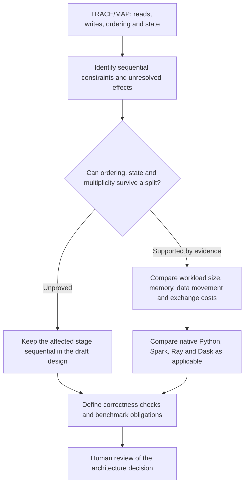

# SAS modernization architecture

The system turns authorized SAS source into traceable evidence, reviewable
designs, and executable Python for explicitly supported candidate contracts.
[The workflow and component diagrams](GOAL4B_P2A_INTAKE.md#workflow-architecture)
show the operator sequence, Python calls, and artifact handoffs.

## Evidence and execution boundaries

| Component | Responsibility |
| --- | --- |
| Public INTAKE | `review_intake.py` inventories files and validates explicit scope. Its multi-file route binds the entry point, literal include edges, and typed synthetic profile before calling `sas_re.evidence.build_inventory` and `sas_re.semantic.reconstruct`. |
| Bounded source review | `review_source.py` analyzes explicitly authorized spans from a hash-identified file. It uses the existing subset parser and bounded rule and interval recognizers. This route supports authorized private inspection outside Git. |
| Evidence and TRACE/MAP | The evidence identifies original bytes, source-qualified spans, operations, dependencies, and unresolved findings. The source-review renderer produces a readable TRACE/MAP. Inferred dependencies do not prove runtime order or dataset-version continuity. |
| Design and configuration | Python generates the review handoff and draft migration profile and tie-out configuration. Copilot uses the selected evidence to draft requirements and architecture. Human reviewers own business and configuration choices. |
| Candidate execution | Existing approval-gated continuations check claims, exact-byte human approval, and supported contracts before publication. The running-balance command separately runs a draft engineering example after verifying exact source and evidence identities. |
| Validation | Repository checks, public engineering expectations, and deterministic replay cover the bounded implementation. Independent SAS comparison requires attributable inputs, outputs, and execution evidence. |

## How the five skills collaborate

Use the selected evidence and its manifest throughout. Skills can work
individually when the task needs only one deliverable. For a complete review,
carry the reconstruction into the requirements and dependency analysis, then
use those findings in the validation plan and design.

| Skill | Inputs and responsibility | Draft output and boundary |
| --- | --- | --- |
| `sas-reconstruct` | Authorized source review, inventory and graph | TRACE/MAP with source spans and coverage. Python performs deterministic reconstruction. |
| `sas-specify` | Recovered facts, dependencies and supplied business context | PRD and functional/module contracts with owner questions. Business intent requires review. |
| `sas-analyze` | Graph, source order, state and available diagnostics | Constraints and optimization hypotheses. Missing edges leave independence unproved. |
| `sas-validate` | Requirements, graph, available observations and expectations | Engineering checks and independent tie-out obligations. Proposed checks stay separate from executed results. |
| `sas-architect` | Requirements, constraints and validation obligations | HLD, LLD and ADRs with conditional runtime alternatives. A design proposal does not grant execution or publication approval. |

## Runtime and optimization decisions

Native Python is available for bounded candidates. Spark and Dask can be
considered for measured partitioned or shuffle-heavy workloads. Ray can be
considered for independent tasks with justified transfer costs. These are
design alternatives. The repository supplies no distributed runtime for the
public running-balance example.

The [public example](../examples/modernization/README.md) demonstrates literal
includes, a literal macro binding, stateful DATA, two-key SORT, and a bounded SQL
join. The [running-balance runner](../examples/running-balance/README.md)
accepts the exact supported fresh INTAKE and evidence package. Other subjects
require their own supported contract. Unsupported subjects stop at review.

SAS reference and benchmark execution remain `NOT_RUN`. Semantic verification
remains `UNVERIFIABLE` and semantic acceptance remains `BLOCKED`.
