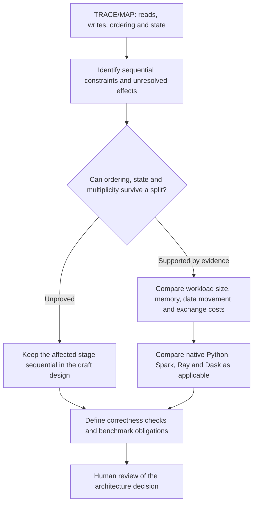

# SAS modernization architecture

The system turns authorized SAS source into traceable evidence, reviewable
designs, and executable Python for explicitly supported candidate contracts.

This is the team's detailed **design explanation**. Use the [README reading path](../README.md#team-reading-path) for onboarding and the [existing INTAKE guide](GOAL4B_P2A_INTAKE.md#workflow-architecture) for operator steps, Python calls and artifact handoffs. The guides explain different parts of the same existing system; they are not separate workflows.

Read [the core design](#what-the-existing-design-is-trying-to-achieve), [component boundaries](#evidence-and-execution-boundaries), [five skills](#how-the-five-skills-collaborate) and [runtime choices](#runtime-and-optimization-decisions) for the main story. [Jim's practical usage guidance](#using-jim-thompsons-practices-without-changing-the-workflow) follows. The retrospective practice-evidence mapping at the end is optional engineering reference, not another team stage.

## What the existing design is trying to achieve

The goal is not to turn each SAS statement into a matching Python statement. It is to recover supported source behavior and dependencies, preserve the required business results, and propose a better execution structure where the evidence justifies it. This is the existing team-handoff design, not a new workflow.

The Python reconstruction tools own the bounded inventory, source identities, operations, inferred dependencies and unresolved findings. The selected evidence package is the basis for skill drafts; the agent must not invent a second source story or treat supplied profile assumptions as measured facts. Reconstruction is limited to supported source forms and is not proof of complete SAS semantics or actual execution.

The **PRD**, or product requirements document, explains the proposed business outcome, scope and acceptance criteria. **Module specifications** describe inputs/outputs and the rules to preserve, including state, order, missing values and multiplicity. Source can support those drafts, but only an owner can confirm intended business behavior or authorize a change to a legacy rule.

The **HLD**, or high-level design, describes components, ownership and data flow. The **LLD**, or low-level design, explains the proposed algorithms, partitions, ordering and state handling. **ADRs**, or architecture decision records, explain alternatives, tradeoffs, assumptions and why a choice may fit the workload. The existing `sas-architect` skill produces these drafts from the reconstruction, requirements and validation findings; it does not select or deploy a distributed runtime automatically.

Consider three scenarios with illustrative sizes of 1,000, 2,000 and 3,000 records. Those are not measurements from this repository. If they share identical preparation and have no unresolved cross-scenario state or producer-consumer dependency, a draft may propose shared preparation or isolated scenario work. If one consumes another's output or retained/group state crosses the split, the design must preserve that constraint. Counts and parallel diagram branches prove neither independence nor speed.

Correctness and efficiency are separate obligations. The existing public candidate demonstrates engineering behavior on its exact supported synthetic workload; it does not establish independent SAS tie-out. Distributed optimization requires its own supported implementation and representative measurements. A proposed architecture or passing replay is not a correctness/performance guarantee.

The operator generates the evidence package and supplies its handoff to a human-invoked Copilot session. The five existing skills inform review; the applicable existing candidate and approval contracts determine whether execution can follow. No new orchestrator, automatic drafting loop, semantic-IR generator or approval mechanism is introduced here.

## Evidence and execution boundaries

| Component | Responsibility |
| --- | --- |
| Public INTAKE | `review_intake.py` inventories files and validates explicit scope. Its multi-file route binds the entry point, literal include edges, and typed synthetic profile before calling `sas_re.evidence.build_inventory` and `sas_re.semantic.reconstruct`. |
| Bounded source review | `review_source.py` analyzes explicitly authorized spans from a hash-identified file. It uses the existing subset parser and bounded rule and interval recognizers. This route supports authorized private inspection outside Git. |
| Evidence and TRACE/MAP | The evidence identifies original bytes, source-qualified spans, operations, dependencies, and unresolved findings. The source-review renderer produces a readable TRACE/MAP. Inferred dependencies do not prove runtime order or dataset-version continuity. |
| Design and configuration | Python generates the review handoff and draft migration profile and tie-out configuration. Copilot uses the selected evidence to draft requirements and architecture. Human reviewers own business and configuration choices. |
| Candidate execution | Existing approval-gated continuations check claims, exact-byte human approval, and supported contracts before publication. The running-balance command separately runs a draft engineering example after verifying exact source and evidence identities. |
| Validation | Repository checks, public engineering expectations, and deterministic replay cover the bounded implementation. Independent SAS comparison requires attributable inputs, outputs, and execution evidence. |

## How the five skills collaborate

Use the selected evidence and its manifest throughout. Skills can work
individually when the task needs only one deliverable. For a complete review,
carry the reconstruction into the requirements and dependency analysis, then
use those findings in the validation plan and design.

| Skill | Inputs and responsibility | Draft output and boundary |
| --- | --- | --- |
| `sas-reconstruct` | Authorized source review, inventory and graph | TRACE/MAP with source spans and coverage. Python performs deterministic reconstruction. |
| `sas-specify` | Recovered facts, dependencies and supplied business context | PRD and functional/module contracts with owner questions. Business intent requires review. |
| `sas-analyze` | Graph, source order, state and available diagnostics | Constraints and optimization hypotheses. Missing edges leave independence unproved. |
| `sas-validate` | Requirements, graph, available observations and expectations | Engineering checks and independent tie-out obligations. Proposed checks stay separate from executed results. |
| `sas-architect` | Requirements, constraints and validation obligations | HLD, LLD and ADRs with conditional runtime alternatives. A design proposal does not grant execution or publication approval. |

## Runtime and optimization decisions

Native Python is available for bounded candidates. Spark and Dask can be
considered for measured partitioned or shuffle-heavy workloads. Ray can be
considered for independent tasks with justified transfer costs. These are
design alternatives. The repository supplies no distributed runtime for the
public running-balance example.

The [public example](../examples/modernization/README.md) demonstrates literal
includes, a literal macro binding, stateful DATA, two-key SORT, and a bounded SQL
join. The [running-balance runner](../examples/running-balance/README.md)
accepts the exact supported fresh INTAKE and evidence package. Other subjects
require their own supported contract. Unsupported subjects stop at review.

SAS reference and benchmark execution remain `NOT_RUN`. Semantic verification
remains `UNVERIFIABLE` and semantic acceptance remains `BLOCKED`.

## Using Jim Thompson's practices without changing the workflow

The [practice ledger](https://github.com/keshavnath1/sas-reverse-engineering/blob/eb9794167339d1991800c290a2b24ac10a57edf8/docs/BEST_PRACTICES_ADOPTION.md#sources-and-attribution) attributes the pinned primary guides. The usage below applies their planning, feedback-loop and responsibility/context guidance to the existing files. It does not add controls or inherit a claim of full compliance.

**Plan from inspected evidence.** Follow [AGENTS.md](../AGENTS.md), the authorized scope and [existing INTAKE guide](GOAL4B_P2A_INTAKE.md). Generate the package before asking `sas-specify`, `sas-analyze` or `sas-architect` for conclusions. Ask the assistant to distinguish source declarations, graph inferences, profile assumptions and unknowns. Do not begin with an unconditional request to parallelize everything in Spark.

**Keep context focused.** Supply the exact `MODERNIZATION_REVIEW.md` handoff and its bound inventory, graph and manifest to the [five skills](#how-the-five-skills-collaborate). Each skill should use the evidence relevant to its deliverable. A skill is a reusable instruction, not proof that a separate worker was launched. Historical milestone documents need not all be loaded into the session.

**Separate authoring from challenge.** Ask a separate reviewer context, where the host supports it, to reread original evidence and challenge the draft's dependencies and preserved behavior. A useful request is: “Check whether this concurrency proposal is supported by the selected source/evidence. Report cited contradictions and unknowns; do not repair the draft or grant approval.” The operator owns reconciliation and human review. This is usage advice, not an implemented reviewer service or automatic correction budget.

**Use the existing mechanical checks for their actual purpose.** Run [P2A citation preflight](GOAL4B_P2A_INTAKE.md#five-skill-modernization-handoff) on the Copilot draft using `check_p2a_citations.py`. `REVIEW_REQUIRED` means citations resolved, not that claims are semantically correct. Applicable structured routes use the existing claim checks and byte-bound approval. Do not substitute a new generic checker for those contracts or bypass a refusal by changing the source/evidence.

**Close the executable loop only on a supported candidate.** Use the original [running-balance guide](../examples/running-balance/README.md), relevant regression tests and repository guard where applicable. Compare actual observed results with the candidate's engineering expectations, correct the owning draft/code through the established route, and retain unresolved failures. Unsupported subjects stop at review; unrun SAS references and benchmarks remain `NOT_RUN`. Source/design review is not a substitute for independent executable SAS comparison.

**Keep plans and human decisions reviewable.** Use the existing linked design and review records, exact evidence versions and applicable approval route. Preserve historical results and do not invent a signoff or weaken criteria to obtain a pass. Private source and review material remain outside Git under the current security policy. No new `PROGRESS.md` state machine or additional artifact family is required by this explanation.

## Modernization Best Practices — Evidence and Design Alignment

**On-demand engineering reference.** The table preserves existing retrospective claims and their limitations. For everyday usage, use [the practical guidance above](#using-jim-thompsons-practices-without-changing-the-workflow). Nonessential dated reports, qualification plans and Copilot trial outputs are removed from this branch's current tree. Their links here and in the [README's engineering-history section](../README.md#engineering-history-and-qualification-plans) point to the preserved immutable original version; no new historical result or approval is created.

The branch's [engineering-practice ledger](https://github.com/keshavnath1/sas-reverse-engineering/blob/eb9794167339d1991800c290a2b24ac10a57edf8/docs/BEST_PRACTICES_ADOPTION.md#sources-and-attribution)
records the pinned primary sources and paraphrases of Jim Thompson's guidance.
This mapping uses its entries J2 (Planning practices, §§1.1–1.12), J3 (Open
and closed loops, §§2 and 4), and J5 (Context management, §§1.1–1.8).
These are retrospective alignments. The ledger distinguishes the primary
guides from the secondary Manus AI summary. The repository-specific runtime
comparison is a design choice, with no attribution to Thompson.

| Practice | Repository evidence | Implementation status | Limitation |
| --- | --- | --- | --- |
| **J2 — Repository-aware planning and explicit scope.** Establish what can be analyzed before planning a migration. | [INTAKE implementation](../scripts/review_intake.py), [public operator walkthrough](../examples/modernization/README.md), [scope](../examples/modernization/source/scope.json), and [INTAKE tests](../tests/test_review_intake.py). | IMPLEMENTED and DEMONSTRATED. The public example binds the entry point, literal includes, source hashes, and typed profile. | Scope and profile are explicit. Unsupported or uninspected source remains a coverage boundary. |
| **J3 — Observable feedback and verification integrity.** Keep source traceability separate from runtime claims. | [Inventory engine](../src/sas_re/evidence.py), [reconstruction engine](../src/sas_re/semantic.py), [TRACE/MAP renderer](../scripts/migration_review.py), and [public evidence graph](../examples/modernization/evidence/EVIDENCE.json). | IMPLEMENTED and DEMONSTRATED. The graph records source-qualified spans, six operations, and four inferred dependencies. | Graph edges leave runtime order, dataset-version continuity, and independence unverified. |
| **J5 — Focused, progressively supplied context.** Give each of the [five skills](#how-the-five-skills-collaborate) the evidence needed for its deliverable. | [Generated Copilot handoff](../examples/modernization/evidence/MODERNIZATION_REVIEW.md), [requirements and design review](../examples/modernization/REVIEW.md), and [recorded live review and correction](https://github.com/keshavnath1/sas-reverse-engineering/blob/eb9794167339d1991800c290a2b24ac10a57edf8/docs/goal4c/README.md). | DEMONSTRATED for handoff generation and a separate live review of the same pattern. The live drafts required correction before human design approval. | The team example contains draft PRD, module specifications, HLD, LLD, and ADRs. The handoff is human-invoked and does not guarantee correct claims or automate approval. |
| **J2 — Acceptance criteria and human gates.** Keep configuration, design approval, and execution authority distinct. | [Migration profile](../examples/modernization/evidence/migration-profile.yaml), [tie-out draft](../examples/modernization/evidence/tie-out.yaml), [claim gate](../scripts/review_claim_gate.py), and [gated continuation tests](../tests/test_review_to_migration.py). | IMPLEMENTED and DEMONSTRATED for supported approval-gated routes. | The running-balance example is a separate draft engineering route. Its business approval and runtime selection remain pending. |
| **J3 — Executable feedback within the verified contract.** Test the recovered behavior with explicit engineering expectations. | [Running-balance implementation](../scripts/run_running_balance.py), [operator guide](../examples/running-balance/README.md), and [public tests](../tests/test_running_balance.py). | IMPLEMENTED and DEMONSTRATED. The candidate executes ordered BY/RETAIN/SUM/LAG processing. Two-key SORT and SQL enrichment consume prepared rows separately. Tests check state, stable ties, missing values, join multiplicity, identity refusal, and replay. | Tied order and numeric handling are bounded engineering choices. The tested outputs do not establish independent SAS equivalence. |
| **Project design — Compare runtimes against dependency and workload evidence.** | [Public architecture and optimization review](../examples/modernization/REVIEW.md). | PROPOSED for Spark, Ray, and Dask. Native Python is demonstrated on the exact public workload. | Distribution requires evidence about ordering, state continuity, multiplicity, data movement, and workload cost. Benchmarks remain NOT_RUN. |
| **J3 — Verification integrity at the semantic boundary.** Require attributable reference evidence before claiming equivalence. | [Public validation plan](../examples/modernization/REVIEW.md#4-validation-and-engineering-tie-out) and [reference execution status](../examples/modernization/evidence/tie-out.yaml). | UNVERIFIED for SAS semantics. | Public expectations and deterministic replay establish engineering behavior within the candidate contract. SAS reference execution remains NOT_RUN and semantic acceptance BLOCKED. |
