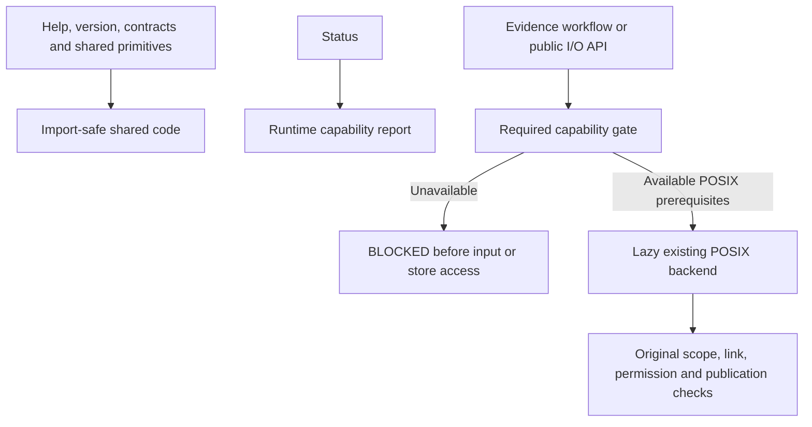

# CP1: import-safe core and capability boundary

Authorized baseline: `1c172fbb79a8ba07bf72f2f40ecf0f5db02b564a`.
Scope: CP1 only, as recorded in [APPROVALS.md](APPROVALS.md). The historical
[portability plan](CROSS_PLATFORM_PORTABILITY_PLAN.md) remains a proposal for later
increments; this authorization does not approve CP2–CP5 or P2B/P3.

CP1 separates shared evidence primitives from the existing POSIX implementation,
reports implementation capabilities and denies unavailable I/O before input or
store access. It does not implement Windows file access. Native Windows
qualification remains **BLOCKED** without an approved actual Windows interpreter
and dependency environment. Simulating selection on macOS/Linux is not native
qualification. Exact tests, failures and limits are in
[CP1_VALIDATION.md](CP1_VALIDATION.md).

## Module boundary

| Module | Responsibility / preservation |
|---|---|
| `_io_common.py` | Original error type, bounds, relative-name validation, JSON parser and canonical serialization, moved without changing function bodies |
| `platform_io.py` | Runtime metadata and required-primitive checks; fixed platform selection, denial and lazy backend import; no source path arguments or user override |
| `safeio.py` | Public guarded facade for root checks, disjointness, reads, enumeration and attempts; preserves existing public call signatures and attempt fields |
| `_posix_io.py` | Original descriptor traversal, race checks, permissions, flock, exclusive reservations, no-clobber installation and seals; original function/class bodies retained |
| `runs.py`, `semantic_runs.py` | Capability gate before reading even the scope JSON; existing error reports/exit codes and workflow logic retained |
| `cli.py` | Add capability information to `status` only; evidence artifacts and reports do not gain platform fields |
| `baseline.py` | Block unsupported local checkout traversal before resolve, Git or file reads; explicit remote check stays optional |

`Attempt` remains a frozen public dataclass with path, workspace/run/attempt IDs
and transient directory identity. Its `publish` method gates before constructing
the native implementation object. `AttemptStore` constructs its implementation
only after the gate; its `begin` and `read_attempt` methods recheck before using
the retained object. `path` and `directory_identity` remain readable properties.
The facade does not add serialization, lock files or artifact metadata.

Private implementation helpers moved modules. Existing tests that inject crashes,
partial writes or races now patch `_posix_io`, where those functions execute.
All original assertions, fixture bytes and real spawned-process scenarios remain.
No compatibility promise is made for monkeypatching private helpers in their old
module. The immutable public fixture expectation file is untouched.

## Selection and explicit denial

`filesystem_capabilities()` evaluates current runtime metadata without probing
any supplied filesystem. It returns a fresh ordinary dictionary, not an
authorization token. Mutating the result cannot change selection. There is no
environment-variable, CLI flag, configuration file or caller-selected backend.

| Runtime condition | Selection / diagnostic |
|---|---|
| `sys.platform == "win32"` **or** `os.name == "nt"` | `blocked`; `WINDOWS_BACKEND_NOT_IMPLEMENTED`; returns before any POSIX import |
| Not `darwin`/`linux` with `os.name == "posix"` | `blocked`; `PLATFORM_NOT_SUPPORTED` |
| Missing/invalid required POSIX flags, callables, descriptor/no-follow support or fcntl members | `blocked`; `POSIX_PRIMITIVES_UNAVAILABLE`; lists fixed primitive names only |
| Recognized POSIX host with those primitives | `posix`; `AVAILABLE`, subject to all existing per-operation checks |
| Backend import fails after selection | Fixed BLOCKED error; no ordinary-open or lock-free fallback |

The POSIX branch checks actual `fcntl.flock` and nonzero integer `LOCK_EX`,
`LOCK_NB` and `LOCK_UN` members, not merely whether a module file exists. It checks
the required OS open flags/callables, descriptor-relative operations, fd-based
scandir and explicit no-follow support. This does not test the filesystem or
establish effective permissions, atomicity, lock semantics or durability.

The status object includes platform, OS name, backend, `evidence_io`, reason,
missing primitives, mitigation and six capability categories: source read, root
traversal, enumeration, file identity, publisher lock and no-clobber publication.
They are enabled together for the existing backend; CP1 does not introduce a
partial unsafe mode. `AVAILABLE` means API prerequisites exist, never stage PASS,
full platform qualification or permission to process real/private data.

Every unavailable public I/O operation raises
`EvidenceError("FILESYSTEM_CAPABILITY_UNAVAILABLE", "BLOCKED")`. All five evidence
commands translate this through the unchanged P1/P2A error report constructors
and exit **2**. Denial precedes reading scope/record/profile/source content and
precedes store construction. No failed attempt is reserved merely to record a
pre-I/O platform denial; the existing pre-reservation reporting convention stays.
Malformed CLI arguments still follow argparse usage/exit 2; unknown internal
workflow commands retain their existing error behavior.

Public low-level gates also cover `require_safe_root`, `ensure_disjoint` (including
an empty root list), `secure_read`, `enumerate_files`, `read_json`, store creation,
`begin`, `read_attempt` and `Attempt.publish`. Higher-level scope/profile/citation
and reconstruction helpers reach these guarded operations. Pure in-memory
validation/hashing is deliberately available on an unsupported I/O platform.

## Pure commands, resources and optional Git

Help, version, status and `contracts.load_schema("1.0" / "2.0")` need no POSIX
backend. Contract inspection reads trusted bundled resources; it is not arbitrary
input-file access and does not grant semantic authority. No new inspection CLI is
added. Existing package dependencies are still needed; CP1 neither extends the
lock nor claims native Windows installation success.

On an already approved installed Windows environment, module commands would use
`& .\.venv\Scripts\python.exe -m sas_re status` (substitute the actual environment
path), or the installed console entrypoint. This is usage guidance, not an
installation instruction or a record of native execution. PowerShell 7 remains
the proposed shell; no execution-policy change, Git Bash or WSL is required.

Git is used only by explicit `check-baseline` operations and repository/development
checks. Importing baseline metadata, status, contract inspection and evidence
computation do not execute Git. Local `check-baseline --checkout` is BLOCKED on
Windows before path resolution or subprocesses because its existing traversal
has no qualified native reparse protection. `--remote` remains an explicit
optional Git/network action; missing Git/network yields its existing BLOCKED
response. There is no automatic remote fallback from a denied local check.

Exit codes remain 0 for successful pure commands or requested structural PASS,
1 for FAIL, 2 for BLOCKED/usage, and 3 for recognized unimplemented commands.
Status retains phase P2A because the semantic engine has not advanced. Authority
remains DRAFT, verification UNVERIFIABLE, acceptance BLOCKED and benchmarks NOT_RUN.

## Preservation and limits

- Frozen v1/v2 schemas, ZIP, reviewed expectations, dependency lock, downstream
  metadata/pin and artifact formats remain unchanged. The v1 POSIX-root contract
  is not widened; no native authorization envelope or identity projection exists.
- Source hash/identity, canonical JSON, graph/revision, parser and observation
  algorithms are unchanged. Original encoding, newline and citation rules stay;
  a different source byte still changes its hash. Platform metadata is not
  included in canonical graphs, inventories, reports, attempts or seals.
- The POSIX implementation retains original permissions, no-follow traversal,
  hardlink/nonregular rejection, bounded reads, mutation checks, flock, exclusive
  reservation, no-overwrite installation, flushes and exact artifact sets.
  Existing owner/admin trust limits remain; no signatures or stronger storage
  guarantee are claimed.
- Physical path-alias and post-seal flush/durability questions from the plan are
  deliberately unresolved here. API availability is not a newly qualified
  filesystem. Unsupported or inconsistent environments are denied rather than
  accommodated with weaker operations.
- No Windows traversal/ACL/lock/publication implementation, path-policy expansion,
  dependency change, new CI matrix, provider adapter, architecture generation,
  real workload execution or evaluator isolation is included. Agent-mastery is
  only a read-only pinned reference.

## Acceptance evidence boundary

Tests must distinguish native macOS/Linux regressions from selection simulations.
The focused suite exercises fresh processes with POSIX imports forbidden, pure
commands without process/network access, absent primitive/locking capabilities,
unknown and inconsistent platforms, direct API/CLI denial and retained-object
gates. Sentinel input bytes and nonexistent stores prove denial precedes access.
No security skip counts as native Windows qualification.

Regression checks retain all 389 original tests; additional CP1 tests do not
replace them. Baseline/candidate synthetic demo comparison checks every sealed
artifact byte and full report JSON. AST comparison checks relocated bodies; frozen
file hashes and unchanged semantic modules provide separate preservation evidence.
Installed-wheel checks use existing approved local dependencies. Native Windows
acceptance remains BLOCKED until an actual approved environment executes the pure
command and denial tests. Any dependency setup there still requires separate
approval. Stop after CP1; success does not authorize CP2.
