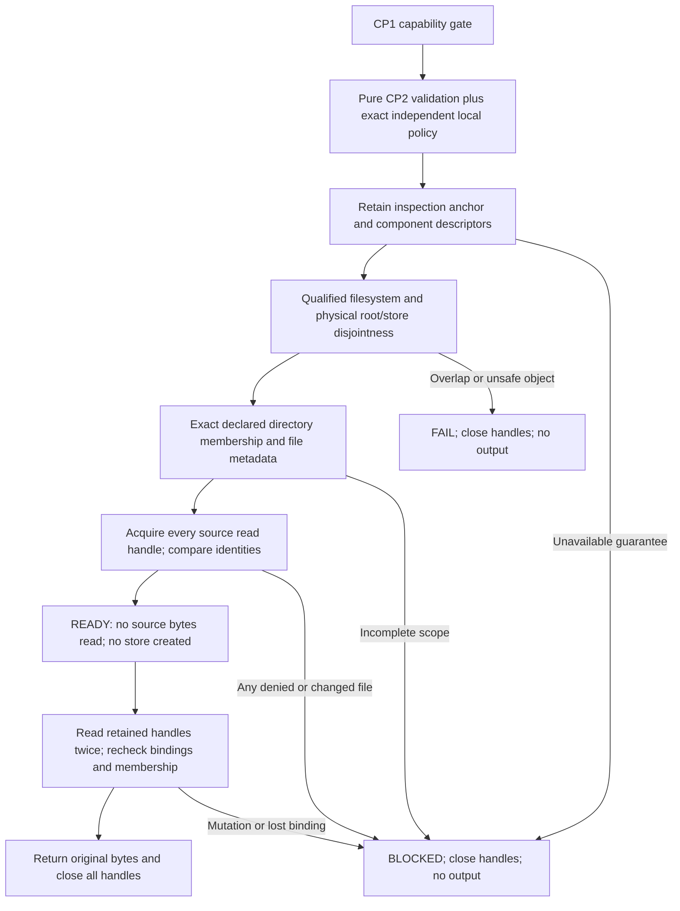

# CP3A POSIX physical authorization and read-only preflight

Approved baseline: `07ddcda5a78a9a2f9f093a94e722532f44e3044b`.
The user approved this bounded POSIX subset; [APPROVALS.md](APPROVALS.md) records
the scope. [Validation](CP3A_VALIDATION.md) distinguishes actual execution from
proposed/blocked guarantees. No Windows reader, publication change, new dependency,
schema/identity change, AI provider, P2B or P3 is included.

## Implemented boundary

The additive [preflight API](../src/sas_re/preflight.py) accepts a supplied CP2
envelope and a separate exact local inspection policy. It returns a short-lived
read-only session, not an approval token or serialized receipt. It creates no
output even on success. Existing CLI/workflow/publisher code remains byte-identical
to the baseline; this API is **not** silently inserted into those workflows.

This avoids changing persisted failure timing: existing P1/P2A commands may reserve
an attempt before inventory validation. CP3A makes no claim that those historical
commands now satisfy pre-store preflight. Integrating this path into publication
would require explicit review of that behavior and stale-binding revalidation.
No records are removed, rewritten or promoted by CP3A.



The public module is import-safe. It lazily imports POSIX code only after the
unchanged CP1 gate and pure policy checks. Windows/unknown platforms still raise
`FILESYSTEM_CAPABILITY_UNAVAILABLE/BLOCKED` before supplied-path access. No new
CLI, override, fallback or runtime Git prerequisite is added. Existing capability
reporting remains an API-availability report, not CP3A filesystem qualification.

## Explicit local policy, not fabricated approval

`LocalInspectionPolicy` is a frozen Python dataclass with required fields:

| Field | Requirement |
|---|---|
| `anchor` | Existing, dedicated, current-user-owned absolute inspection directory |
| `source_roots` | Exact tuple of `(root_id, native_path)` pairs, matching the envelope |
| `store_path` | Explicit proposed output location to inspect; never permission to create |
| `workspace_id`, `run_id` | Exact logical owners |
| `scope_sha256` | Exact existing CP2 logical projection hash; no physical metadata added |
| `source_model` | Explicit `QUIESCENT_SYNTHETIC_TRUSTED_WRITERS` precondition |

The embedding host/caller must obtain its authorized scope independently. Do not
automatically construct a policy from an untrusted envelope to bypass that duty.
Both declarations are data inside a trusted process; Python object construction
does not authenticate a person. Caller `human_approval: NOT_VERIFIED` stays unchanged.
No approver name, signature, timestamp, allowlist administrator or security-review
acceptance is invented. This is an invocation boundary, not a sandbox against
malicious code executing in the same interpreter.

The source model explicitly requires quiescent synthetic fixtures and trust in
**every principal able to modify the objects, ACLs, ancestors or mount namespace**,
including ACL-granted writers and administrators. It assumes approved ordinary
local storage backing: an APFS/ext4 filesystem name alone cannot rule out a remote
block device or disk-image backing. If these conditions cannot be established, do
not supply this model; the API reports `CP3A_WRITER_POLICY_UNAVAILABLE/BLOCKED`.

Current effective-UID ownership and absence of group/world-write mode bits are
required on the anchor and scoped directories/files. These are conservative mode
checks, **not an ACL audit or proof of exclusive write authority**. No ACL/mode is
repaired. Trusted system ancestors, including sticky temporary-directory layouts,
are bootstrap assumptions; retained name/object checks detect their relevant
replacement but do not establish an independent administrator security boundary.

## Bounded physical namespace

Every source root must be a strict lexical descendant of the exact anchor spelling.
The store may be the anchor (then overlap is rejected) or a descendant. Outside
paths, alternate bootstrap spellings and implicit roots are rejected before access.
CP2's conservative source/source alias screens remain unchanged.

The [POSIX session](../src/sas_re/_posix_preflight.py) opens `/` once and descends
one literal component at a time with `O_DIRECTORY|O_NOFOLLOW|O_CLOEXEC`. It retains
every parent/component descriptor and verifies named and opened object identities.
Normal macOS system/data volume transitions are allowed only during anchor
bootstrap. Every directory/file beneath the anchor must have the same qualified
filesystem identity as the anchor; no descendant mount transition is accepted.

This narrow anchor policy avoids pretending that `(st_dev, st_ino)` and lexical
ancestors prove whole-host ancestry through bind mounts or macOS firmlinks. Root
identity is compared with each other root's retained anchor-relative ancestry in
both directions. Common ancestors of genuine siblings do not imply overlap.
The same rule applies to an existing store. A store traversal that reaches a
source root stops before entering its descendants, including alias spellings.

An absent store stops at its first missing component, retaining the existing
parent and missing suffix. The parent must be qualified and disjoint; absence is
rechecked before/after reads. No `mkdir`, output-file open, lock or publication
method exists. A store appearing or its parent being replaced invalidates the
session. A successful result cannot be replayed as permission to create a store.

## Filesystem evidence and explicit limits

[Filesystem metadata](../src/sas_re/_posix_filesystem.py) is read through retained
descriptors using stdlib `ctypes`; no new Python/native dependency is installed.
Native function bindings are boundedly cached, but filesystem observations are not.
Unknown ABI, missing symbol, failed query or unsupported filesystem yields BLOCKED.

| Platform | Implemented checks | Qualification boundary |
|---|---|---|
| macOS LP64 ARM64/x86_64 | `fstatfs64`, APFS/local flags, nonzero fsid plus device, matching mount flags; reject union/ignored ownership/automount/FSKit and unknown extended flags | Actual execution is ARM64/APFS only unless validation explicitly records otherwise; no Intel/other-filesystem qualification inferred |
| Linux LP64 x86_64/aarch64 | `fstatfs`, matching ext4/xfs/btrfs/tmpfs magic/name, nonzero fsid, descriptor inode/mount ID, stable bounded mount table | Only one whole-filesystem mount for that device; duplicate-device, subdirectory/bind/subvolume and unknown arrangements BLOCKED. Native results must be reported separately from injected parser tests |

Linux reads only fixed current-PID `/proc` metadata, component-relative/no-follow
and verified as procfs: `fdinfo/<retained-fd>` and `mountinfo`. It never follows a
`/proc/PID/fd` source symlink. These kernel metadata reads occur before source
readiness and are explicitly distinguished from source-file reads. Missing procfs,
unknown mount identity, inconsistent observations or metadata overflow blocks.

Darwin ABI review used the installed macOS SDK `sys/mount.h` LP64 layout and
`fstatfs64` declaration, with structure-size and primitive-width checks in code.
Field layout was reviewed against the SDK. Apple's
[archived fstatfs reference](https://developer.apple.com/library/archive/documentation/System/Conceptual/ManPages_iPhoneOS/man2/fstatfs.2.html)
is historical context, not current qualification. Linux metadata semantics use
[kernel proc documentation](https://docs.kernel.org/filesystems/proc.html), with
ABI review against [Linux statfs definitions](https://raw.githubusercontent.com/torvalds/linux/master/include/uapi/asm-generic/statfs.h)
and [glibc definitions](https://raw.githubusercontent.com/bminor/glibc/master/sysdeps/unix/sysv/linux/bits/statfs.h).
These sources do not certify this application or qualify untested machines.

## Metadata, all-file readiness and original bytes

1. Purely validate/detach the envelope, matching its projection and explicit policy.
   CP2 remains independently usable without filesystem access.
2. Establish anchor, roots/store, physical disjointness and filesystem evidence.
3. Build directory-prefix tries only from declared files. At each scoped directory,
   compare its **complete bounded name set before opening any child directory**.
   Unexpected files, hidden entries and empty undeclared directories cause BLOCKED.
   Record file metadata using descriptor-relative no-follow `stat`; do not open
   source data handles during this phase.
4. Recheck all bindings/membership. Acquire **every** source handle with
   `O_RDONLY|O_NOFOLLOW|O_NONBLOCK|O_CLOEXEC`, using retained parents. Verify regular
   type, single link, ownership/mode, bounds, filesystem and the metadata fingerprint.
   A missing/denied last file yields zero source-content reads. No retry with
   weaker flags, altered permissions or substituted roots is allowed.
5. Only a READY session may read. Recheck all directory/name/file relationships
   before content and between files, read bounded chunks from retained handles,
   compare fingerprints, make a second byte/hash pass and check final membership.
   Return the complete mapping only after success; close on success, failure,
   cancellation/exception, or explicit context exit. Every retained close is
   attempted once; an ambiguous close error blocks success without retrying a
   possibly reused descriptor number. Close/reuse never authorizes
   another read. Keep handles noninheritable and do not expose them as a public API.

The API returns original bytes keyed by logical file key. It does not decode,
normalize newlines, compute a replacement identity algorithm, construct a graph,
or manufacture a sealed inventory. Frozen public vectors independently apply the
existing identity rules to those bytes. Existing citation/graph/encoding validators
and v1/v2 artifact formats are unchanged. Native paths, filesystem IDs, descriptors
and policy metadata are never inserted into portable evidence hashes/artifacts.

Repeated metadata/byte checks detect tested mutations, replacement and membership
changes. They are **not an atomic snapshot** against arbitrary writers: changes
after final checks or sufficiently coordinated hostile edits remain outside the
explicit quiescent-writer model. OS-managed access-time changes are possible;
the application does not restore timestamps or claim every metadata bit unchanged.

## Bounds and diagnostics

Preserved source bounds: 1,000 files, 1,000 scoped child directories, depth 32,
8 MiB/file and 64 MiB total. Added bounds: 64 bootstrap components, 32 root/store
components below anchor, 4,096 retained handles, 1 MiB/4,096 mount-table rows and
64 KiB/128 fdinfo lines. OS descriptor exhaustion fails BLOCKED with cleanup;
no limit increase or privilege escalation is attempted. Global rechecks are
quadratic in file count; finite limits are not a latency/benchmark claim or a
hard deadline around a stalled kernel I/O call.

| Diagnostic family | Gate and meaning |
|---|---|
| `FILESYSTEM_CAPABILITY_UNAVAILABLE` | Existing CP1 BLOCKED before supplied-path access |
| `CP3A_POLICY_REQUIRED`, `CP3A_WRITER_POLICY_UNAVAILABLE` | BLOCKED; missing explicit inspection/trust precondition |
| `CP3A_POLICY_MISMATCH`, `CP3A_OUTSIDE_ANCHOR` | FAIL; invalid/mismatched scope before physical access |
| `CP3A_SOURCE_OVERLAP`, `CP3A_STORE_OVERLAP`, `CP3A_UNSAFE_TYPE` | FAIL; observed forbidden overlap/link/object type |
| `CP3A_MEMBERSHIP_CHANGED`, `CP3A_BINDING_CHANGED`, `CP3A_SOURCE_CHANGED` | BLOCKED; incomplete or changed physical evidence; first applicable check determines the code |
| `CP3A_ACCESS_UNAVAILABLE`, `CP3A_OWNER_POLICY_UNAVAILABLE`, `CP3A_DESCRIPTOR_UNAVAILABLE` | BLOCKED; rights/ownership/descriptor guarantee unavailable |
| `CP3A_FILESYSTEM_BOUNDARY`, `CP3A_FILESYSTEM_UNAVAILABLE`, `PHYSICAL_*` | BLOCKED; unsupported, unknown, ambiguous or changed filesystem/mount/ABI |
| `CP3A_LIMIT`, `CP3A_SESSION_CLOSED` | BLOCKED; finite bound or invalid resource lifetime |
| `CP3A_CLOSE_UNCERTAIN` | BLOCKED; all closes attempted, but native cleanup success cannot be established; no descriptor-number retry |

Errors contain fixed codes only, never native paths, source text or raw OS errors.
This Python API raises existing `EvidenceError`; it introduces no new CLI exit
convention. Structural failure/BLOCKED remains distinct from semantic acceptance.
All existing DRAFT, UNVERIFIABLE, BLOCKED and NOT_RUN status rules are preserved.

## Use and remaining gates

With an existing approved installed environment, a trusted embedding caller uses:

```python
from sas_re.preflight import open_preflight

# supplied_envelope: already supplied CP2 data, not an input filename
# approved_local_policy: separately established LocalInspectionPolicy
with open_preflight(supplied_envelope, policy=approved_local_policy) as session:
    original_bytes_by_key = session.read_sources()
# No store, attempt, seal or approval receipt was created.
```

Native Windows, independent security-review ownership, comprehensive ACL/observer
qualification, hostile-writer snapshots and untested filesystems/mounts remain
OPEN/BLOCKED. Native-case tests and OS-call observers provide bounded development
evidence, not privileged kernel tracing or independent semantic certification.
The [CP3 plan](CP3_SECURITY_TEST_PLAN.md) remains the broader future obligation list;
CP3A does not claim completion of every planned CP3 test family.

Stop after CP3A. CP3B, Windows access, publication integration/CP4, CP5, P2B/P3 and
downstream changes require separate explicit approval.
