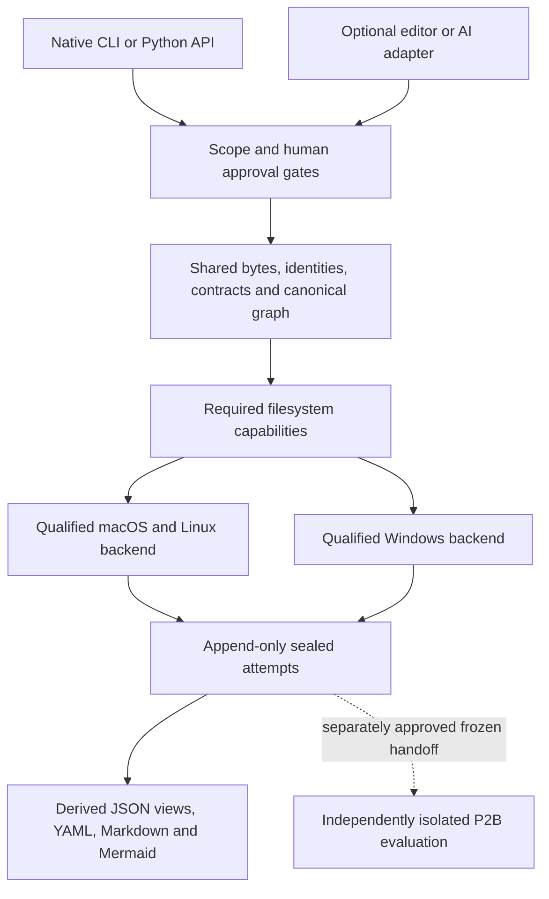

# Cross-platform portability plan

Prepared 2026-11-05. **Planning only; implementation is not authorized.**

Native Windows and macOS are required workstation targets; Linux remains a
required regression/qualification target. Ordinary operation must require only
an approved Python installation, the installed package and authorized local
files. Git is needed for repository development and optional compatibility
checks. VS Code, PowerShell and GitHub Copilot fit the intended workstation
environment, but an editor, model, cloud service, Docker, WSL or Linux VM must
not become a core runtime prerequisite.

The main blockers are the POSIX-only filesystem implementation, a v1 scope
contract that requires POSIX absolute paths, and missing Windows/macOS Intel
wheel hashes. A backend substitution alone cannot solve all three. The proposed
design keeps factual computation portable, introduces reviewed local filesystem
backends and separately versions native-path authorization. It preserves frozen
contracts and existing evidence bytes. Native support is **NOT_VERIFIED** until
the acceptance gates below pass; unsupported safety capabilities mean **BLOCKED**.

## 1. Authority and inspected baseline

The current user instruction authorizes this document only. It does not approve
any proposal below, a contract change, a dependency installation, private-data
intake, P2B or P3. Reference documents describe requirements/proposals rather
than executable instructions. Agent-mastery remains read-only.

| Evidence | Revision / meaning |
|---|---|
| Repository reviewed | `6be8e6659206a4abc796afc63ad743ad7fa40ace`; local HEAD, origin/main and GitHub main matched at review |
| Last accepted executable P2A checkpoint | `56154dd75a0149043c36081da9704b0a939230e1`; implementation `e5f5eb2fde973acf2dd059b4522247aa6fd2283c` |
| Existing downstream compatibility | Agent-mastery `bc754e0f1204a99020c864df2a5b25983005e09c`; 20 pinned file digests; no repinning or modification |
| Exact v2 specification ZIP | SHA-256 `e3cbf3d9df6cc20c594261556c5e3ea1dfc292c9c1a30672c2d7b1a736b9718e` |
| Frozen v1 schema | SHA-256 `15e3265fac9af300b40967580998ef4ac90eb1d830a10ce201855fc4ec2738a2` |
| Frozen v2 schema | SHA-256 `093216d16bb02e91a3997c97175420bf2257982f5a5fe3a4374ef92f7637a90b` |
| Dependency lock | SHA-256 `4676c7fe0a41ce2fdb35c2fb10cc014a8b352a8ca71029eb28b7373c0053e19b` |
| Compatibility metadata | SHA-256 `d22af8651c77a0569e9de7ca473e2274c108de14896b23089421100d6aa2e040` |

Repository review covered [AGENTS.md](../AGENTS.md), [README.md](../README.md),
[SECURITY.md](../SECURITY.md), [approvals](APPROVALS.md),
[implementation plan](IMPLEMENTATION_PLAN.md), [open decisions](OPEN_DECISIONS.md),
[compatibility](COMPATIBILITY.md), the P0/P1/P2A design and validation records,
[P2 readiness](P2_READINESS.md), [evaluation design](P2_EVALUATION_DESIGN.md),
[P2B readiness](P2B_READINESS.md) and [practice adoption](BEST_PRACTICES_ADOPTION.md).
Code inspection covered safe I/O, evidence identity, contracts, run orchestration,
CLI, compatibility checks, demos, repository guard, packaging, lockfile, workflow
and adversarial tests. References below are paths at the reviewed commit.

The complete pack/manifest review is recorded in P2B_READINESS.md; this checkpoint
uses that authority assessment and verifies the preserved archive identity. It
does not claim a new execution of the pack's scripts. Pack documents 02, 04, 05
and 10 remain workflow, verification, compatibility and practice references.
REA is research context, not a SAS parser or a mandatory runtime dependency.

Labels used here: **Observed** means repository inspection or cited external
documentation; **inferred risk** means a consequence not reproduced on a native
host; **proposed** means unimplemented design; **NOT_VERIFIED** means missing
qualification. Historical 389-test P2A results are attributed to their reports,
not presented as new Windows/macOS/Linux qualification.

## 2. Observed platform dependencies and risks

| Area and repository evidence | Observed behavior | Portability / integrity consequence |
|---|---|---|
| `src/sas_re/safeio.py:13,34–35`; `cli.py:9` | Unconditional `fcntl` import; POSIX open flags; CLI imports this transitively | Native Windows cannot currently reach even `status`/help. This is an import failure, not an implemented honest BLOCKED response |
| `safeio.py:79–102,137–225` | Opens `/`, traverses using directory descriptors and `dir_fd`, no-follow flags and `scandir(fd)` | Windows needs equivalent handle-relative traversal and enumeration; ordinary `Path.resolve()` plus `open()` is insufficient |
| `safeio.py:113–119`; `evidence.py:44–55` | Source/store and source/source overlap checks use lexical path ancestry | Inferred safety gap on case-insensitive macOS and Windows, drive/mount aliases and differently spelled physical roots. Prove physical disjointness before any store creation |
| `safeio.py:32,47–76` | Relative paths are bounded ASCII components with `/`; absolute roots permit valid Unicode/spaces | Unicode relative filenames are already rejected. The ASCII rule still admits Windows device names and trailing dots |
| `contracts/v1/evidence.schema.json:163` | Root path must match `^/`; P2A consumes the same scope validation | Native `C:\...` roots are invalid. Do not widen frozen v1/v2, fake POSIX drive paths or bypass validation |
| `safeio.py:278–309` | Exclusive temporary file, `fchmod(0400)`, file fsync, no-clobber hard link, unlink, directory fsync | Windows requires a reviewed permission/publication protocol, not a replacement with overwriting rename |
| `safeio.py:340–368,371–461` | Nonblocking directory `flock`; exclusive attempt reservation; exact artifact set; seal last; identity checks | Locking and append-only publication need native equivalents without inserting a new lock file into sealed attempts |
| `baseline.py:14–18,35–38` | Git argv list, timeout, locale-sensitive text decoding; path-based symlink check then byte reads | Preserve shell-free Git execution. Qualify reparse safety and decoding separately; this traversal is not the safe intake boundary |
| `scripts/p2a_demo.py:30`; `tests/test_foundation.py:50` | Constructs a `sas-re` path beside the interpreter | Windows console entrypoint is normally `sas-re.exe`; use module invocation for orchestration and test the installed entrypoint separately |
| `tests/test_safeio.py` | Real symlinks/hardlinks, FIFO test, POSIX mode assertions, real spawned-process races | Preserve each safety obligation using native tests; do not turn missing fixture privileges into successful skips |
| `requirements.lock`; `.github/workflows/foundation.yml` | Nine pins; native hashes for macOS ARM64/Linux x64; Ubuntu-only workflow and Unix shell expressions | Published Windows/Intel wheels are not currently authorized by the lock; hosted Linux success proves no native Windows coverage |
| `tests/test_p2a_public.py:297–300`; no `.gitattributes` | Reviewed expectation file is hashed as raw bytes | Git CRLF conversion can invalidate its reviewed digest. Future checkout policy must preserve it, not update the digest to hide conversion |

Python documents platform-dependent descriptor operations and Windows chmod's
limited readonly-attribute behavior. Neither API availability nor chmod's success
establishes equivalent security. [Python 3.12 os documentation](https://docs.python.org/3.12/library/os.html#os.supports_dir_fd)

## 3. Proposed compatibility architecture



This diagram is a proposal, not implemented integration. Keep canonical hashing,
source spans, IDs, deterministic reconstruction, validation and approval/status
rules shared. Isolate only native I/O, path binding, permissions, identity,
locking, publication and process cleanup behind narrow capability interfaces.
Keep the existing POSIX backend behavior until replacement conformance passes.

Proposed boundary operations: authorize/open a root; enumerate approved names;
read a bounded regular file; obtain transient physical identity; prove root/store
disjointness; reserve an attempt; acquire a nonblocking publisher lock; install
canonical bytes without replacement; flush/close; reopen and verify publication.
Names describe responsibilities, not approved Python APIs or new schemas.

Backend selection must be import-safe and capability-based. Pure help/status and
contract inspection must work without `fcntl`. A missing or unqualified required
capability makes the affected I/O command BLOCKED with a reason and mitigation,
before content access or store mutation. Never silently choose a weaker backend,
follow links, widen sharing permissions or downgrade locking/durability. An
unsupported operation does not disable unrelated pure/offline core commands.

### Local authorization and frozen contracts

**Proposed, requires CP-D02:** introduce a separately versioned local authorization
envelope with explicit OS-native physical-root bindings and the logical scope
declaration. Preserve existing scope/inventory/graph/seal readers, serializers and
validation semantics byte-for-byte. The new envelope is a new input format,
validated independently; it is not a permissive mode for the old schema.

The current `scope_identity()` excludes physical root paths but includes logical
scope metadata and its schema version. Specify and review an exact compatibility
projection for the new envelope before claiming existing IDs can be reproduced.
Given identical root IDs, file declarations, module ownership, dependencies,
provenance links, original bytes and semantic profile, the projection must retain
the existing logical fingerprint. Transport version, native handles and machine
paths may be excluded only by this explicit rule. Do not silently remove a
version field from an existing hash. If equivalence cannot be proved, use a new
identity version with explicit revision mappings; do not preserve old IDs by fiat.
The projection specifies hash input over an independently validated logical
declaration, not a pretend v1 Scope. A new explicitly selected workflow consumes
validated native bindings; historical v1 readers keep their existing meaning.
Retaining a legacy schema-version value in that hash is valid only as part of
the named, reviewed identity algorithm, not a claim that the new envelope is v1.

Legacy POSIX scopes remain valid historical records. Running them on another
machine requires explicitly authorized local rebinding, never implicit file
search or guessed drive substitution. Native volume/file identifiers and path
comparison rules are transient authorization facts, not portable source evidence.
A local binding receipt, if needed, belongs outside the frozen sealed artifact
set and outside Git; its ownership and hash binding require contract review.
Do not create `/C:/...` placeholders, path URIs or normalization hacks to satisfy
the old `^/` constraint.

### Invariants preserved on every platform

1. Only explicitly authorized roots/files are read. Complete bounded scope
   inspection precedes source-content reads. Sources are opened read-only;
   no SAS execution, source write, ACL repair or encoding conversion occurs.
2. Original bytes determine SHA-256. Declared encoding, byte spans, original
   delimiters and semantic revision rules remain authoritative. Matching
   filenames never prove LOG/LST provenance; dynamic/missing dependencies stay
   unresolved. Module graphs remain derived views of canonical IDs.
3. Store/source disjointness and all ancestor/link checks are enforced before
   creating artifacts. OS-specific evidence of file identity cannot replace
   byte hashing or enter canonical graph IDs.
4. Attempt identifiers cannot be reused; reservations and publication cannot
   overwrite. History is append-only under the existing trusted-writer model.
   Failed attempts remain failed/incomplete; they are not repaired into success.
5. Keep exact artifact sets, canonical serialization, hash seals, seal-last
   publication, bounded files and revalidation. A sealed but tampered or stale
   attempt cannot pass. No new lock/receipt files inside old sealed formats.
6. Graph authority stays DRAFT, independent verification UNVERIFIABLE and P2A
   semantic acceptance BLOCKED. Platform conformance cannot grant semantic
   acceptance, migration approval, performance claims or downstream authority.
7. Filesystem permissions/hashes are not signatures or protection against an
   administrator or the authorized owner rewriting everything. Existing
   before/after checks are not a globally atomic multi-file snapshot. Preserve
   these trust limits explicitly rather than promise stronger unproved safety.

## 4. Windows equivalents and explicit blocking conditions

The first proposed Windows qualification target is native Windows x64 on a local
NTFS volume, as a standard user. The following are engineering candidates,
**unimplemented and NOT_VERIFIED**; API documentation is not equivalence proof.

| Obligation | Proposed native mechanism | BLOCKED condition and mitigation |
|---|---|---|
| Authorized read-only traversal | Retain directory handles; open one component at a time with user-mode `NtCreateFile`, `OBJECT_ATTRIBUTES.RootDirectory`, `FILE_OPEN_REPARSE_POINT`; enumerate from retained handles | If handle-relative traversal/enumeration cannot be demonstrated, block intake. Review a narrow native helper/FFI implementation; no check-then-path-open fallback |
| No link/reparse escape | Inspect attributes/tags on every opened component and reject all reparse points, including junctions, symlinks, mount tags, placeholders and unknown tags | Unsupported/ambiguous reparse information blocks access. Use an explicitly authorized ordinary local directory; do not resolve through the link |
| Bounded, stable regular files | Read-only existing-file access; noninheritable handles; sharing excludes write/delete; check type, size, link count of one, delete-pending state and before/after identity; retain second hash and final name passes | Sharing conflict, nonregular file, hardlink, mutation or uncertainty blocks the run. Require a quiescent approved source snapshot; never retry with broader sharing |
| Physical root identity and disjointness | Retained handle plus volume identity and `FILE_ID_INFO.FileId`; compare actual roots/ancestors, including the existing ancestor of a not-yet-created store | Case/drive/mount alias or ancestry not provable means BLOCKED before mkdir. Reauthorize disjoint roots on a qualified volume; path strings alone are not proof |
| Publisher exclusion | Candidate: `LockFileEx(EXCLUSIVE | FAIL_IMMEDIATELY)` on a fixed byte beyond the maximum allowed length of immutable `attempt.json`; retain file and directory handles and verify identities | Contention, unsupported locking or missing cross-process/crash proof blocks publication. Review the protocol and test native processes; no unlocked or stale PID-file fallback |
| No-clobber installation | Exclusive attempt directory; handle-relative exclusive temporary creation (`FILE_CREATE` through `NtCreateFile`; `CREATE_NEW` for applicable Win32 calls); write exact bytes, set restrictive DACL, flush; same-directory `SetFileInformationByHandle` with `FILE_RENAME_INFO.RootDirectory` and `ReplaceIfExists=False`; seal last | Collision, unsupported atomicity or failed flush returns BLOCKED. A post-install failure may leave a visible seal with uncertain durability; recovery semantics require review. No `os.replace`, overwrite flag, cross-volume copy/delete or reuse of the attempt |
| Artifact privacy/read-only policy | Explicit restrictive DACL at creation and reviewed effective inheritance on every store object; readonly attribute only supplementary | Untrusted inherited access or inability to enforce approved ACL means BLOCKED. Use a qualified user-owned local store; never modify source permissions |
| Crash and durability guarantees | Prove native no-replace behavior, process termination recovery, incomplete-seal detection and required flush ordering on the selected filesystem | File flush alone is insufficient evidence for directory/power-loss durability. Block publication until the required guarantee is demonstrated; obtain a reviewed local protocol/configuration |

Microsoft documents handle-relative creation and reparse-open options in
[NtCreateFile](https://learn.microsoft.com/en-us/windows/win32/api/winternl/nf-winternl-ntcreatefile),
[OBJECT_ATTRIBUTES](https://learn.microsoft.com/en-us/windows/win32/api/ntdef/ns-ntdef-_object_attributes)
and [attribute/tag information](https://learn.microsoft.com/en-us/windows/win32/api/winbase/ns-winbase-file_attribute_tag_info).
Share conflicts and file state are described in
[CreateFileW](https://learn.microsoft.com/en-us/windows/win32/api/fileapi/nf-fileapi-createfilew)
and [FILE_STANDARD_INFO](https://learn.microsoft.com/en-us/windows/win32/api/winbase/ns-winbase-file_standard_info).
Physical identity uses [FILE_ID_INFO](https://learn.microsoft.com/en-us/windows/win32/api/winbase/ns-winbase-file_id_info);
[GetFinalPathNameByHandleW](https://learn.microsoft.com/en-us/windows/win32/api/fileapi/nf-fileapi-getfinalpathnamebyhandlew)
can aid diagnostics but is not the sole authorization boundary.

[LockFileEx](https://learn.microsoft.com/en-us/windows/win32/api/fileapi/nf-fileapi-lockfileex)
allows locks beyond EOF and releases locks on process exit/handle close; it does
not constrain memory-mapped writes. Every publisher must follow the same reviewed
protocol. Opening the immutable lock subject must neither alter bytes nor
accidentally enable a replacement path. Native tests must settle handle access,
sharing and DACL compatibility before accepting this candidate.
[FILE_RENAME_INFO](https://learn.microsoft.com/en-us/windows/win32/api/winbase/ns-winbase-file_rename_info)
documents no-replace collisions, but not the whole publication proof.
[Windows file security](https://learn.microsoft.com/en-us/windows/win32/fileio/file-security-and-access-rights)
explains inherited ACL behavior; a successful chmod is not a privacy check.

**Durability decision:** distinguish process-crash consistency and detectable
incomplete attempts from hardware/power-loss durability. Windows
[FlushFileBuffers](https://learn.microsoft.com/en-us/windows/win32/api/fileapi/nf-fileapi-flushfilebuffers)
does not establish a general directory-fsync equivalent; volume flushing requires
administrative privileges and cannot be an ordinary workstation prerequisite.
Existing macOS code calls fsync, not F_FULLFSYNC; Apple's
[historical fsync documentation](https://developer.apple.com/library/archive/documentation/System/Conceptual/ManPages_iPhoneOS/man2/fsync.2.html)
also limits what fsync proves about drive caches. This is not modern APFS test
evidence. Define and preserve the actual approved guarantee on all platforms;
do not retroactively claim power-loss proof or quietly lower a requirement.
If an equivalent guarantee remains unavailable, publication remains BLOCKED.
Inject failures both before and after seal installation: existing POSIX code also
has a post-install flush window. A visible `COMPLETE` seal is not independently
proof that every durability operation succeeded. Do not delete/rewrite history
to disguise a failed publication, silently reinterpret the frozen seal contract
or report uncertain durability as success. Review recovery/qualification semantics
explicitly; any required additional receipt would need separate approval.

Initially block UNC/SMB, mapped network drives, cloud-synchronized roots, FAT,
exFAT and ReFS until separately qualified. Ordinary users need no administrator
rights. Privileged hostile-fixture setup for qualification is a separate test
requirement, never a reason to disable production checks. The Windows native
binding choice remains open: a narrowly reviewed stdlib `ctypes` implementation
or a small pinned helper, with ABI/error/handle-lifetime tests. A generic path or
locking library alone does not supply these guarantees.

## 5. Byte identity, paths, encodings and graph consistency

Keep `canonical_bytes()` unchanged: sorted keys, compact JSON, `ensure_ascii=False`,
finite numbers only, UTF-8 and final LF. This is the repository's serialization
contract, not a claim of RFC 8785 compliance. Published bytes, not console
renderings or platform-native newlines, are hashed.

| Input / transport condition | Required behavior |
|---|---|
| Identical bytes and logical declarations on different hosts | Identical source/operation IDs and canonical graph bytes after the explicitly reviewed binding projection; fix run/attempt/profile inputs for comparisons |
| LF versus CRLF, CR-only, BOM change or recoding | Different source hash and applicable identities/revision lineage. Never normalize intake to force equality; citations refer to original byte offsets |
| Encoding not declared/supported or invalid decoding | Preserve current `utf-8`, `utf-8-sig`, `ascii`, `latin-1` and `binary` declarations and strict decoding. UTF-16 is not supported by this contract; no locale guessing or replacement decoding |
| Case-insensitive filesystem | Preserve declared canonical spelling; detect ambiguous collisions and physical aliases before access. Do not lowercase canonical IDs or confuse Python casefold with full filesystem comparison semantics |
| Unicode absolute parent directory | Proposed native wide-character access and strict valid Unicode; test composed/decomposed names and alias checks. No automatic NFC/NFD conversion of evidence |
| Unicode or space-containing relative filename | Currently rejected by the bounded relative-path policy; keep this boundary initially. Expansion needs separate versioned path/identity design, collision and source-span tests |
| Windows reserved names, ADS, device namespaces, trailing dot/space | Reject new Windows intake even if a historical POSIX scope permits the literal name. Historical artifacts remain readable without materializing unsafe paths; no silent rename |
| Drive-relative `C:foo`, root-relative `\foo`, `..`, mixed/ambiguous separators | Reject local bindings; logical file keys remain `/`-separated. Require explicit absolute roots |
| Long paths, SUBST/8.3 aliases or uncertain volume ancestry | BLOCKED until policy and identity proof are qualified; internal extended-path handling cannot allow caller-supplied device namespace escape |
| Source/store aliases on macOS or Linux mounts | Strengthen physical disjointness across the POSIX backend too. If reliable ancestry cannot be established, fail closed before creating the store |

Windows naming exclusions follow [Microsoft naming rules](https://learn.microsoft.com/en-us/windows/win32/fileio/naming-a-file).
A portable path profile may reject case/normalization collisions on every OS,
including a case-sensitive host; it must not rewrite existing logical paths.
Relative Unicode support is a separate open decision, not implied by a Unicode
absolute-root test. Filesystem file IDs/inodes are transient race checks and can
change when copying a source tree; canonical identities depend on evidence bytes
and logical declarations instead.

Propose a reviewed `.gitattributes` policy for LF in tracked code/docs/JSON and
explicit byte treatment for synthetic fixtures. Preserve the reviewed expectation
digest `f42549738a041db87d3547adec59ddfd0f9b15aa2621f1cf0b7ea7fa9f7ffd93`.
Use `write_bytes`/binary fixture construction for intentional CRLF/BOM examples.
This policy concerns repository checkout, never intake or downstream source
normalization. [Git text attributes](https://git-scm.com/docs/gitattributes#_text)

Compatibility checks must continue hashing actual downstream bytes against the
20 frozen digests. Git autocrlf conversion there is a mismatch, not permission
to update hashes or edit Agent-mastery. Tests can use a separately authorized
disposable byte-preserving reference checkout. Missing Git/network/access yields
an honest unavailable check, never implicit approval or a drift-free claim.

## 6. Dependency and installation plan

Observed pins: `pip==25.3`, `setuptools==80.9.0`, `wheel==0.45.1`,
`attrs==26.1.0`, `jsonschema==4.26.0`, `jsonschema-specifications==2025.9.1`,
`referencing==0.37.0`, `typing-extensions==4.16.0`, `rpds-py==2026.9.1`.
Read-only PyPI release metadata checked on 2026-11-05 confirms eight universal
wheels with the current hashes and Python 3.12 compatibility. The native
dependency's [release metadata](https://pypi.org/pypi/rpds-py/2026.9.1/json)
also advertises unyanked CPython 3.12 wheels for the targets below. This verifies
published metadata, not artifact installation or native execution.

| Platform / architecture | Required wheel published | Current lock admits wheel | Existing execution evidence |
|---|---|---|---|
| Windows x64 | Yes | No — installation BLOCKED | None |
| Windows ARM64 | Yes | No — installation BLOCKED | None; optional future qualification |
| macOS ARM64 | Yes | Yes | Historical approved local tests only |
| macOS Intel x64 | Yes | No — installation BLOCKED | None |
| Linux glibc x64 | Yes | Yes | Historical Ubuntu CI only |
| Linux ARM64, musl, other combinations | Not assessed in this checkpoint | Not approved here | NOT_VERIFIED |

Future work should review and add hashes for required wheels without changing
package versions or relaxing `--require-hashes --only-binary=:all:`. Record exact
wheel filenames/digests and verify downloads during that authorized increment.
Retain locked packaging tools, offline wheelhouse use, `pip check`, and application
installation with `--no-deps --no-build-isolation`. No automatic source-build/Rust
fallback for rpds-py. A missing approved binary remains BLOCKED.
[pip secure installation guidance](https://pip.pypa.io/en/stable/topics/secure-installs/)

The workflow's Python 3.12.5 pin is historical and superseded. Choose a maintained,
approved Python 3.12 patch/distribution and repeat qualification before production;
do not silently update it in this checkpoint. A wheel alone does not qualify an
interpreter/OS/architecture tuple. In particular, the
[3.12.5 release page](https://www.python.org/downloads/release/python-3125/)
labels its Windows ARM64 installer Experimental. Decide ARM64 support separately.
Ordinary offline use must work after installation; an approved internal wheelhouse
can support installation without a public package service.

## 7. CLI, PowerShell and process behavior

Proposed documentation examples, **not executed installation commands here**:

```powershell
# Native Windows; no activation or execution-policy change required.
py -3.12 -m venv .venv
& .\.venv\Scripts\python.exe -m sas_re status
$LASTEXITCODE
```

```bash
# macOS / Linux; invoke the selected environment directly.
python3.12 -m venv .venv
.venv/bin/python -m sas_re status
```

Package installation belongs between environment creation and CLI use, following
the future reviewed hash-locked recipe. Direct interpreter invocation avoids
mandatory activation scripts. [Python venv documentation](https://docs.python.org/3.12/library/venv.html)
Document VS Code interpreter selection as convenience, not runtime dependency.
Quote native absolute paths with spaces; JSON backslashes require JSON escaping,
while logical file keys retain `/`. Do not require Git Bash or Unix utilities on
Windows. Test PowerShell 7; decide explicitly whether PowerShell 5.1 is required.

Preserve exit codes: 0 successful status/help/version or requested structural
PASS, 1 FAIL, 2 BLOCKED/usage, 3 NOT_IMPLEMENTED. Status/help/version do not execute
validation or grant a stage gate. Preserve P2A's deliberate semantic BLOCKED
result. Invoke subprocess demos using
`[sys.executable, '-m', 'sas_re', ...]`; separately test installed `sas-re` and
`sas-re.exe`. Check each native command's exit code in PowerShell; a later zero
must not hide an earlier error. Expected BLOCKED demos require explicit assertions
of status and exit 2, not blanket error suppression.

PowerShell 5.1 redirection/Out-File can produce UTF-16LE, unlike modern UTF-8
defaults. Console JSON is a display format; use engine-published artifact files
as canonical evidence. Do not hash redirected pretty output as a sealed artifact.
[PowerShell encoding documentation](https://learn.microsoft.com/en-us/powershell/module/microsoft.powershell.core/about/about_character_encoding?view=powershell-7.5)

Keep argv-list subprocess execution, bounded timeouts, explicit decoding/binary
capture and trusted executable resolution. No shell concatenation, arbitrary
adapter command strings, or untrusted `.bat`/`.cmd` dispatch. Existing Git timeout
does not prove descendant-process cleanup. If optional adapters launch children,
test cancellation/Ctrl-C/timeout/abrupt exit and cleanup using qualified Windows
Job Objects or POSIX process groups as appropriate. Ordinary core reconstruction
continues to forbid SAS subprocesses and network calls.
[Python subprocess](https://docs.python.org/3.12/library/subprocess.html#subprocess.Popen),
[Windows Job Objects](https://learn.microsoft.com/en-us/windows/win32/procthread/job-objects)

## 8. Compatibility matrix and native CI proposal

This is a target matrix, not a support declaration. Existing macOS/Linux evidence
does not close the newly identified physical-alias or durability questions.

| Capability | Native Windows x64 / NTFS | Native macOS ARM64 + Intel / APFS | Native Linux x64 / local filesystem |
|---|---|---|---|
| Import/help/status today | BLOCKED by POSIX import | Existing implementation; Intel installation gap | Existing Ubuntu implementation |
| Authorized native scope today | BLOCKED by v1 root format and I/O | POSIX scopes supported within current restrictions | POSIX scopes supported within current restrictions |
| Safe intake target | New native backend and envelope; qualification required | Retain backend; strengthen alias proof; qualify both architectures | Retain backend; qualify identity/alias/filesystem behavior |
| Locks/publication target | New reviewed lock, DACL, no-replace/flush protocol; BLOCKED until proved | Existing flock/link/fsync plus native conformance | Existing flock/link/fsync plus native conformance |
| Canonical graph and bytes | Same shared core after explicit binding projection | Same shared core | Same shared core |
| Unicode relative input | Still unsupported initially | Still unsupported initially | Still unsupported initially |
| Shell | PowerShell 7; 5.1 decision pending | bash/zsh; no mandatory editor | bash; no mandatory editor |
| Optional AI | Optional approved client only | Optional approved client only | Optional approved client only |
| P2B independent evaluation | Separate approval/proof; BLOCKED | Separate approval/proof; BLOCKED | Proposed isolated deployment; still BLOCKED pending D08-C/D09 |

Proposed initial required hosted lanes: `windows-2025` x64, `macos-15` ARM64,
`macos-15-intel` x64 and `ubuntu-24.04` x64. Labels are documented as of this
review; record actual image/interpreter/filesystem versions on each run. Windows
Server CI is not proof on a Windows 11 enterprise workstation. Add native Windows
11 standard-user acceptance with the intended ACL/antivirus policy. Initial Linux
qualification should name the actual local filesystem (proposed ext4); do not
claim all Linux filesystems. Windows ARM64 and network/cloud filesystems require
separate qualification. [GitHub hosted runners](https://docs.github.com/en/actions/reference/runners/github-hosted-runners)

Retain SHA-pinned actions and verify that their approved versions provision the
chosen Python tuple. Use native `pwsh` for Windows and explicit `bash` for POSIX,
with a reviewed Python runner for portable paths, wheel selection and checked
subprocesses. `fail-fast: false` may collect all failures; a required aggregate
gate cannot pass when a safety lane is missing, skipped or BLOCKED.
[GitHub workflow shells](https://docs.github.com/en/actions/reference/workflows-and-actions/workflow-syntax#jobsjob_idstepsshell)

Each required lane must exercise:

1. Fresh hash-locked binary install, offline wheelhouse replay and `pip check`;
   package build/install in a second venv outside the checkout; verify installed
   resource origins and frozen v1/v2 schema bytes.
2. All existing applicable P0/P1/P2A obligations, repository/private-data guards,
   CLI module and installed entrypoint, exit codes, quoted paths, Unicode parents,
   stdout/stderr and the platform's native shell. Keep reconstruction network and
   subprocess prohibitions. Existing spawn-based concurrency tests remain real.
3. Backend conformance with hostile root/ancestor replacement, final/intermediate
   links, hardlinks, junctions/reparse tags, case aliases, traversal, reserved names,
   source/store overlap, bounded nonregular-file refusal and locked-file conflicts.
   Replace POSIX FIFO/mode assertions with equivalent Windows device/pipe/ACL
   assertions. Missing native fixture privileges are BLOCKED qualification.
4. Concurrent reservation/publication, preexisting destinations, process death
   and I/O failure before/after seal installation and at every publication
   transition, lock release, valid complete-seal acceptance, incomplete/tampered
   seal refusal and unchanged historical bytes. Preserve source bytes and permissions;
   account for OS access-time updates rather than claim all metadata is immutable.
5. Non-admin privacy/ACL checks with a distinct untrusted test principal where
   required, cancellation and bounded cleanup, capability-denial behavior and
   positive controls proving each hostile test actually exercised its condition.
6. Synthetic cross-OS artifact exchange: fixed logical scope/profile/run IDs,
   identical byte fixtures, exact canonical graph/ID/hash comparison and reopening
   of sealed artifacts produced on other systems. CRLF/BOM/semantic mutations must
   change applicable identities or be rejected, never falsely compare equal.

Keep downstream drift as an explicitly networked read-only check; no repinning,
integration or private data in CI. The guard needs reviewed Windows reparse and
Git-index link-mode coverage, not exemptions. Hosted services are development
validation infrastructure, not required for users to run the installed engine.
Repeated cross-OS agreement proves reproducibility, not independent SAS semantics.

## 9. Optional AI adapters and portable outputs

These are future interfaces, not part of the minimum native filesystem port.
Keep adapter packages/executables separate from core dependencies. The core must
run offline without credentials, Node, VS Code, Copilot, Codex or any model.

Propose a vendor-neutral boundary for capability discovery, bounded request,
cancellation and result receipt. Requests reference approved artifact IDs,
hashes and source spans, with explicit role, tools, data scope, approval and
budgets. Do not accept arbitrary host paths, URLs or shell commands. Returned
claims/citations/unknowns are proposals, never new source evidence or approval.
Record actual runtime/protocol, endpoint/model/revision behavior, request hash
and reported usage; absent measurements stay UNKNOWN. No silent vendor fallback,
implicit uploads or retrospective fabricated usage. Receipts need a separately
approved format rather than mutation of existing graph/seal contracts.

| Optional client | Documented interface | Boundary / unverified requirements |
|---|---|---|
| Copilot in VS Code | Editor Chat and optional tools | UI access is not a headless Python API entitlement; account/org/data policy unverified |
| VS Code model bridge | `vscode.lm.selectChatModels()` / `sendRequest()` | Optional extension host; discover models, obtain consent, handle no-model/quota/denial; no hardcoded provider |
| Copilot tool access | VS Code Language Model Tool API or approved MCP bridge | Expose only bounded authorized core functions; tool settings cannot override core approval gates |
| Codex | Optional TypeScript SDK or JSONL stdio app-server interface | Node/runtime only for that adapter; prefer portable stdio; pin protocol and test approval/cancellation behavior |
| Other approved provider | Same capability/request/receipt boundary | Explicit provider/data/budget approval and qualification; no requirement to support every vendor |

Sources: [GitHub Copilot IDE guide](https://docs.github.com/en/copilot/how-tos/copilot-in-your-ide/chat-with-copilot/chat-in-ide?tool=vscode),
[VS Code Language Model API](https://code.visualstudio.com/api/extension-guides/ai/language-model),
[VS Code tools](https://code.visualstudio.com/api/extension-guides/ai/tools),
[Copilot MCP policy](https://docs.github.com/en/copilot/how-tos/copilot-in-your-ide/customize-copilot/extend-copilot-with-tools-and-context/extend-copilot-chat-with-mcp),
[Codex SDK](https://learn.chatgpt.com/docs/codex-sdk) and
[Codex App Server](https://learn.chatgpt.com/docs/app-server).
Documented [native Windows Codex sandbox support](https://learn.chatgpt.com/docs/windows/windows-sandbox)
does not verify this workstation, confer account entitlement or establish P2B
isolation. Missing consent/policy/runtime/capability/budget makes that adapter
BLOCKED while local core commands remain available. Even synthetic transmission
requires explicit approval. An “Always Allow” tool setting is not project approval.

Future adapter tests should use deterministic fakes for denied scope/consent,
unavailable models, tool/path injection, malformed/oversize output, unknown usage,
timeout and cancellation on all target systems. Live provider calls require
separate authorization and must not be mandatory in ordinary CI.

| Output | Proposed portability rule |
|---|---|
| JSON | Existing canonical UTF-8/LF bytes remain authoritative; human formatting is a derived view |
| YAML | Optional restricted JSON-compatible export; quote identifiers/numeric lexemes; reject duplicate keys/custom tags/executable constructors if later importing; no new YAML dependency now |
| Markdown | UTF-8/LF, portable relative bundle links and explicit graph IDs/hash; omit private absolute machine paths |
| Mermaid | Derived text with escaped labels and basic syntax, plus readable Markdown; renderer is optional and version-dependent, not part of factual identity |

Derived views cannot become separately editable factual graphs. Optional Mermaid
rendering should pin the renderer, use strict configuration and disable HTML,
click callbacks and external assets. Rendering identical images across viewers
is not promised. [GitHub Mermaid diagrams](https://docs.github.com/en/get-started/writing-on-github/working-with-advanced-formatting/creating-diagrams),
[Mermaid security configuration](https://mermaid.js.org/config/usage)

## 10. Ordinary workstation use versus P2B evaluation

The dedicated Linux VM/host in P2B_READINESS.md is a proposed **evaluation-only**
isolation deployment. It is not a dependency of native workstation intake,
reconstruction, verification, artifact reading or optional editor use. This
checkpoint neither starts that deployment nor changes its approval boundaries.

Future Windows/macOS evaluator alternatives must independently prove equivalent
role/file/process/network/credential isolation, trusted immutable handoff and
sentinel denials/positive controls. Until then they remain BLOCKED. Same-user
processes, separate prompts, distinct models, a product sandbox or successful
native CI are not evaluator independence. Protected gold and diagnostic feedback
must remain inaccessible to candidate/reviewer roles. D08-C and D09 remain open.
Functional portability must not lower the P2B isolation standard.

All development fixtures remain synthetic. The intended production workstation
environment does not authorize real customer source/logs or protected evaluator
answers in Git, CI, model requests or this checkpoint. Existing human scope,
data-egress, migration and downstream approval boundaries remain in force.

## 11. Proposed implementation and testing sequence

Each increment requires explicit approval and stops for review. The sequence is
portable foundation work, not P2B/P3. Timing and performance are unmeasured.

| Increment | Proposed work | Required evidence / review boundary |
|---|---|---|
| CP0 — this checkpoint | One planning document; static and metadata review | Review architecture, limitations and decisions below; no implementation |
| CP1 — boundary and qualification specification | Refactor import-safe backend selection; specify capability failures and common conformance obligations; preserve POSIX behavior and frozen bytes; no Windows intake/publication yet | Existing regression tests plus pure import/help/status on native Windows; unavailable I/O is BLOCKED before access; no new dependencies/contracts or weakened tests |
| CP2 — local authorization design and versioning | After CP-D02 approval, specify then implement additive native binding envelope and exact legacy projection or explicit revised identity version | Independent contract/identity review; unchanged v1/v2 readers/hashes; legacy artifact exchange; rejected implicit rebinding and namespace hacks; stop before native content access |
| CP3 — safe native reading and physical aliases | Implement reviewed Windows handle backend; strengthen POSIX disjointness; apply approved path, filesystem and ACL policies | Native adversarial read/alias/reparse/encoding tests; unchanged sources; unsupported cases BLOCKED; no publication until CP4 |
| CP4 — append-only native publication | Implement approved lock/reservation/DACL/no-replace/flush protocol | Native contention, kill-point, no-overwrite, old-byte and seal tests; independent security review; unresolved durability means BLOCKED |
| CP5 — installation, shells and release qualification | Approved wheel-hash extension, Python tuple, LF checkout policy, portable demos/guard and four required native CI lanes | Fresh/offline installs and wheel tests; all regression/security obligations; exact cross-OS artifact comparisons; native standard-user workstation report; explicit supported-tuple declaration |
| Optional later increment | Approved adapters or derived exporters only when separately requested | Fake-adapter/format safety tests first; live data/provider approval separately; no change to P2B/P3 status |

Qualification dependencies can be brought forward narrowly: a Windows CP1
import test needs a disposable environment with the existing dependencies. That
requires prior explicit approval to extend reviewed binary hashes/install the
test environment (part of CP-D05), or a separately approved prepared environment.
Do not bypass the current lock or claim full native CP1 execution without it.
CP1 is therefore the smallest recommended implementation scope **after** the
platform and qualification prerequisites are resolved. CP2 must not start merely
because CP1 succeeds. No acceptance result in this plan authorizes a later phase.

## 12. Acceptance criteria

Release approval for native workstation support requires all of the following:

- Named OS/architecture/Python/filesystem/shell tuples and recorded native runs;
  native Windows and both approved macOS architectures install and operate as
  standard users without WSL, Docker, VMs, cloud, editor or model requirements.
  Linux remains a required regression lane; unsupported tuples report BLOCKED.
- All existing P0/P1/P2A behavior, frozen schema/compatibility hashes, source-byte
  identities and approval statuses preserved. Any new input/identity projection
  is separately versioned, approved and adversarially tested. No silent semantic
  identity reuse, line-ending normalization or implicit provenance links.
- Physical source/source/store disjointness, authorized complete scope, read-only
  regular-file access, reparse/link refusal, bounded reads and explicit uncertainty
  proved by native hostile tests and positive controls. No source-content read or
  store creation before authorization/capability checks.
- Actual native concurrency/crash tests establish the approved lock/publication
  guarantees, immutable history and privacy. All missing security prerequisites
  are visible BLOCKED gates; no safety test is skipped into a successful release.
  Required power-loss guarantees, if any, receive separate filesystem evidence.
- Identical byte fixtures and logical inputs produce identical canonical IDs,
  graphs and seals under fixed attempt inputs across OSes; changed bytes produce
  appropriate different identities/stale rejection. Copied artifacts verify
  without machine-specific path identities becoming factual graph content.
- Hash-locked binary/offline installs, native shell exit handling, wheel resources,
  repository exclusions and standard-user privacy tests pass. Downstream remains
  pinned/read-only and private inputs never enter test artifacts or Git.
- Core functionality works offline with no provider runtime/account. Optional
  adapters cannot expand scope, mutate history or grant approval. Planned text
  exporters, if later implemented, remain derived views.
- Review report lists exact commands, tested versions/capabilities, failures,
  skipped/missing evidence, limits and commit/run references. Passing portable
  tests does not change DRAFT/UNVERIFIABLE/BLOCKED semantic status or start P2B/P3.

## 13. Unresolved decisions requiring human review

All decisions below are **proposed**, not approvals or replacements for D01–D09.

| Decision | Recommendation | Required human input / unresolved evidence |
|---|---|---|
| CP-D01 — supported tuples | Initial native Windows 11 x64/NTFS, macOS 15 ARM64 + Intel/APFS and Linux x64/local ext4; current maintained versions explicitly qualified | Minimum enterprise OS versions, macOS Intel commitment, filesystem policy and owners; Windows ARM64/network/cloud roots deferred |
| CP-D02 — native authorization | Add a separately versioned local binding envelope; prove exact legacy logical projection; otherwise explicit new identity/revision mappings | Approve contract-design scope, receipt location/ownership/hash binding and identity compatibility proof before implementation |
| CP-D03 — Windows safety protocol | Narrow reviewed native bindings; handle-relative traversal, no reparse traversal, DACLs, candidate immutable-file byte lock and no-replace installation | `ctypes` versus pinned helper; ACL ownership and trusted-writer model; security reviewer; exact crash/power-loss guarantee and proof method. Unproved equivalence stays BLOCKED |
| CP-D04 — path policy | Preserve current ASCII relative paths initially; support Unicode absolute parents; reject collisions and unsafe Windows names; conservative long-path policy | Whether/when to approve versioned Unicode relative paths, maximum native lengths and alias support; no normalization of IDs |
| CP-D05 — reproducible runtime | Review additional wheel hashes without version relaxation; choose maintained Python 3.12 distribution/patch; preserve reviewed LF bytes | Approved interpreter distribution/patch and artifact provenance, offline distribution owner, approval for qualification installation/hash extension |
| CP-D06 — qualification environment | Four required hosted lanes plus Windows 11 standard-user checks; PowerShell 7 first | Windows hostile-fixture host/administrator and independent reviewer; whether PowerShell 5.1 is mandatory; test principals and filesystem/durability proof resources |
| CP-D07 — optional integrations | Keep adapters/exporters outside minimum port; select none by default | Separately approve desired interface/provider/data/usage policy if later needed; native P2B evaluation requires its own D08-C/D09 review |

Recommended next authorization: **CP1 only**, after CP-D01, the relevant CP-D05
qualification setup and CP-D06 ownership are resolved. Specify import-safe
capability reporting and POSIX regression preservation, allow no Windows intake
or publication and no schema change, report native checks and stop for review.
Keep CP-D02/03/04 as design gates for subsequent increments. No implementation
approval is inferred from creation or publication of this document.

## 14. Checks for this planning checkpoint

Static repository inspection and three focused read-only reviews covered native
I/O/security, dependencies/CI/shells, and optional adapters/outputs. Primary
documentation links above were inspected on 2026-11-05. Nine pinned PyPI release
metadata records were read; initial sandbox DNS lookups failed, then an authorized
read-only network retry succeeded. No wheels were downloaded or dependencies
installed. No Windows host, native backend, provider, benchmark, SAS workload,
isolated evaluator or new CI matrix was executed by this review.

The following local checks actually passed (exit 0). Historical unit/CI evidence
remains attributed to its original commit. No local unit suite was rerun for
this prose-only change. Any unchanged hosted workflow triggered by publication
is separate from native portability qualification and is reported with its
actual run reference.

| Executed check | Actual result and limit |
|---|---|
| Scope/bytes/links/hash script below | Exactly one new planning file; all 54 baseline files byte-identical; 11 local links exist; fences balanced; UTF-8/LF; five frozen hashes match |
| `git diff --check` and `git diff --cached --check` | PASS; whitespace validation only |
| `.venv/bin/python scripts/check_repository.py` after staging | PASS, no findings; tracked-file rules and selected secret formats, not complete DLP |
| `.venv/bin/sas-re check-baseline --checkout /private/tmp/sas-re-downstream-bc754e0` | PASS: exact downstream pin, clean checkout, 20 matching digests; no downstream modification or integration claim |
| Focused read-only draft reviews | Corrected status-exit wording, explicit native-envelope hash projection, native creation API terminology and post-seal failure semantics; no code/test changes |

Exact scope/document/hash check, run from the repository root:

```bash
python3 - <<'PY'
from pathlib import Path
import hashlib, re, subprocess
base='6be8e6659206a4abc796afc63ad743ad7fa40ace'
allowed={'docs/CROSS_PLATFORM_PORTABILITY_PLAN.md'}
def git(*args): return subprocess.check_output(['git',*args])
changed=set(git('diff','--name-only',base).decode().splitlines())
changed.update(git('ls-files','--others','--exclude-standard').decode().splitlines())
assert changed==allowed,changed
protected=0
for name in git('ls-tree','-r','--name-only',base).decode().splitlines():
    assert Path(name).read_bytes()==git('show',f'{base}:{name}'),name
    protected+=1
p=Path(next(iter(allowed)))
raw=p.read_bytes()
body=raw.decode('utf-8')
assert b'\r' not in raw
assert len(re.findall(r'^```',body,re.M))%2==0
links=0
for target in re.findall(r'\[[^\]]+\]\(([^)]+)\)',body):
    if target.startswith(('https://','http://','#','mailto:')): continue
    assert (p.parent/target.split('#',1)[0]).exists(),target
    links+=1
expected={
'reference/Codex_SAS_Architecture_Pack_v2.zip':'e3cbf3d9df6cc20c594261556c5e3ea1dfc292c9c1a30672c2d7b1a736b9718e',
'src/sas_re/contracts/v1/evidence.schema.json':'15e3265fac9af300b40967580998ef4ac90eb1d830a10ce201855fc4ec2738a2',
'src/sas_re/contracts/v2/evidence.schema.json':'093216d16bb02e91a3997c97175420bf2257982f5a5fe3a4374ef92f7637a90b',
'requirements.lock':'4676c7fe0a41ce2fdb35c2fb10cc014a8b352a8ca71029eb28b7373c0053e19b',
'src/sas_re/data/baseline.json':'d22af8651c77a0569e9de7ca473e2274c108de14896b23089421100d6aa2e040'}
for name,sha in expected.items(): assert hashlib.sha256(Path(name).read_bytes()).hexdigest()==sha,name
print(f'PASS: exactly one new planning doc; {protected} baseline files byte-identical; {links} local links exist; fences balanced; UTF-8/LF; five frozen hashes match')
PY
```

Staging, guard, whitespace and read-only compatibility commands:

```bash
git add docs/CROSS_PLATFORM_PORTABILITY_PLAN.md
.venv/bin/python scripts/check_repository.py
git diff --check
git diff --cached --check
git diff --cached --stat
.venv/bin/sas-re check-baseline --checkout /private/tmp/sas-re-downstream-bc754e0
```

No local validation check failed. The metadata DNS failure/retry above is the
only research-access failure recorded here; it did not require any dependency
installation or relaxation. Implementation, native qualification, new CI lanes,
P2B and P3 remain **NOT_RUN / not authorized** by this checkpoint.
