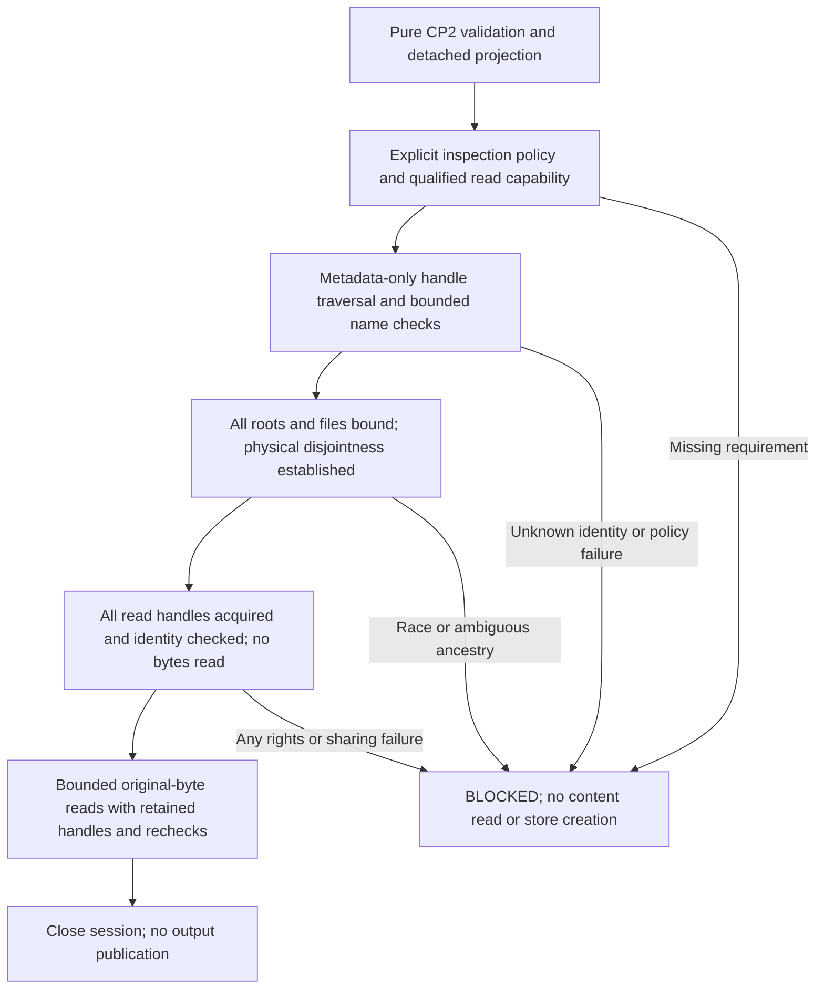

# CP3 native filesystem security readiness

Reviewed baseline: `fe3bbe98704fd33fb9516b53e8786e516dce9e1e`.
Prepared 2026-11-05. CP2 is accepted within its approved scope. This checkpoint
authorizes **planning and implementation design only**; see [APPROVAL_HISTORY.md](APPROVAL_HISTORY.md).
No native reader, publisher, lock, schema, dependency or test implementation is
added. Native Windows execution and qualification remain **BLOCKED**.

**Readiness conclusion:** a bounded design can be reviewed, but implementation
approval, host ownership, independent security review, an approved Windows runtime,
volume bootstrap and the source-writer trust policy are still OPEN. A valid CP2
envelope is declaration data; it never becomes human approval or physical permission.
The [security test plan](https://github.com/keshavnath1/sas-reverse-engineering/blob/eb9794167339d1991800c290a2b24ac10a57edf8/docs/CP3_SECURITY_TEST_PLAN.md) contains proposed Windows/macOS
qualification instructions, privilege separation and acceptance obligations.

## Evidence and scope

OBSERVED means inspected repository code or an attributable prior report.
PROPOSED means future design, not implemented or proven. OPEN identifies missing
human decisions or evidence; an unavailable required guarantee must yield BLOCKED.
Public documentation describes APIs, not qualification of this application.

Inspected: AGENTS.md, SECURITY.md, README.md, APPROVAL_HISTORY.md, OPEN_DECISIONS.md,
BEST_PRACTICES_ADOPTION.md, CROSS_PLATFORM_PORTABILITY_PLAN.md, CP1/CP2 designs and
validation reports; `platform_io`, `safeio`, `_posix_io`, `authorization`,
`_authorization_paths`, `evidence`, P1/P2A workflows, frozen contracts, relevant
security/identity tests, package metadata and lock. References remain pinned to
the reviewed commit. Specification proposals are not execution instructions.

The CP2 record reports 456 passing macOS and Linux regressions and unchanged
historical demo artifacts. Those are **historical results**, not newly executed
native security tests. No private intake, protected answers or SAS execution is
part of this assessment. Semantic acceptance stays BLOCKED, verification
UNVERIFIABLE, authority DRAFT and benchmarks NOT_RUN.

## Observed interfaces and gaps

| Area | Observed at the reviewed baseline | Proposed obligation, not an existing guarantee |
|---|---|---|
| [CP1 selector](../src/sas_re/platform_io.py) | Source/read/traversal/identity and publication capabilities are enabled together for POSIX; Windows fails before supplied-path I/O | Separate a future read-only requirement from publication; never set full Windows `evidence_io` AVAILABLE when only a reader exists |
| [CP2 validation](../src/sas_re/authorization.py) | Pure validation, detached legacy projection, no physical consumer/token; caller approval NOT_VERIFIED | Copy/revalidate declarations at entry; bind actual objects only under a separately approved local run/inspection policy |
| [POSIX traversal](../src/sas_re/_posix_io.py) | Component-relative no-follow descriptors; read-only/nonblocking regular-file access; link count one; bounds and before/after/name checks | Retain root identity across calls; verify physical ancestry, filesystem and mount arrangements |
| Disjointness | `ensure_disjoint` and `validate_scope` compare lexical paths/parents | Check physical root identities and ancestry, including case/Unicode/mount aliases and absent output targets |
| Enumeration | Recursive walk enters directories, including undeclared empty directories; complete file list checked before file bytes | Derive permitted directory prefixes and reject an unexpected directory before entering it |
| Permissions | OS access checks; new artifact directories/files get restricted modes | No existing owner/ACL audit of all ancestors; future trusted-writer/ACL policy needs review |
| [P1](../src/sas_re/runs.py) / [P2A](../src/sas_re/semantic_runs.py) ordering | Store/attempt construction precedes full inventory scope validation; Windows capability denial still precedes all input/store I/O | New physical preflight must create nothing; legacy workflow ordering changes require explicit compatibility review |
| Original-byte evidence | Existing inventory does complete file comparison, raw hashing, repeat reads and final enumeration | Preserve byte/identity algorithms; repeated checks are not a hostile-writer snapshot proof |

The stronger claim “all physical authorization finishes before any output store
exists” is **not** established for current POSIX workflows. This plan neither
rewrites their historical evidence nor silently changes their behavior.

## Proposed authorization and resource boundary

Keep three independent conditions: explicit human/local-policy scope for this run,
OS access rights, and verified physical confinement. None substitutes for another.
Caller `declared_by`/`approval_reference` values remain unverified. A host-owned
allowlist/policy must authorize metadata inspection of the chosen roots and any
proposed store ancestor; its owner, provisioning and binding mechanism are OPEN.
Do not invent a signer, approval timestamp, default root or cached permission.

CP2 has no store field. A future store-target inspection request must be explicit,
separately reviewed local input; it is not inferred from source bindings or added
silently to the frozen envelope. It grants no create permission. Inspecting an
absent target means inspecting its nearest existing ancestor and missing suffix.

PROPOSED `NativeBindingSession` is a process-local resource owner, not a new
serialized evidence contract. It owns noninheritable handles, detached logical
declarations and their existing scope hash, transient native identities, bounded
membership observations and a lifetime/cancellation state. It exposes no arbitrary
path reader, publisher, lock, handle injection or environment override. Copying a
report or replaying a prior session/receipt cannot authorize another run. Close
all handles on success, rejection, cancellation and partial failure.



Metadata inspection itself is filesystem access, explicitly scoped before it
starts. Pure CP2 validation must still perform none. During physical inspection,
directory-name enumeration and object attributes/security information are allowed;
source-file content reads are not. Rights must be interpreted by object type:
directory `FILE_LIST_DIRECTORY` shares a numeric bit with file `FILE_READ_DATA`.
Do not misclassify a listing as a source-content read or permit file-data access
because the same bit was needed on a directory.

After all metadata checks succeed, obtain file-data handles only through the
retained verified parent and literal component, then compare identity with the
metadata handle. Acquire and identity-check **every** required read handle and
its rights/sharing conditions before the first source-content read. A later
file's denied read access must not follow an earlier file's content read.
Bound the retained handle count and release all handles on a failed acquisition.
Do not reopen a full pathname or assume an
unreviewed handle-upgrade API is interchangeable. Rejection invalidates the whole
session; no retry with wider sharing, guessed roots or ordinary Python `open`.

Existing full evidence commands stay BLOCKED on Windows until separately approved
publication capabilities exist. A future CP3-only harness may exercise the reviewed
reader API; it cannot bypass that API's own authorization. CP4 is responsible for
any later store creation/revalidation, locks and publication. No persistent binding
receipt is proposed for this checkpoint; a future receipt needs separate version,
ownership and privacy review outside frozen seals/canonical hashes.

## Proposed Windows 11 x64 / local NTFS protocol

The exact Windows build, Python 3.12 patch/distribution, PowerShell 7 patch and
NTFS configuration are OPEN. Recommend an initial single approved local fixed
volume with dedicated quiescent synthetic directories. This is a proposed
qualification subset, not a new claim of support. UNC/network/mapped drives,
SUBST, cloud-synchronized/offline roots, removable media, ReFS/FAT/exFAT and
ambiguous/multiple-volume arrangements remain BLOCKED until separately qualified.
No administrator, backup/restore privilege, raw disk access or driver is required
for ordinary application use. Host administrators remain trusted, not adversaries
the proposed reader can constrain.

### 1. Runtime and volume bootstrap

Probe required API/ABI availability without touching caller paths. A narrow
stdlib `ctypes` layer is the preferred candidate for review, not an approved
implementation decision. Require trusted system-library loading, explicit pointer
widths/argument/result types, structure sizes/alignment, bounded buffers, correct
NTSTATUS versus Win32 error handling and leak/noninheritance tests. Python's
[ctypes documentation](https://docs.python.org/3.12/library/ctypes.html) explains
the loader/prototype/error mechanisms; it does not verify a security wrapper.
A helper dependency would require separate approval. Windows dependency artifacts
are also absent from the current approved lock; no installation is authorized here.

Bootstrap an eligible **volume-root directory handle**, not a raw volume/device
handle. Resolve only approved OS volume information and correlate it with an
independently approved local physical-volume expectation. The exact secure bootstrap
mechanism is OPEN: querying a drive mapping then opening a path is not atomic.
[QueryDosDeviceW](https://learn.microsoft.com/en-us/windows/win32/api/fileapi/nf-fileapi-querydosdevicew)
describes DOS mappings, including local/global namespaces; a drive letter is not
physical identity. [Volume GUID lookup](https://learn.microsoft.com/en-us/windows/win32/api/fileapi/nf-fileapi-getvolumenameforvolumemountpointw)
can return one of multiple GUID paths for a volume, so GUID text alone is insufficient.
Caller-supplied device namespaces remain rejected by CP2; an internal qualified
bootstrap cannot become a general namespace escape. Unprovable bootstrap => BLOCKED.

Query filesystem/ACL capabilities from the retained handle using
[GetVolumeInformationByHandleW](https://learn.microsoft.com/en-us/windows/win32/api/fileapi/nf-fileapi-getvolumeinformationbyhandlew).
Its serial number is a formatted-volume value, not hardware provenance. Require
local NTFS, consistent identity observations and an approved ancestor policy;
do not infer those properties from a folder label, `Get-Volume` display or path.

### 2. Single-component traversal and reparse rejection

Candidate primitive: `NtCreateFile` with a retained filesystem `RootDirectory`,
one literal relative component, existing-only `FILE_OPEN`, appropriate directory
or non-directory options and `FILE_OPEN_REPARSE_POINT`. The function documents
relative opens and these dispositions/options. This proposal still requires
native ABI/behavior review; a final-component flag on an arbitrary full pathname
does not validate its ancestors. [NtCreateFile](https://learn.microsoft.com/en-us/windows/win32/api/winternl/nf-winternl-ntcreatefile)

Inspect every returned object before descent or content access. Reject all reparse
attributes/tags, including unknown tags, symlinks, junctions, mounted folders and
cloud placeholders; do not resolve, hydrate or whitelist them. Use
[FILE_ATTRIBUTE_TAG_INFO](https://learn.microsoft.com/en-us/windows/win32/api/winbase/ns-winbase-file_attribute_tag_info)
and checked object type. Failure to inspect is BLOCKED. Metadata/provider side
effects and no-hydration behavior need actual native negative tests.

**API-contract uncertainty:** generic
[OBJECT_ATTRIBUTES](https://learn.microsoft.com/en-us/windows/win32/api/ntdef/ns-ntdef-_object_attributes)
describes `OBJ_DONT_REPARSE`, while the function-specific NtCreateFile page limits
its Attributes description to zero/case-insensitive lookup. Do not assume a
version-stable user-mode security contract from that discrepancy or from Q&A
experiments. Reliance on this flag is OPEN. The candidate component-relative
open-and-inspect protocol must be independently accepted and qualified; if it
cannot supply the required guarantee, the reader remains BLOCKED.

### 3. Identity, rights and bounded membership

Use retained handles and
[FILE_ID_INFO](https://learn.microsoft.com/en-us/windows/win32/api/winbase/ns-winbase-file_id_info)
(volume serial plus 128-bit file ID) for object comparisons. Supplement with the
qualified volume binding; duplicate/ambiguous volumes, inconsistent or unavailable
identity results block. IDs are transient checks, never canonical source/graph IDs.
Use [FILE_STANDARD_INFO](https://learn.microsoft.com/en-us/windows/win32/api/winbase/ns-winbase-file_standard_info)
for directory/non-directory status, length, delete-pending and link-count checks.
Non-directory status alone does not establish a regular source file: combine
qualified NTFS namespace confinement, disk-file/object-type and reparse checks;
reject device, pipe and raw-volume handles. Reject regular files with link count
other than one and recheck later.

Request only metadata/list/traverse rights until physical preflight completes;
source data handles request read rights only. Never request write/append/delete,
security-change or file-execution rights, or repair ACLs. Directory traversal
rights share the numeric value of file-execution rights and require the same
object-type distinction as listing/data rights. Determine required directory
sharing separately from file sharing: locking a whole volume's directory tree is
not an ordinary-use prerequisite. Directory rename/reparent protection and trust
must be reviewed; share flags alone do not freeze directory membership.

For file data, propose `FILE_SHARE_READ` only, refusing ordinary conflicting
write/delete opens without retry. Attribute/EA access is not controlled by sharing.
[CreateFileW sharing documentation](https://learn.microsoft.com/en-us/windows/win32/api/fileapi/nf-fileapi-createfilew)
supports these distinctions; share-mode refusal is not a CP4 publication lock.
Windows access checks are object-specific, and traversal privilege can bypass
parent traversal restrictions; a parent deny alone is not proof of denied child
data. Verify actual leaf/list rights and the approved writer policy.
[File security and access rights](https://learn.microsoft.com/en-us/windows/win32/fileio/file-security-and-access-rights)

Enumerate from retained directory handles only. The candidate
[handle-information API](https://learn.microsoft.com/en-us/windows/win32/api/winbase/nf-winbase-getfileinformationbyhandleex)
supports extended directory queries but warns of release/driver differences.
Validate [directory records](https://learn.microsoft.com/en-us/windows/win32/api/winbase/ns-winbase-file_id_extd_dir_info)
for offsets, alignment, filename lengths, IDs, duplicate entries, bounds and finite
progress. Treat incomplete/unsupported queries as BLOCKED. Never use `FileIndex`
as stable NTFS identity. Enumerate hidden/system names too; no extension filtering.

Derive an allowlist of directory prefixes from the declared files. Unknown entries
block before descent/content; no include search or log association is inferred.
Retain existing maxima: 1,000 files, 1,000 directories, depth 32, 8 MiB per file,
64 MiB aggregate source bytes. Bound handles, query bytes, calls and cancellation
as well; exact native buffer/deadline ceilings require review and finite tests.

### 4. Physical disjointness, races and raw reads

For every source root, compare its identity with each other source root and each
other root's retained ancestry. For the target store, compare both directions of
actual ancestry, including its nearest existing parent and missing suffix. Common
distant ancestry is normal for siblings and is **not** an overlap. A missing leaf
is not automatically safe. Mount transitions, ambiguous serials, inconsistent
name/handle identities or inaccessible ancestry => BLOCKED. Do not enumerate
unrelated ancestor siblings. Final-path strings can aid diagnostics, never replace
this proof. [GetFinalPathNameByHandleW](https://learn.microsoft.com/en-us/windows/win32/api/fileapi/nf-fileapi-getfinalpathnamebyhandlew)

Keep all relevant handles and recheck name-to-object relations before content reads.
If any file-data reopen differs from the metadata-bound object, reject without
reading it. Read original bytes in bounded chunks; preserve strict declared
encoding, newline/BOM identity and existing hash/span algorithms. Repeat state,
link-count, membership and byte-hash checks across the run. Stop on mutation;
never silently rebind, retry on a replacement or retain stale operation IDs.

Retained handles and repeat hashes are detection measures, not an atomic snapshot.
Mapped views can survive closing original file/mapping handles, so a share-mode
policy alone does not establish immutability against arbitrary writers.
[Mapping lifetime](https://learn.microsoft.com/en-us/windows/win32/memory/closing-a-file-mapping-object)
The proposed initial model requires quiescent, approved sources and trusted writers.
Enforcement/attestation and hostile-writer exclusions are OPEN; unavailable required
assurance blocks. No new source locks or snapshot service is implemented or approved.

## Proposed macOS/Linux physical-alias strengthening

Retain every current POSIX no-follow, single-link, nonregular-file, bound, mutation,
permission and publication check. Replace repeated root-string resolution with
an additive retained-descriptor binding session after the same pure/inspection
gates. Verify roots/ancestors by object identity and qualified mount/filesystem
evidence, and use the permitted-prefix enumeration policy. Detect root replacement
between calls, physical root equality/nesting, store ancestors and case/Unicode aliases.

`realpath`, `samefile`, device numbers, casefolding and Unicode normalization are
not standalone ancestry proofs. Never normalize canonical strings. Apple's
[retired APFS FAQ](https://developer.apple.com/library/archive/documentation/FileManagement/Conceptual/APFS_Guide/FAQ/FAQ.html)
motivates case/normalization tests, not qualification of a current macOS build.
Descriptor-based filesystem information is a candidate from Apple's
[archived fstatfs manual](https://developer.apple.com/library/archive/documentation/System/Conceptual/ManPages_iPhoneOS/man2/fstatfs.2.html);
current ABI and adequacy remain OPEN. Qualify actual APFS case settings, system/data
volume transitions and alternate roots; do not accidentally block normal macOS
system volume layout with a blanket “no mount transition from /” rule.

Linux mount boundaries need more than inode/device equality. Kernel
[pathname lookup documentation](https://docs.kernel.org/filesystems/path-lookup.html)
distinguishes symlink, mount and rename controls; no-cross-device resolution also
covers bind mounts. `openat2` containment and descriptor-bound
[statx mount identity](https://kernel.googlesource.com/pub/scm/docs/man-pages/man-pages/+/master/man/man2/statx.2)
are candidates, subject to actual kernel support. No syscall wrapper or dependency
is introduced. Reject unqualified bind mounts/namespaces rather than guessing.
Bootstrap transitions need an explicit qualified policy; thereafter unexpected
transitions inside a scoped tree block. Unknown platform-specific equivalence blocks
the affected new physical binding, not unrelated pure commands.

Existing successful POSIX operations within the newly approved physical/scope
policy, identities and sealed bytes must remain compatible. Earlier denial of
alias/unauthorized-directory cases is a deliberate
future strengthening requiring acceptance tests. Moving checks ahead of
`AttemptStore.begin` changes when failures have persisted attempts: record and
review that behavior explicitly before integration. Do not remove old assertions,
rewrite old attempts or claim that historical runs satisfied new guarantees.
CP3 planning leaves those workflows untouched; CP4 must revalidate retained parent
bindings at creation time, not trust a stale path-only preflight receipt.

## Proposed fail-closed mapping

Names below describe reasons; new diagnostic codes/API shapes are not implemented.

| Condition | Required outcome | Mitigation, never automatic fallback |
|---|---|---|
| Unavailable native API/ABI/qualified host or input format | BLOCKED before supplied-path access | Approved environment/API review and native proof |
| Valid string but missing run inspection policy, physical-volume expectation or required permissions | BLOCKED before source content; no store | Obtain explicit scoped policy/host-owner decision; no privilege escalation |
| Unsupported filesystem, unknown reparse/identity/mount result, uncertain ancestry or trace gap | BLOCKED; release resources | Supply qualified evidence or supported synthetic location |
| Known invalid path, duplicate logical ID, observed forbidden link/overlap | FAIL under reviewed deterministic invalid-input mapping; no content/store | Correct declaration/fixture under new explicit scope; preserve old codes |
| Writer/share conflict or detected change | BLOCKED for new native uncertainty/change policy; preserve existing legacy FAIL codes | New quiescent authorized run; no silent retry or broader sharing |
| Full evidence command while CP4 is absent | Existing BLOCKED/exit 2 | Separate CP4 implementation and qualification approval |

Preserve current P1/P2A FAIL/1 and BLOCKED/2 conventions and DRAFT authority.
Proposed native tests must freeze exact error mappings before implementation;
neither a blocked native read nor valid declaration produces semantic PASS.

## OPEN decisions and implementation gate

The authoritative new rows are in [OPEN_DECISIONS.md](https://github.com/keshavnath1/sas-reverse-engineering/blob/eb9794167339d1991800c290a2b24ac10a57edf8/docs/OPEN_DECISIONS.md), CP3-R01–R10.
All remain OPEN except this planning scope itself. Required: Windows host owner,
independent security reviewer, runtime/offline package approval, native ABI and
volume bootstrap, filesystem/writer/ACL assumptions, macOS/Linux mount policy,
privileged fixtures and observer, legacy early-denial compatibility, and explicit
CP3 implementation approval. GitHub account/repository names do not identify owners
or independent reviewers. No missing name is filled in by this plan.

Recommended sequence, each gated by human review:

1. Assign owners/reviewer and approve exact threat model, local filesystem tuple,
   bootstrap and finite security obligations. Resolve runtime/dependency provisioning
   separately; no current installation or lock change is permitted.
2. Approve only the reviewed native read-only binding interface and bounded POSIX
   alias work, with no publisher/lock or full Windows evidence-command enablement.
3. Implement and test only after explicit approval; run independent native
   observations and regressions in approved environments. Missing required cases
   remain BLOCKED. Freeze report, hashes and reviewer disposition.
4. Stop for CP3 acceptance. CP4 publication/locks, CP5 release qualification and
   P2B/P3 are separate approvals, not consequences of a successful reader test.

## Checks for this planning checkpoint

Repository/primary-document inspection and three focused read-only reviews were
performed. No new local unit/security suite, synthetic native fixture, native
Windows API, source scan, dependency install or filesystem alias probe was run.
Historical CP2 results are cited separately above. Actual documentation and
preservation checks are recorded below.

Primary API sources were read on 2026-11-05. Some reference retrievals failed:
Apple's current JavaScript page exposed Markdown the browser tool could not decode;
the retired FAQ was used only as explicitly historical context. A mistaken
GetFinalPathName header-path URL was corrected to the official `fileapi` page.
The POSIX reviewer encountered an Open Group HTTP 403 and an unavailable upstream
read-manual URL; neither supports a conclusion here. A search named nonexistent
`tests/test_inventory.py`, then located `tests/test_evidence.py` with `rg --files`.
These are research/inspection limitations, not native test failures or passing probes.

### Executed local checks

All commands below ran from the repository root on macOS 26.6.2 build 25G83,
ARM64, using the existing CPython 3.12.5 environment. No dependency was installed.

| Command / check | Actual result |
|---|---|
| `git rev-parse HEAD`; `git status --short` before edits | Exit 0; exact reviewed baseline, clean working tree |
| `.venv/bin/python -c 'import platform,sys; print(sys.version); print(platform.platform()); print(platform.machine())'`; `sw_vers` | Exit 0; CPython 3.12.5, macOS 26.6.2/25G83, arm64 |
| Read-only `cat`, `sed`, `rg`, `git show` inspection and official API reference retrieval | Findings above; retrieval/path mistakes below retained as limitations |
| Preservation/documentation command reproduced below | Exit 0; 66 baseline files outside the four edited Markdown files byte-identical; six changed/new Markdown files UTF-8/LF, balanced fences and existing local-link targets |
| Static AST count within that command | 16 + 17 + 12 = 45 CP2 test definitions; **not a test execution** |
| `git diff --check` | Exit 0; no whitespace errors |
| `git add AGENTS.md docs/APPROVAL_HISTORY.md docs/OPEN_DECISIONS.md docs/BEST_PRACTICES_ADOPTION.md docs/FILESYSTEM_SECURITY_READINESS.md docs/CP3_SECURITY_TEST_PLAN.md` | Exit 0; only six Markdown files staged |
| `.venv/bin/python scripts/check_repository.py` | Exit 0; PASS, no prohibited tracked paths or selected credential-pattern matches; not complete DLP |
| `git diff --cached --check` | Initial exit 2: one extra blank line at readiness EOF; removed; rerun exit 0. Preservation and repository guard reruns also exited 0 |

The preservation check includes every source, test, script, contract, workflow,
package/dependency file and reference artifact. It confirms the downstream pin
`bc754e0f1204a99020c864df2a5b25983005e09c`. It does not execute the native protocol,
replay sealed artifacts or inspect external historical stores. CP2's prior sealed
comparison remains historical evidence; no new semantic/performance result follows.

Reproducible command actually executed (reads only the development checkout/Git):

```sh
.venv/bin/python - <<'PY'
import ast, hashlib, json, re, subprocess
from pathlib import Path
baseline = "fe3bbe98704fd33fb9516b53e8786e516dce9e1e"
edited = {"AGENTS.md", "docs/APPROVAL_HISTORY.md", "docs/OPEN_DECISIONS.md",
          "docs/BEST_PRACTICES_ADOPTION.md"}
added = {"docs/FILESYSTEM_SECURITY_READINESS.md", "docs/CP3_SECURITY_TEST_PLAN.md"}
names = subprocess.check_output(["git", "ls-tree", "-r", "--name-only", baseline],
                                text=True).splitlines()
checked = 0
for name in names:
    if name not in edited:
        old = subprocess.check_output(["git", "show", f"{baseline}:{name}"])
        assert Path(name).read_bytes() == old, name
        checked += 1
assert set(subprocess.check_output(["git", "ls-files", "--others", "--exclude-standard"],
                                  text=True).splitlines()) <= added
for name in edited | added:
    data = Path(name).read_bytes()
    text = data.decode("utf-8")
    assert b"\r" not in data, name
    assert sum(line.lstrip().startswith("```") for line in text.splitlines()) % 2 == 0, name
    for target in re.findall(r"\]\(([^)]+)\)", text):
        if "://" not in target and not target.startswith("#"):
            assert (Path(name).parent / target.split("#")[0]).exists(), (name, target)
print(f"PASS: {checked} baseline files byte-identical; six Markdown files checked")
frozen = [
    "src/sas_re/contracts/v1/evidence.schema.json",
    "src/sas_re/contracts/v2/evidence.schema.json",
    "src/sas_re/contracts/authorization/v1/local-authorization.schema.json",
    "requirements.lock", "src/sas_re/data/baseline.json",
    "tests/p2a_expectations.py", "tests/cp2_vectors.py",
    "reference/Codex_SAS_Architecture_Pack_v2.zip",
]
for name in frozen:
    print(hashlib.sha256(Path(name).read_bytes()).hexdigest(), name)
metadata = json.loads(Path("src/sas_re/data/baseline.json").read_text())
assert metadata["downstream"]["commit"] == "bc754e0f1204a99020c864df2a5b25983005e09c"
counts = {}
for path in sorted(Path("tests").glob("test_authorization*.py")):
    tree = ast.parse(path.read_text())
    counts[path.name] = sum(isinstance(node, ast.FunctionDef) and node.name.startswith("test_")
                            for node in ast.walk(tree))
assert sum(counts.values()) == 45, counts
print("Static test-definition count only (not executed):", counts)
PY
```

Observed SHA-256 values, unchanged from the reviewed baseline:

| File | SHA-256 |
|---|---|
| v1 evidence schema | `15e3265fac9af300b40967580998ef4ac90eb1d830a10ce201855fc4ec2738a2` |
| v2 evidence schema | `093216d16bb02e91a3997c97175420bf2257982f5a5fe3a4374ef92f7637a90b` |
| CP2 authorization schema | `427ce869b05e75227653e6f3dcf99466cfaf5111e2be95242a9da5ee157a08f6` |
| requirements.lock | `4676c7fe0a41ce2fdb35c2fb10cc014a8b352a8ca71029eb28b7373c0053e19b` |
| baseline.json | `d22af8651c77a0569e9de7ca473e2274c108de14896b23089421100d6aa2e040` |
| p2a_expectations.py | `f42549738a041db87d3547adec59ddfd0f9b15aa2621f1cf0b7ea7fa9f7ffd93` |
| cp2_vectors.py | `02b4bd89c0bb0e9550c0fb8665738f5db411b2f858b9f261975f50a117da7509` |
| v2 specification ZIP | `e3cbf3d9df6cc20c594261556c5e3ea1dfc292c9c1a30672c2d7b1a736b9718e` |

Documentation review corrections: rejected an empty-scope positive fixture because
the frozen contracts require a file; added the all-file read-readiness barrier;
qualified source-bound versus logical identities and non-directory versus regular
file checks. No implementation/test expectation was changed to satisfy these reviews.
An inspection also tried nonexistent `.github/workflows/scaffold.yml` (exit 1),
then located and read the actual `foundation.yml`; no workflow was changed.

Files in this checkpoint: two new readiness/test documents; updates only to
AGENTS.md, APPROVAL_HISTORY.md, OPEN_DECISIONS.md and BEST_PRACTICES_ADOPTION.md. No native
reader, harness, publisher, lock or dependency change is included. Stop for explicit
CP3 implementation approval; Windows qualification and the missing decisions stay
BLOCKED/OPEN as specified above.
