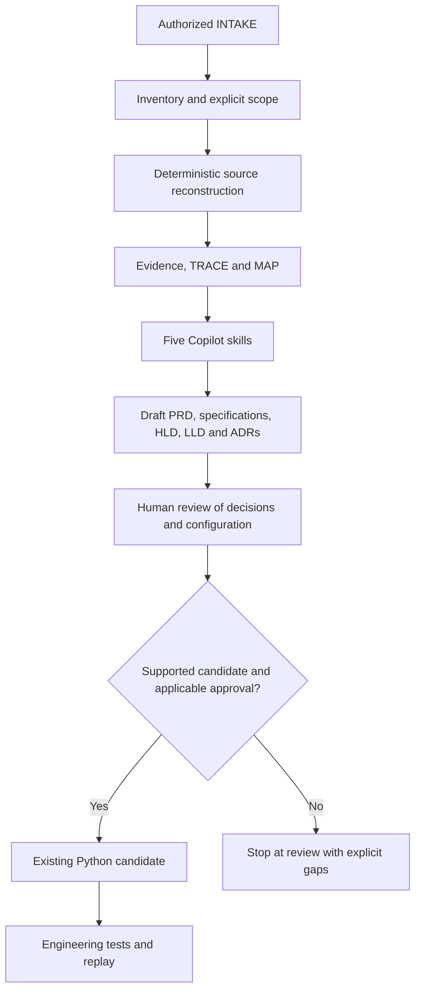
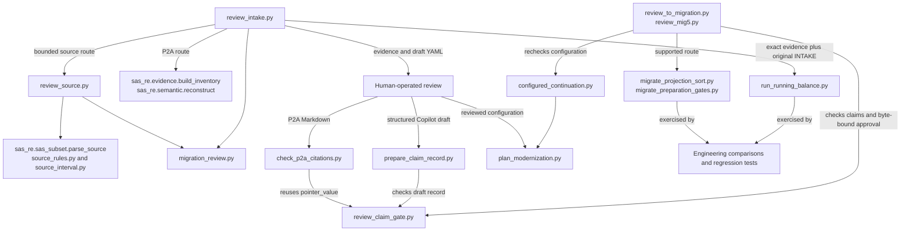

# Public synthetic P2A INTAKE review

Use this opt-in route to review a bounded public SAS project with a single
entry point, declared literal includes and typed synthetic input descriptors.

```bash
python3.12 -IB scripts/review_intake.py --p2a --intake /path/to/INTAKE \
  --destination /tmp/sas-re-int1-p2a-review
```

Use a fresh destination for each run. The flat INTAKE directory must contain
exactly `scope.json`, `profile.json`, the declared SAS files and any declared
LOG/LST files. Fill in each digest below with the lowercase SHA-256 of the
corresponding original file bytes.

```json
{
  "version": "p2a/1",
  "scope": "public-synthetic",
  "entrypoint": "main.sas",
  "sources": {
    "main.sas": "<sha256>",
    "settings.sas": "<sha256>"
  },
  "includes": [["main.sas", "settings.sas"]],
  "profile_sha256": "<sha256>",
  "supporting": {}
}
```

Each include pair names the declaring file and the authorized target. P2A
resolves a target only from an actual supported literal include with that
declared edge. Keep `supporting` empty or map each optional LOG/LST filename to
its digest. The route leaves those files unbound to any execution.

Use the existing [P2A profile schema](../src/sas_re/contracts/v2/evidence.schema.json)
for `profile.json`. Set `entrypoints` to the single file key
`synthetic:main.sas` for the example, use module `main` for inputs, and leave
`log_bindings` and `lst_bindings` empty. Supply typed column descriptors, bounded
public sample rows where needed, and any declared input ordering. These are
synthetic profile assumptions. The [P2A design](P2A_DESIGN.md) describes the
supported source forms and interpretation limits.

The package contains `INVENTORY.json`, canonical P2A `EVIDENCE.json`,
`README.md` and `MANIFEST.json`. Use the graph's original source spans, operations,
dependencies and unknowns to review coverage. Unsupported syntax and unbound
observations can produce a `PARTIAL` reconstruction. Refused identities and
invalid scopes produce no package.

This route publishes a draft source review. SAS reference execution is
`NOT_RUN`, semantic verification is `UNVERIFIABLE` and semantic acceptance is
`BLOCKED`.

## Five-skill modernization handoff

Add `--modernization-drafts` to the command above to generate
`MODERNIZATION_REVIEW.md`, `migration-profile.yaml` and `tie-out.yaml` alongside
the unchanged P2A evidence package. The drafts bind the source-review manifest
and its inventory and graph identities.

In a human-invoked Agent session, provide the exact artifacts listed in the
handoff and ask the five existing skills to follow its P2A evidence mapping.
The handoff covers TRACE reconstruction, requirements, MAP analysis, validation
planning and architecture decisions. Review the five drafts against the graph
and keep them separate from the deterministic package. This route supports
design review only. Existing GATE-1 and candidate publication routes retain
their own evidence and approval contracts.

Run citation preflight before human review of the Copilot Markdown draft:

```bash
python3.12 -IB scripts/check_p2a_citations.py \
  --package /tmp/sas-re-int1-p2a-review --intake /path/to/INTAKE \
  --draft /path/to/COPILOT_DELIVERABLES.md
```

Use canonical paths for the preflight inputs (on macOS, use `/private/tmp`
in place of the `/tmp` alias). Use one inline code span per citation, such as `EVIDENCE.json#/operations/0`.
The checker verifies the cited documents' package bindings and uses the
existing claim-gate pointer resolver. `BLOCK` reports unresolved or malformed
citations. `REVIEW_REQUIRED` means the supplied citations resolved. Claim
coverage, factual support and classification still require human review.

## Workflow architecture

The workflow below combines operator steps and tool boundaries. The
five-skill review is human-invoked. Its deliverables inform human review.
Only existing candidate contracts and approval routes can continue to execution.



The public running-balance command is a separate draft engineering route for
an exact verified workload. It does not publish an approval-gated candidate.
The P2A citation preflight checks pointers for design review. Existing GATE-1
continuations use their own supported review subjects.

## Script responsibilities

Arrows show calls or the labeled artifact handoff. The two continuations
remain separate operator commands.


