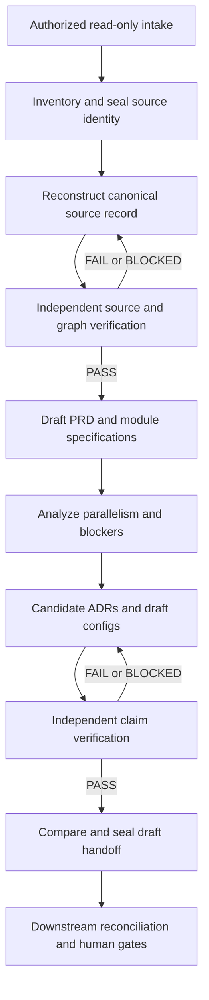

# SAS Reverse Engineering and Computation Architecture Planner

Status: PROPOSED — Step 1 planning only. Reviewed 2026-11-05.

Build a separate, read-only SAS evidence and architecture planner. Establish trustworthy source identity before reconstructing behavior; verify behavior before proposing computational changes. Produce candidate requirements, designs, and configurations for downstream human reconciliation. Do not generate production translations or grant approval upstream.

This document and [OPEN_DECISIONS.md](OPEN_DECISIONS.md) are the only retained project deliverables from this step. No skills, schemas, validators, agents, or application code were implemented. Step 2 requires explicit user approval.

## 1. Evidence inspected and authority

### Specification baseline

The requested `reference/` directory is absent in the current workspace. The supplied `/Users/divyasreegundaram/Downloads/Codex_SAS_Architecture_Pack_v2.zip` was used instead, without modifying it. Its archive root is `sas_reverse_engineering_codex_pack/`; preparation date is 2026-11-05.

Archive SHA-256: `e3cbf3d9df6cc20c594261556c5e3ea1dfc292c9c1a30672c2d7b1a736b9718e`.

All 28 non-directory entries were inspected: README; documents 01–12; three proposed contracts; three templates; the evaluation matrix; the synthetic SAS example, its README and expected result; two reference essays; and three verification files. Expected results and the supplied verification report are reference material, not executions of the proposed product.

| Document | Authority or role |
|---|---|
| `README.md`, `docs/01_PRODUCT_AND_SCOPE.md` | Mission, requirements REQ-01–15, scope, non-goals |
| `docs/02_ARCHITECTURE_AND_WORKFLOW.md` | Governs lifecycle, ownership, state, and status conflicts |
| `docs/03_PARALLELISM_AND_ADRS.md` | Computation analysis, candidate design obligations |
| `docs/04_EVIDENCE_AND_EVALS.md` | Evidence checks, independent semantics, evaluation boundaries |
| `docs/05_HANDOFF_AND_CONFIG.md` | Governs downstream compatibility conflicts |
| `docs/06_CODEX_BUILD_PLAN.md` | P0–P7 roadmap, acceptance gates; not authorization to execute |
| `docs/07_REFERENCES_AND_PROVENANCE.md` | Source attribution and proof limitations |
| `docs/08_DEMONSTRATION.md` | Future demonstration requirements |
| `docs/09_REA_CASE_STUDIES_AND_IMPLEMENTATION_LESSONS.md` | Research-derived lessons; case studies not reproduced |
| `docs/10_ENGINEERING_PRACTICES_TO_EXECUTABLE_CONTROLS.md` | Focused context, bounded execution, verification practices |
| `docs/11_REPOSITORY_AUDIT_TO_IMPLEMENTATION_TRACEABILITY.md` | Audit-to-implementation risk mapping |
| `docs/12_FINAL_ONE_SHOT_CHECKLIST.md` | Acceptance ledger; inclusion is not implementation |
| `contracts/`, `templates/`, `examples/`, `evals/` | Proposed pilot shapes and future tests, subordinate to normative requirements |
| `references/`, `verification/` | Supporting research and packaging evidence, not alternative workflow authority |

User instructions govern execution scope. Within the pack, use document 02 for workflow and document 05 for compatibility; actual source evidence governs factual claims. Upstream requirements do not authorize changes to downstream contracts.

### Downstream baseline

Observed remote `feature/governed-learning-memory` HEAD and inspected checkout HEAD both equal `bc754e0f1204a99020c864df2a5b25983005e09c`, matching the pack's audit baseline. The temporary inspection checkout is `/tmp/sas-re-downstream-bc754e0`; it remains clean. Existing workspace copies were not used as the current baseline because one is at older commit `742d28d3c64b64940595bc56fb81e3075d044246`.

Inspected at the pinned commit:

- `AGENTS.md`, `config/workflow.yaml` (schema version 1.0).
- `config/migration_profile.yaml` (profile version 2, `UNAPPROVED_TEMPLATE`).
- `config/tieout.yaml` (contract version `template-3`, `UNAPPROVED_TEMPLATE`) and `contracts/tieout_contract.schema.json`.
- `contracts/run_state.schema.json`.
- `.github/skills/trace/SKILL.md`, its `references/sas-trace-contract.md`, and `schemas/execution_trace.schema.json`.
- `.github/skills/map/SKILL.md`, its `references/behavior-mapping-contract.md`, and `schemas/policy_registry.schema.json`.
- `.github/skills/specify/SKILL.md`, `decide/SKILL.md`, `import/SKILL.md`, and `diagnose/SKILL.md`.
- `scripts/intake.py`, `scripts/project.py`, `scripts/smoke_test.py`, and `.github/workflows/template-validation.yml`.

Pinned source: [Agent-mastery commit](https://github.com/keshavnath1/Agent-mastery/tree/bc754e0f1204a99020c864df2a5b25983005e09c). Future phases must recheck branch drift and retain the compatibility pin rather than silently tracking HEAD.

### Research boundary

The supplied audit and Manus AI-authored Jim Thompson guide were read in full. Public repository landing pages for [REA](https://github.com/morluto/rea) and [coding-assistant-practices](https://github.com/jimthompson5802/coding-assistant-practices) were retrieved. `git ls-remote ... HEAD` observed research tips `80849168590dedcab49cfdb5d5b94749fc9e89fc` and `abdf5661855dae25e002578fe25c961a6200db5d`, respectively. Web page content was not proven to correspond to those Git tips. No research source code was adopted or executed, and no showcase was reproduced.

Proposed use: evidence-based reconstruction, explicit numerical semantics, progressive context, bounded repair, and independent tests. REA is not assumed to parse SAS. No dependency on REA or model-routing capability is established.

## 2. Proposed architecture

Use a Python package with a CLI, deterministic evidence services, and separately evaluated reasoning stages. Python 3.12 and pinned dependencies are proposals for P0, not installed project requirements. Keep runtime-specific proposals data-driven; Spark, Ray, and Dask are not prerequisites for inventory.



This is document 02's runtime sequence. Development phase numbering is not permission to bypass it. Repair routes to the earliest failed gate, with a proposed maximum of three attempts and a stop after two repeated failures without new evidence.

| Component | Responsibility and boundary |
|---|---|
| Intake and identity | Explicit authorized roots; fresh inventory of SAS/log/LST/include/format/config/reference files; byte hashes; no source execution |
| Evidence store | Explicit workspace/module/run/attempt identities; atomic publication; immutable versions and append-only attempts; hash-bound references |
| Canonical source record | One composed factual record per scoped run, with module ownership on operations; dataset/column lineage, state, observed order, typed edges, citations, run-linked logs, unknowns |
| Deterministic verification | Shape, hashes, file coverage, citation bounds, graph references, duplicate IDs, run linkage, derived coverage and state transitions |
| Independent semantic verification | Whether evidence supports claims; missing dependencies, numerical semantics, contradictory logs, false independence; cannot edit candidate or gold |
| Requirements and computation planner | Clearly separate observed behavior from inferred intent; draft PRD/SPEC; dependency constraints and conditional optimization hypotheses |
| Candidate design portfolio | Spark/Ray/Dask/native proposals or evidence-based exclusions; as-is/to-be HLD and LLD, Mermaid, source-to-target mapping, rollback and benchmark plans |
| Handoff packager | Hash-bound candidate bundle and compatibility report; no selected runtime or downstream approval |

The composed-run graph is a proposal resolving the pack's per-module versus whole-workload ambiguity; confirm decision D04 before P1. Module views and diagrams reference canonical IDs and hashes, never become competing editable graphs. Loops and retained state remain explicit in the source model; only a justified scheduling projection may be a DAG. Do not erase cycles to manufacture parallelism.

Keep `OBSERVATION`, `INFERENCE`, `ASSUMPTION`, `HYPOTHESIS`, and `MEASUREMENT` distinct. Claim verdicts are `VERIFIED`, `PARTIAL`, `UNSUPPORTED`, `CONTRADICTED`, or `UNVERIFIABLE`; stage gates are `PASS`, `FAIL`, or `BLOCKED`. Benchmarks remain `NOT_RUN` without execution evidence. Upstream artifacts never emit `HUMAN_APPROVED`. An integrity PASS is not semantic approval.

Read-only intake is an access boundary, not merely a prompt. Exclude raw evidence from Git; reject traversal and symlink escapes; never execute attachments. Hash seals detect changes relative to a trusted digest but do not authenticate an actor who can replace both content and digest. Production trust anchors and retention require a separate decision.

### Proposed repository layout — not created

```text
sas-reverse-engineering/
  README.md
  AGENTS.md
  pyproject.toml
  requirements.lock
  .github/workflows/
  reference/                  # approved, provenance-recorded specification
  config/                     # scope examples, workflow, downstream pin
  contracts/                  # versioned upstream contracts
  src/sas_re/
    cli.py
    intake/
    evidence/
    verification/
    reconstruction/
    planning/
    handoff/
  skills/                     # later, one bounded stage per contract
  templates/
  tests/unit/
  tests/integration/
  tests/security/
  tests/fixtures/synthetic/   # no business intake
  evals/                      # harness/specs; protected gold is external
  docs/
    IMPLEMENTATION_PLAN.md
    OPEN_DECISIONS.md
  artifacts/                  # ignored, local run-scoped outputs
```

Raw intake lives outside the repository by default. Evaluator gold must be in a separate access-controlled execution context; putting it in another folder is insufficient. Keep a single owner for graph reconciliation and publication. Multi-agent operation is optional and not required for the pilot.

## 3. Compatibility findings and conflict resolutions

These findings are observed from text/code inspection; they are not downstream integration-test results.

| Finding | Risk | Proposed treatment |
|---|---|---|
| Reference audit suggests adding early discovery inside Agent-mastery; pack 01/02 specifies a separate upstream repo | Competing controllers and skipped approvals | Follow 01/02; future receiving adapter separately authorized |
| Document 06 lists parallelism before requirements in development phases; 02 orders requirements first at runtime | Accidental lifecycle bypass | Separate implementation order from runtime transitions |
| Source schema v0.1 omits attempt identity, typed columns, structured unknowns, log observations/run links and classification | Shape-valid records cannot meet narrative requirements | Version and expand upstream contracts in P1; do not silently label supplied schema complete |
| Claim schema lacks narrative-required edge references, counterevidence and preconditions; manifest lacks full provenance/version/privacy fields | Incomplete evidence and auditability | Design explicit versioned additions before implementation |
| Status field names vary (`classification`/`verification`/`authority` versus narrative names) | Inconsistent consumers | One canonical vocabulary and explicit serialization mapping |
| Trace schema has loose `scripts`/`logs` objects and optional citations/governance | Schema validity cannot prove source truth | Deterministic and semantic gates required; receiving adapter must reconcile |
| Map schema permits unconstrained owner strings and independent coverage counters | Duplicate ownership, false coverage | Derive coverage from IDs; downstream improvements require separate authorization |
| Run-state schema has no discovery stage and no complete ordinary approval-chain enforcement; helper status uses newest mtime | Wrong run selection or presumed authorization | Explicit upstream identities; never call helper state an upstream authority |
| Existing `import` is approved pattern reuse | It cannot import a PRD/ADR bundle safely as-is | New reconciliation protocol in P7; no direct canonical writes |
| Profile has version 2 fields and null selections; tie-out accepts drafts but execution requires approved evidence | Accidental executable or approved contract | Preserve null human decisions; shared behavior contract across candidates; separate runtime proposals |
| Downstream public-template CI rejects `.sas`, `.log`, `.lst`, `.csv` | Synthetic upstream fixtures cannot simply be copied downstream | Separate upstream CI and private integration fixtures |
| Pack ZIP has a misencoded audit filename; manifest uses its Unicode spelling | Blind extraction/hash lookup can fail | Record explicit filename mapping; preserve original ZIP and content hashes |

Preserve downstream canonical paths exactly: `stage1_extraction/output/execution_trace.json`, `policy/policy_registry.yaml`, `artifacts/semantic_ir/<module>.json`, and `artifacts/evidence/runs/<run-id>/attempts/<attempt-id>/`. New upstream artifacts are candidates; they do not replace these live files.

Downstream retains `interview → specify → decide`, optional approved pattern reuse, then `trace → map → model → generate → test → validate → adapt → ingest → review → release → learn`. Business intent, population, keys, oracle, tolerance, runtime selection, merge and release remain human-owned. No schema enum or user-editable approval label substitutes for attributable, hash-bound approval evidence.

## 4. Phased implementation proposal

| Phase | Scope and exit evidence | Requirement coverage |
|---|---|---|
| P0 | Bootstrap isolated repo, reproducible environment, CI, baseline pin/hash inventory, compatibility matrix, security exclusions and documented workflow; fresh-checkout scaffold checks | REQ-13–15 foundations |
| P1 | Inventory/seal identity, versioned operation/edge/citation contracts, deterministic graph/citation/run checks, explicit unknowns; positive and adversarial tests | REQ-01–03, 12, 14 foundations |
| P2 | Agent-assisted reconstruction and independent source-aware verification; source graph views; SET/MERGE/SQL/macros/BY/RETAIN/log gold evaluations | REQ-02–03, 10 |
| P3 | Critical path when timing evidence allows; whole-workload/module/stage/feature/partition/expression/algorithm/training analysis; unknowns block independence | REQ-05–06, 12 |
| P4 | Draft PRD/capability map/SPEC and candidate ADR portfolio; HLD/LLD, difference ledger, measurable tradeoffs, shared tie-out obligations, module-growth reevaluation | REQ-04, 07–08 |
| P5 | Complete independent semantic evaluation, access-controlled hidden gold, frozen evaluators, pressure tests and reproducibility; zero critical false approvals in pilot | REQ-10, 13–15 |
| P6 | Draft profile/tie-out/benchmark/runtime plans, provenance manifest, stale-bundle rejection and pinned-schema compatibility checks | REQ-09, 11–12, 15 |
| P7 | Separately authorized receiving-side prototype; independent reconciliation, preserved approval chain, source-change invalidation, downstream reuse demonstration | REQ-11, 15 integration |

Verification begins in P0/P1; P5 consolidates assurance rather than postponing it. Later phase completion requires tests and observed outputs, not documents. No calendar estimate is asserted before pilot scope, available SAS evidence, and evaluation environment are agreed.

## 5. First implementation milestone: M1, foundation and evidence identity

M1 comprises P0 and P1 with separate review checkpoints. Recommended Step 2 authorizes P0 only; P1 requires the contract decisions and subsequent approval. No automatic SAS semantic extraction, agent execution, runtime selection, architecture generation, or downstream integration belongs in M1.

### P0 acceptance

1. Approved isolated repository location, supported Python version and reproducible dependency setup.
2. README explicitly states implemented versus planned functionality; no placeholder command reports successful analysis.
3. Frozen downstream commit and relevant file digests, with an explicit drift check; no downstream mutation.
4. Fresh-checkout install and scaffold CI checks pass locally; report hosted CI separately if not run.
5. Raw intake, credentials, local outputs and protected evaluator material are excluded from version control; synthetic fixture policy documented.

### P1 acceptance and required tests — all currently NOT_RUN

| Test family | Required positive and negative evidence |
|---|---|
| Inventory | Correct synthetic scope inventories every authorized file; reject omitted required include, duplicates, inaccessible or missing files; detect added, removed and changed files on recheck |
| Source identity | Stable hashes for unchanged bytes; fake digest and stale log/source/include/config rejected; no intake bytes modified |
| Citations | Exact 1-based source span validates; reject zero/negative/reversed/out-of-bounds spans, wrong excerpt, unknown path, and valid-format fake hash; test CRLF/LF and declared encodings |
| Graph structure | Valid supplied operations and typed edges accepted; duplicate IDs, dangling endpoints/evidence IDs, empty required evidence and inconsistent run/module identities rejected |
| Log provenance | Explicit source/run binding retained; mismatched run or stale log rejected; missing linkage stays unresolved, never inferred from filename alone |
| Unknowns | Dynamic macro/include or absent evidence is preserved as unresolved; integrity success cannot unlock semantic or independence claims |
| Sealing and state | Repeated identical command has documented idempotent behavior; concurrent writers cannot overwrite; crash cannot publish partial success; new attempt preserves history; stale downstream references invalidated |
| Security and privacy | Traversal, symlink escape and output-inside-intake rejected; source comments cannot trigger commands; reports do not copy raw records or secret values; no SAS executed |
| Authority | Upstream approval assertions rejected; unsupported later-stage commands cannot advance workflow; every verdict states its proof boundary |
| Packaging | Installed CLI works from a fresh checkout and outside repo cwd; contract resources are packaged; deterministic demo returns documented exit codes |

Graph checks in P1 validate supplied records, not complete SAS semantics. Source/log run declarations alone cannot prove that a log actually came from the stated program. Freeze a small, explicitly synthetic fixture set with expected outcomes; do not describe it as a hidden-gold agent evaluation. Semantic false-independence rejection and enforced evaluator isolation are P2/P5 gates.

M1 exit demo: inventory a synthetic scope, seal identity, validate a supplied factual record, change an include, detect stale evidence, and preserve the previous attempt. Report exact commands, exit codes, artifact hashes, test counts and limitations. This proves only the tested identity and validation behavior.

## 6. Checks actually executed during Step 1

| Check | Result and limit |
|---|---|
| Workspace inventory and instruction search | No root `reference/` or applicable root `AGENTS.md` found; planning uses the supplied ZIP |
| ZIP listing and CRC via `zipfile.testzip()` | 28 files; no bad CRC entry |
| Independent archive SHA-256 | Recorded above |
| Read-only comparison with supplied SHA manifest | 26/26 content hashes match after one explicit CP437-to-UTF-8 filename mapping; manifest/report excluded by original design |
| JSON syntax parsing in memory | All four packaged JSON files parse; no schema or semantic validity claim |
| Remote branch lookup and checkout `rev-parse HEAD` | Both equal audited `bc754e0f1204a99020c864df2a5b25983005e09c` |
| Downstream `git status --short` | Empty; inspection checkout unchanged |
| Research URL retrieval and Git HEAD lookup | Both repositories reachable; no execution or adoption validation |

The packaged `verify_pack.py` was inspected but not run because it rewrites its manifest. The supplied report's schema-validation results and audit's 43 passing smoke tests are reported historical evidence, not tests rerun here. No new product tests, downstream smoke tests, SAS execution, agent evaluations, integration tests, or runtime benchmarks were executed.

Preparatory specification copies, a baseline JSON record and empty scaffold directories created before the Step 1 clarification were removed after checking their contents. No application code had been written. Final deliverables are only the two planning documents in this workspace's `docs/` directory; the proposed new repository has not been initialized.

## 7. Exact recommended Step 2

After reviewing D01–D03 in OPEN_DECISIONS.md, authorize:

> Step 2: Implement P0 only from docs/IMPLEMENTATION_PLAN.md in the approved new repository location. Use Python 3.12, pin Agent-mastery compatibility to bc754e0f1204a99020c864df2a5b25983005e09c, and treat the supplied v2 ZIP with SHA-256 e3cbf3d9df6cc20c594261556c5e3ea1dfc292c9c1a30672c2d7b1a736b9718e as the specification baseline. Create the package/CLI scaffold, reproducible dependency setup, CI, repository safety rules, documented workflow and compatibility record. Do not implement P1 contracts or validators, skills, agents, SAS extraction, planning algorithms, or downstream changes. Run P0 acceptance checks, report exact results and remaining decisions, then stop for review before P1.

This text is a recommendation, not authorization. Stop here until the user approves Step 2.
