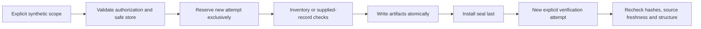

# P1 canonical source evidence foundation

Implemented scope: Step 3/P1 only, approved 2026-11-05. Package 0.2.0,
contract version `1.0`, Python 3.12. The observed outcomes are recorded separately
in [P1_VALIDATION.md](P1_VALIDATION.md). This document explains design decisions;
it is not evidence of SAS execution or semantic correctness.

## Authority and references

Inspected repository instructions, README, implementation plan, decisions,
P0 validation and compatibility documentation at P0 commit
`0dcdd34aafa5c766bfdd9c87777896c71641bfc4`, plus all 28 entries of the v2 pack.
The exact unchanged archive is `reference/Codex_SAS_Architecture_Pack_v2.zip`:
`e3cbf3d9df6cc20c594261556c5e3ea1dfc292c9c1a30672c2d7b1a736b9718e`.
The pack's document 02 governs workflow; document 05 governs proposed handoff
compatibility. Its examples, proposed v0.1 schemas and expected results are
reference material, not executable instructions or observed verification.

Agent-mastery is read-only and pinned to
`bc754e0f1204a99020c864df2a5b25983005e09c`. Its AGENTS/workflow, trace/map,
migration profile and tie-out contracts remain downstream-owned. P1 adds no
conversion, integration or approval path. The P0 baseline retains 20 file digests.
No REA dependency was added; REA is not treated as a SAS parser.

## Approved decisions and tradeoffs

| Decision | Implemented choice | Consequence |
|---|---|---|
| D04 | One composed graph in each versioned RECORD attempt for an explicitly selected scoped run; module ownership on nodes/operations | Cross-module edges share canonical IDs. Module views contain only IDs and the parent graph hash; no separately editable factual graphs |
| D05 | SHA-256 original bytes, explicit file identity and line spans; operation IDs bind all supplied operation fields and the entire scoped source fingerprint | Includes/configuration/log changes conservatively invalidate operation IDs. Even harmless line shifts can change IDs; no unsupported semantic-equivalence matching |
| D06 | Explicit roots and exact file list, declared dependencies and log/run associations | Added files are detected by name without reading contents. No root expansion, filename matching, dynamic include resolution or execution |
| D07 | Synthetic-only local POSIX intake and append-only attempts, read-only sources, disjoint output store | Tested integrity and overwrite prevention; no authenticated provenance, hostile-owner protection or production retention claim |

Versions/attempts are retained within the run. There is no mutable “latest” graph
selector or automatic canonical promotion. Callers name the exact attempt.
Both an attempt reservation and its graph ownership bind workspace/run/attempt;
module views bind the graph digest. A new attempt is required for any correction.

## Contracts and implementation

The bundled `src/sas_re/contracts/v1/evidence.schema.json` is Draft 2020-12.
All references are internal and the runtime loads only this trusted package
resource. Input-supplied schemas, external URLs and unknown properties are rejected.
The public `validate_contract(name, value)` API checks JSON-only finite values
and shape; it does not verify source bytes or meaning.

| Definitions | Purpose |
|---|---|
| Scope, Root, ScopedFile | Explicit synthetic authorization, root/file/module ownership, encoding |
| Inventory, File | Raw-byte SHA-256, size, newline policy, stable file ID, dependencies and log links |
| Citation | File key, full-file hash, inclusive 1-based line bounds, original excerpt byte hash |
| Dataset, Column, Operation, Edge | Canonical IDs, ownership, reads/writes, typed dependencies and supplied stateful constructs |
| LogAssociation, LogObservation | Declared execution/run links, citations, operation references and supplied numeric observations |
| Issue, Graph, Coverage | Structured unresolved facts/contradictions, composed graph and recomputed counts |
| Attempt, Seal, Report, VerificationReport | Explicit attempt stage, complete publication, artifact hashes and gate results |
| ModuleView, RevisionMap | Hash-bound IDs-only view and explicit retained/removed/added operation mapping |

Exact definition names/fields in the bundle are authoritative for serialization.
The supplied pack's v0.1 schema is not wire-compatible with this complete v1
contract; an old record fails validation. No automatic upgrader is implemented.

Evidence classification retains `OBSERVATION`, `INFERENCE`, `ASSUMPTION`,
`HYPOTHESIS`, `MEASUREMENT`. Claim-status vocabulary retains `VERIFIED`, `PARTIAL`,
`UNSUPPORTED`, `CONTRADICTED`, `UNVERIFIABLE`. P1 concrete semantic fields accept
only `UNVERIFIABLE`; a schema/structural pass cannot assign another semantic status.
Stage gates remain `PASS`, `FAIL`, `BLOCKED`. All artifacts retain `DRAFT` and
benchmarks remain `NOT_RUN`. `HUMAN_APPROVED` or arbitrary approval fields fail.

`safeio.py` handles safe file access and publication; `contracts.py` checks shape;
`evidence.py` checks scope, identity, locators and supplied graph consistency;
`runs.py` combines these checks and publishes validated reports; `cli.py` selects
explicit operations. The lower-level store is an integrity primitive, not a
standalone semantic/schema gate. Use the workflows to publish validated evidence.

## Identity and byte policy

1. Sources are hashed exactly as read. No newline normalization, transcoding,
   BOM stripping, whitespace stripping or SAS macro expansion occurs.
2. File keys are `root_id:relative/path`. File IDs hash all declared file metadata
   plus original-byte hash, size and line/newline metadata. Root absolute paths
   are authorization bindings, excluded from portable identities and output.
3. A scope hash includes workspace/run/modules, root IDs, exact file declarations,
   dependencies and log declarations; maps use sorted keys and the documented
   scope collections use stable sorting. The source fingerprint hashes that
   scope hash plus the sorted source inventory. Attempt ID is excluded.
4. A canonical ID is `prefix_` plus SHA-256 of canonical JSON containing
   `source_fingerprint` and the entire record payload excluding its own ID.
   Prefixes are `file`, `ds`, `col`, `op`, `edge`, `log`. A file ID uses an empty
   fingerprint; its payload already contains its original-byte identity.
5. Operation IDs are stable for identical source scope and identical supplied
   facts across attempts. Altered bytes anywhere in scope or altered operation
   facts yield new IDs. Lists inside supplied graph records are ordered; reordering
   them can conservatively change identity. No semantic normalization is claimed.
6. Metadata serialization is sorted-key, compact UTF-8 JSON, no NaN/Infinity,
   one final LF. Duplicate input keys are invalid. This is a versioned Python
   serialization policy, not a claim of RFC 8785 interoperability.

Declared encodings are `utf-8`, `utf-8-sig`, `ascii`, `latin-1`, or `binary`.
Text decoding must succeed strictly. Citation line splitting recognizes only
CRLF, LF and CR, retaining delimiter bytes. Line numbers start at 1; ranges are
inclusive; a final delimiter creates no extra phantom line. Empty files have
zero lines. Excerpt hashes include their original terminators and BOM if present.
Binary files may be inventoried but cannot be cited as text. Mixed newlines are
recorded explicitly. Relative paths use a conservative portable ASCII subset.

`revision_map(previous, current)` reports retained/removed/added IDs, binds both
graph hashes and always says `semantic_equivalence: NOT_ASSERTED`. It verifies
record shape and operation ID derivation, not historical source availability.
Use already verified canonical records for meaningful revision comparisons.
`module_view(graph, module_id)` likewise derives references from the supplied
graph, including parent datasets of referenced columns; it does not grant a new
validation result. Neither helper edits or promotes a historical record.

## Scope and deterministic verification

Scope declares dedicated absolute roots, every authorized file, a synthetic flag,
module owners, dependencies, and explicit LOG/LST execution/run links. Roots must
not overlap. A dependency target absent from scope remains unresolved; no content
is read outside the authorized list. An undeclared dependency absent from the
manifest cannot be discovered without semantic extraction, which is P2 work.

Each LOG/LST has at most one explicit association. Missing associations become
structured unknowns; duplicate/ambiguous associations block. Contradictory run or
execution identities fail. Associations are `DECLARED`, never authenticated.
Filenames are not evidence of execution provenance. Logs are not parsed: a numeric
observation with an intact citation can still be false and remains semantically
unverifiable. No log is required if none is in the authorized scope or claimed.

Inventory enumerates names before any file contents, compares them with the exact
list, then reads bytes through no-follow descriptors. A second byte pass catches
inter-file changes; a final name pass catches additions/removals. Record checks
and workflow completion recheck the inventory. This detects tested races but is
not a multi-file atomic snapshot; trusted writers must remain quiescent. Production
requires a snapshot or externally enforced source lock.

Record checks recompute inventory and compare scope/record ownership, deterministic
IDs, duplicate IDs, citations, dataset/column references, edge endpoints, issue
references, log linkage and coverage. DATA edges must name nodes written by the
producer and read by the consumer. Other typed edges retain declared evidence
references. Cycles are permitted; P1 does not infer scheduling or independence.

Coverage is counts of supplied files, nodes, operations, edges, observations,
issues and distinct operation-cited files. It is not a semantic completeness or
accuracy metric. Inventory-derived unknowns cannot be omitted from a graph.
Unresolved unknowns block; declared contradictions fail, including contradictions
misplaced in the unknowns collection. Missing semantic facts not supplied by the
caller remain a P2 detection obligation.

## Publication and CLI lifecycle

The store layout is `STORE/workspace_id/run_id/attempt_id/`. `attempt.json`
records STARTED before processing. Successful inventory writes inventory/report;
successful RECORD also writes the supplied graph. A verification attempt writes
a verification report with exact subject attempt and the readable subject seal
hash when available. No prior attempt is changed.

Safe publication reserves attempt directories exclusively, takes a POSIX process
lock, writes bounded temporary files, flushes them, installs each with no-clobber
atomic hard linking, and fsyncs directories. `seal.json` is installed last and
hashes every artifact including `attempt.json`. The seal itself is hash-referenced
by subsequent verification reports; it cannot hash itself.

Publication completion and success are distinct: a complete seal may have FAIL
or BLOCKED. Validation failures after safe reservation retain a report and any
valid inventory; invalid input records are not copied to artifacts. Preauthorization
failures return redacted diagnostics without attempting unsafe storage. I/O/crash
interruptions may leave temporary or partial files with no seal; they remain
incomplete and cannot be reused. Retrying requires a new attempt ID.

Verification requires exact artifact sets for each stage, artifact hashes, valid
contracts, matching ownership, recomputed reports and fresh sources. Failed or
blocked subjects are never upgraded. Verification reports are not recursively
treated as source evidence. There is no retry loop, automatic repair, newest-file
selection, downstream write or human approval mechanism.

## Security, limits and deferred work

Synthetic fixtures are Python strings generated under temporary roots. Sources
are opened read-only. All path components reject symlinks; source files must be
regular and single-link. Traversal, control paths, unsafe artifact names and
output/source overlap fail. Prompt-like source/log text is never interpreted.
Artifacts omit raw source text and absolute roots; identifiers and relative paths
can still carry sensitive information. Synthetic authorization cannot detect PII.

Limits: 8 MiB/file or JSON artifact, 64 MiB total source bytes, 1,000 files and
1,000 directories per root, relative depth 32, JSON depth 64, component length
128, root path length 4096. Contract identity fields are stricter (64 characters).
Limits reject work explicitly rather than truncating evidence. Tests use macOS
POSIX local storage; Linux CI is configured but hosted execution must be reported
separately. Windows/network filesystem guarantees are not claimed.

Local SHA-256 detects disagreement against retained hashes. A filesystem owner
can rewrite all files and hashes or delete attempts. No signatures, trusted time,
WORM retention, production attestation or independent evaluator isolation exists.
No real data, SAS executable, parser, agent framework, benchmark or architecture
recommendation is included. A valid citation supporting a false architectural
conclusion is outside P1's structural proof boundary.

Recommended next checkpoint: review P1 evidence; resolve D08/D09 for a narrowly
declared synthetic SAS subset and independent semantic evaluation with protected
gold/process access. Only then authorize P2 extraction/semantic checks. P1 does
not start that work or grant any downstream approval.
