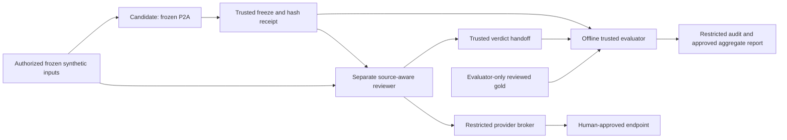

# P2B independent evaluation readiness

Prepared 2026-11-05 against accepted P2A commit
`56154dd75a0149043c36081da9704b0a939230e1`.
**Documentation checkpoint only. Execution readiness: BLOCKED.**
The user authorized this assessment and decision-ledger updates, not an evaluator,
provider, isolation deployment, hidden corpus or campaign. All architecture,
budgets and tests below are proposals unless explicitly labeled observed.
Semantic acceptance remains **BLOCKED**, verification **UNVERIFIABLE**, authority
**DRAFT**, and benchmarks **NOT_RUN**. Stop after this checkpoint.

## Evidence and authority

Inspected `AGENTS.md`, `README.md`, approval/decision records, implementation and
compatibility plans, P0/P1 design/validation evidence, and the P2/P2A documents
at the accepted commit. The primary P2 references are
[P2_READINESS.md](P2_READINESS.md), [P2_EVALUATION_DESIGN.md](P2_EVALUATION_DESIGN.md),
[P2A_DESIGN.md](P2A_DESIGN.md), [P2A_VALIDATION.md](P2A_VALIDATION.md), and
[P2A_FIXTURE_REVIEW.md](P2A_FIXTURE_REVIEW.md).

All 28 file members of the v2 specification ZIP were read across the assessment
and its read-only reviews: README, documents 01–12, three proposed contracts,
three templates, three example files, evaluation matrix, three verification
files and two embedded reference guides. The archive's own script was read as
text, never executed. A separate read-only check matched all 26 manifest hashes,
including the documented CP437-to-UTF-8 audit filename mapping.

The current user instruction controls scope. Pack document 02 controls workflow,
05 compatibility, 04 independent evidence checks, and 10 practice adaptations.
Published examples and expected results are not hidden gold. REA is research
context, not a SAS parser or evaluation dependency. The embedded downstream
audit's 43 smoke tests are reported historical results, not rerun here.

| Baseline | Preserved identity |
|---|---|
| v2 specification ZIP | SHA-256 `e3cbf3d9df6cc20c594261556c5e3ea1dfc292c9c1a30672c2d7b1a736b9718e` |
| v1 contract | SHA-256 `15e3265fac9af300b40967580998ef4ac90eb1d830a10ce201855fc4ec2738a2` |
| v2 contract | SHA-256 `093216d16bb02e91a3997c97175420bf2257982f5a5fe3a4374ef92f7637a90b` |
| Dependency lock | SHA-256 `4676c7fe0a41ce2fdb35c2fb10cc014a8b352a8ca71029eb28b7373c0053e19b` |
| Compatibility metadata | SHA-256 `d22af8651c77a0569e9de7ca473e2274c108de14896b23089421100d6aa2e040` |
| Agent-mastery | Read-only commit `bc754e0f1204a99020c864df2a5b25983005e09c`; 20 frozen file digests |

**Observed:** P2A reports 389 cumulative tests, including 187 public fixture
tests. Its 26 false-claim mutations include 22 schema-valid rehashed semantic
challenges and four closed-schema rejections. Its checker shares reconstruction
logic. Separate development review occurred in the same environment; it is not
protected evaluator isolation. These facts justify readiness work, not semantic
acceptance. No missing historical provider telemetry is reconstructed from tests.

## Decision assessment

| Decision | Recommendation for human review | Missing evidence or owner |
|---|---|---|
| D08-C: candidate scope | Prefer the frozen deterministic P2A implementation as Lane R candidate for the first pilot. Add a separately implemented source-aware reviewer; retain both evaluation lanes and all 360 scheduled attempts | Human approval of this refinement to the earlier configurable candidate/reviewer model proposal; a model-generated candidate would be a separately frozen alternative |
| D08-C: provider | Select one approved reviewer endpoint and exact model revision, account/project, region, credentials owner and tool protocol only after capability/data-policy review | No provider, model, account access, quote or API control has been supplied or verified |
| D08-C: data/budgets | Synthetic-only, explicit transmission allowlist, bounded retrieval and aggregate budgets below; no gold or evaluator diagnostics sent to models | Data owner approval of endpoint retention/training/region terms, dollar ceiling, concurrency and unavailable-control handling |
| D09-A: gold | A named SAS domain author, a second named reviewer, and an accountable custodian freeze expectations independently of candidate output | People, access groups, adjudicator, evaluator-only storage and review records are unassigned |
| D09-B: isolation | First prove a dedicated Linux VM/host with distinct principals, restricted mounts/processes/tools/network and trusted handoff, using sentinels only | Host/administrator, image/runtime versions, policy owner, test location, retention and operating budget are unassigned |
| D09-C: evaluation | Retain the 36-case, two-lane, five-repetition schedule and strict finite-pilot gates; freeze denominators, stops and diagnostic release before any hidden attempt | Human approval of protocol and thresholds, independently reviewed grader/matching rules, complete frozen corpus and release authority |

No item is approved by its inclusion in this table. P1/P2A authorization permits
local synthetic development, not synthetic-data transmission to an unspecified
provider. A useful isolation proof can precede provider and gold selection;
actual model evaluation cannot.

## Minimal proposed architecture

Use one dedicated Linux VM/host with separate candidate, reviewer, evaluator and
broker identities, controlled by a trusted orchestrator. Candidate and reviewer
run in fresh restricted process/mount/network contexts with read-only snapshots
and separate bounded staging. Evaluator material is absent from their mount
views and inaccessible by host permissions. This is an administrative trust
boundary, not protection against the host administrator or a compromised kernel.
An additional evaluator host is required if that administrator cannot be trusted;
that stronger threat model is a separate decision.



This diagram describes a future deployment; none was created here. Lane V skips
candidate generation and hands the reviewer a custodian-prepared challenge graph.

| Role | Allowed evidence and writes | Enforced exclusion / proof obligation |
|---|---|---|
| Candidate | Authorized source/profile, pinned P2A code and v2 contracts; its own attempt output | No gold, reviewer output, previous hidden feedback, general network or evaluator tools. P2A source checks remain diagnostic, not the gold oracle |
| Reviewer | Frozen candidate/challenge graph, original source/citations, approved semantic references; separate hash-bound verdict output | No gold, expected labels or candidate modifications. Fresh context; cannot use P2A reconstruction as its expected-answer implementation |
| Trusted evaluator | Independently frozen gold, source, graph, verdicts and matching rules; evaluator-owned scores | Offline deterministic comparisons; cannot import candidate semantic routines to derive expected facts. May reuse audited byte/hash/shape primitives only |
| Custodian/orchestrator | Version manifests, launch policy, safe submission transfer and audit store | Trusted administrative role; no feedback path carrying hidden answers into candidate/reviewer sessions. Only this role can publish evaluation receipts |
| Provider broker | Opaque authorized source objects and bounded requests from approved principals | No gold mount, arbitrary host paths, arbitrary URLs, provider keys in agent environments or evaluator-to-model route |

The candidate remains one canonical v2 graph per attempt, DRAFT/UNVERIFIABLE with
P2A's BLOCKED acceptance. Future evaluator judgments belong in a separate,
versioned hash-bound report; they do not mutate v1/v2 seals or grant human approval.
Evaluation of P2A does not require relaxing its current status constants.
Different role identities, prompts or models do not by themselves establish
semantic independence; independently reviewed gold challenges shared mistakes.

Two eligibility clarifications prevent accidental test bypass:

- A structurally complete, sealed artifact with explicit semantic PARTIAL/BLOCKED
  unknowns is eligible for U tests. The older readiness text's ineligible
  “partial” means incomplete structural publication/unsealed evidence, not named
  semantic uncertainty. Stale, structurally failed or unsealed inputs are ineligible.
- Lane V attacks must pass shape, original-byte citations, IDs and references.
  Do not prefilter them with P2A's reconstruction-equality checker: that would
  discard the false meanings before the independent reviewer is tested.

## Provider and synthetic-data requirements

Before any live request, record an approval matrix for candidate/reviewer role,
model identifier and revision behavior, API endpoint, account, context/output
limits, request/tool schema, rate limits, allowed inference settings, usage fields,
retention/training policy, region, price unit/date and credentials owner. An alias
that can change without an immutable revision is a reproducibility limitation;
the campaign must not quietly combine different versions. No product's documented
feature is assumed enabled for this account.

| Proposed control | Planned enforcement | Actual provider support at this checkpoint |
|---|---|---|
| Three calls, 32,000 aggregate input tokens, 8,000 aggregate output tokens per role/case | Trusted broker counts all calls, repeated context, tool responses and retries; rejects over-budget work before dispatch where calculable | NOT_VERIFIED; tokenizer/accounting, reasoning-token treatment and output-cap parameter must be checked |
| Five-minute role/case deadline | Runner deadline and admission control; preserve partial receipt on timeout | NOT_VERIFIED; request cancellation may not cancel provider billing |
| Fresh context, pinned prompts/model, recorded inference settings | New role session and frozen request manifest; no cross-case memory/feedback | NOT_VERIFIED; seed/temperature/reasoning settings are recorded only if supported, never invented |
| Structured bounded output | Validate response locally with trusted contracts and size/depth limits | NOT_VERIFIED; native structured-output support is optional and is not semantic verification |
| Restricted tools and egress | Host policy plus broker validates object IDs, endpoint, model, size and role | Host controls require proof; provider cannot be relied on to enforce local filesystem isolation |
| Usage and dollar ceiling | Reserve worst-case approved charge before request; reconcile authoritative billed units after response | NOT_VERIFIED; absent usage remains UNKNOWN and consumes its reservation; no cache discount assumed |

The 32k/8k limits are totals across at most three calls, not allowances for every
call. All billable reasoning/output units must fit the approved accounting model;
if an upper bound cannot be established, spending readiness remains BLOCKED.
Errors, transport retries and rejected outputs count toward calls/time and any
billed usage. A smaller provider context limit must be respected; truncation of
required evidence is an explicit blocker, not a silent prompt edit.
During hidden acceptance there are no automatic transport retries: an
interruption stops the campaign as incomplete. The retry accounting rule applies
to approved development work; up to three ordinary in-role calls may gather
allowed evidence, but cannot consume hidden-case feedback or repair graded output.

Permitted material is newly authored synthetic SAS/profile/LOG/LST evidence,
public contracts and approved semantics references. No customer source, logs,
data, earlier private intake, secrets, evaluator answers, P/N/U labels, answer-bearing
filenames or restricted diagnostic payloads may enter an agent request. Hidden
source cases themselves are confidential evaluation inputs, even though synthetic;
the data owner must approve their provider retention and exposure policy.
Do not copy public examples, their traces, or private workloads into “hidden” gold.
Use opaque case IDs and a manifest that separates allowed inputs from answers.

Only evaluator-authorized humans may see detailed hidden feedback. Release of
case details retires those cases from hidden acceptance. Request auditing should
retain approved identifiers, hashes, sizes and usage; protected content stays in
access-controlled custody, with an approved retention/deletion policy. No raw
chain-of-thought collection is needed. A synthetic flag is not a leakage detector.

## Local tests versus actual isolation

| Locally testable after a separate implementation approval | Requires the actual isolated environment |
|---|---|
| Tool/path allowlist, bounded JSON, reference/hash matching, receipt mismatch, duplicate attempts and stub request accounting | Effective UID/GID/capabilities, mount visibility/propagation, correct `/proc`, PID boundaries, inherited descriptors, runtime socket absence |
| Deterministic denial logic and harmless prompt-like text treated as data by a non-model stub | Network/DNS/socket egress denial, broker-only route, account credentials separation, effective limits and lifecycle cleanup |
| Freeze/copy/receipt protocol and simulated races/crashes with synthetic markers | Handoff against live role processes, access revocation, evaluator-owned snapshot protection and cross-role/attempt denial |
| Mock endpoint allowlisting and simulated usage/deadline behavior | Actual endpoint/model access, retention/region policy, billing/usage fields and cancellation behavior, after provider approval |

Local tests cannot establish that a deployment implements those controls. The
development macOS workspace, different chats and same-user directories do not
qualify as the evaluation boundary. A local dedicated Linux VM may qualify only
after its actual policy is tested and signed off; it need not be a purchased
cloud host. GitHub CI regression success is not evaluator isolation evidence.

Technical basis checked on 2026-11-05: separate mount views and propagation are
described by [Linux mount namespaces](https://man7.org/linux/man-pages/man7/mount_namespaces.7.html);
ancestor visibility and process boundaries by [PID namespaces](https://man7.org/linux/man-pages/man7/pid_namespaces.7.html).
[Network namespaces](https://man7.org/linux/man-pages/man7/network_namespaces.7.html)
separate network resources, but an explicit deny-egress policy is still required.
[Docker's security guidance](https://docs.docker.com/engine/security/) explains why
runtime-daemon access and host mounts are privileged and why ordinary container
networking is not sufficient isolation. These sources support design choices;
no installed runtime or host configuration has been verified here.

## Sentinel-only access-isolation proof: proposed first increment

No sentinel, hidden answer, runner or grader is created in this checkpoint.
After narrow approval, build deterministic probe processes under the intended
candidate and reviewer principals, not candidate agents. Use a local offline
broker stub with no provider key or outbound route. The evaluator identity holds
fresh harmless random canaries in the locations intended for protected assets;
there are no semantic answers or gold schemas. Only the trusted test controller
knows canary bytes. Probe instructions contain target paths, never canary values.

Freeze image/kernel/runtime/policy/tool versions, identity and mount inventories,
probe list and expected denial types before execution. Record every atomic
probe; the following are families, not an asserted test count. Run each under
both principals, on two fresh launches: 10 families × 2 × 2 = 40 family-runs,
plus positive controls at the start and end of each launch. Parameterized path
variants increase the atomic count, which must be preregistered.

| ID | Probe family | Required observation |
|---|---|---|
| S01 | Direct absolute/relative reads, listing and parent traversal toward evaluator canaries | Protected names/content unavailable through tested interfaces; explicit access denial or absence in isolated view, with evaluator positive control proving files exist |
| S02 | Symlink/hardlink, archive-member/path and alternate-root routes | Cannot resolve/read a protected object or escape authorized staging; no privileged link creation is granted to make the test work |
| S03 | Inherited descriptors, `/proc`/process/environment inspection, shared temp/cache/home paths | No evaluator descriptor, environment, process content or shared-cache canary accessible |
| S04 | Host mounts, runtime sockets/API, subprocess and forbidden tool invocation | No mount/daemon/host-shell escape, escalation or unapproved tool route; direct probes run under the same effective permissions as future roles |
| S05 | Network/DNS/socket destinations and broker path/URL/model spoofing | All non-allowlisted egress denied; stub accepts only allowed synthetic object IDs; no live provider calls |
| S06 | Instructions embedded in synthetic SAS comments, LOG/LST text and artifact names | Deterministic dispatch treats content as data and cannot grant tools/approval; this is not evidence of a model resisting prompt injection |
| S07 | Writes to source, evaluator canaries/policy, other role and earlier attempts | Every forbidden write denied; trusted before/after hashes unchanged |
| S08 | Oversized, special-file, link, undeclared-file and malformed submissions | Trusted copier refuses safely; never executes a submitted artifact or trusts actor labels supplied by a role |
| S09 | Staging mutation during/after freeze, duplicate submission and receipt substitution | Revoke writes/terminate role, copy bounded allowlisted regular files with no-follow checks, seal evaluator-owned copy; graded hash must equal receipt; race/mismatch cannot earn a score |
| S10 | Crash/restart, partial handoff and cleanup | Incomplete artifacts remain incomplete, cannot reuse attempt IDs; new launch cannot read prior role state; complete old receipts remain unchanged |

Positive controls require authorized source reads and own-staging writes to
succeed, evaluator canary reads to succeed, allowed stub requests to succeed,
and a valid frozen submission to retain identical bytes/hash through handoff.
A broken runner that denies everything cannot pass. Canary scans cover outputs,
captured traffic/stub payloads and retained logs, including explicit common
encodings used in probes; they do not prove detection of every covert encoding.
Do not expose canary values in the public evidence report.

PASS requires all expected denials, positive controls, unchanged protected bytes,
clean leakage scans for tested encodings and matching immutable-subject receipts
in both launches under both identities. Unexpected access/mutation/leakage is
FAIL and stops the proof. Missing probes, unobservable policy or unavailable
host is BLOCKED. A controlled race may be correctly rejected; it must never
produce a successful receipt for unstable content. Admin/custodian tampering is
outside the trust model; “immutable” here means inaccessible to untrusted roles.

Publish only sanitized probe IDs, expected/actual outcomes, principal/policy/image
identities, hashes, exact commands and exit codes. Retain restricted raw evidence
with the named owner. Independent security review must approve the proof before
gold is created or staged. Host/policy/tool changes invalidate it. Adding a live
model broker requires renewed egress/account testing and later model-injection
tests; the stub proof cannot satisfy those future requirements.

## Evaluation budget and stopping rules

Keep the proposed campaign at 36 cases × 2 lanes × 5 fresh-context repetitions =
**360 scheduled case-attempts**. Repetitions are not statistically independent
workloads. Lane R has 180 candidate and 180 reviewer invocations; Lane V has 180
reviewer invocations. The deterministic evaluator needs no model calls.

| Topology, neither selected yet | Model role/cases | Maximum calls | Aggregate input / output caps | Serial role deadline ceiling |
|---|---:|---:|---|---|
| Recommended first pilot: deterministic P2A candidate + model reviewer | 360 | 1,080 | 11.52M / 2.88M tokens | 30 hours for reviewer roles, excluding local work |
| Earlier configurable model candidate + model reviewer option | 540 | 1,620 | 17.28M / 4.32M tokens | 45 hours for model roles, excluding local work |

These are planning upper bounds, not predictions, provider-supported settings or
observed usage. Recommend sequential case-attempt execution initially; approved
parallelism could reduce wall time but not total usage or required isolation.
Adding models, reruns or A/B comparisons changes this budget and needs a new scope.

With uncached input/output prices `p`/`q` dollars per million approved billable
units, first-pilot model cap is `11.52p + 2.88q`. For distinct candidate prices
`pc,qc` and reviewer prices `pr,qr`, the two-model cap is
`5.76pc + 1.44qc + 11.52pr + 2.88qr`. Cache discounts are zero in budgeting.
The following rate sensitivity is hypothetical arithmetic, **not a vendor quote**:

| Hypothetical p / q (USD per million) | First-pilot token ceiling | Both-model ceiling at the same rates |
|---|---:|---:|
| 1 / 5 | $25.92 | $38.88 |
| 5 / 25 | $129.60 | $194.40 |
| 15 / 75 | $388.80 | $583.20 |

Actual anticipated dollar cost remains unresolved until an approved dated quote,
billing-unit rules and infrastructure rate are supplied. Total spending also
includes host/storage/tool fees, taxes if applicable, and human gold authoring,
review and incident work. Record those separately; none has been measured or
priced here. Reserve the worst-case remaining authorized schedule before launch;
if it exceeds the human's dollar ceiling, reduce scope through review or remain
BLOCKED. Do not silently lower evidence budgets or thresholds to fit a price.

For the sentinel increment, propose **zero external model calls**, at most two
host-hours per complete proof run and no more than three development attempts.
Host cost is at most `2 × approved hourly rate` per run (six host-hours across
three attempts), plus explicitly approved
setup/storage charges; the actual rate and dollar ceiling are still missing.
This is an authorization ceiling, not a measured setup-duration estimate.
Local simulated tests do not prove the host proof will fit that limit.

Proposed stopping rules:

1. No launch without required scope, identity, source freeze, approvals and budget.
   Missing dependencies of the authorized increment are BLOCKED, not assumed
   present. Provider access and gold are deliberately not B1 dependencies.
2. During the sentinel proof, stop immediately on any unauthorized access,
   leakage, protected mutation or handoff mismatch. Retain the failed attempt.
   Development may repair within three total attempts; stop after two repeated
   failures without new evidence. Re-run the complete proof after a policy fix.
3. Before a hidden campaign, freeze all 360 schedule entries and atomic assertion
   denominators. No adaptive repair, feedback, best-of-five selection or silent
   transport replay. Any attempted request counts, including failed transport.
4. Stop a hidden campaign on any unexpected critical error in the evaluated
   candidate/reviewer outcome, including critical false approval or omission,
   or on leakage/mutation, approval impersonation or oracle/threshold drift: FAIL.
   Deliberate defects in Lane V challenge inputs are not campaign failures;
   incorrect reviewer handling of those defects is a scored error.
   Budget exhaustion, missing usage needed to bound spending, timeout or
   infrastructure interruption means incomplete/BLOCKED evaluation; it is not a
   correct semantic rejection. Stop before the next charge when the ceiling fails.
5. Preserve completed and failed entries and mark remaining schedule entries
   `NOT_RUN_STOPPED` in the future ledger. That proposed ledger marker does not
   change current schemas. Report completed/attempted/scheduled counts and unmet
   obligations; never call a successful subset campaign acceptance.
6. After failure, diagnose in custodian-controlled context. Exposing hidden facts
   retires the affected cases. A replacement campaign needs a separately approved,
   frozen full schedule; do not reset counters or rewrite old results.

The proposed D09-C thresholds stay unchanged: every applicable positive fact and
verdict correct, precision/recall 1.0 by required family, 100% case completion and
correct obligation coverage, 100% required-uncertainty and critical-rejection
correctness, zero critical false approvals in every attempt, and all security/
regression gates passed. A generic BLOCKED answer does not correctly reject a
known false claim. Contradictions take precedence while unknowns remain recorded.

Preregister claim counts; they are not yet known. Lane V has 120 N/U case
opportunities, Lane R has 180 critical-obligation case opportunities and 60 U
false-PASS opportunities across repetitions. Report N and U separately, raw
TP/FP/FN, omitted/spurious facts, incomplete attempts and zero denominators as N/A.
No aggregate compensates for a critical error. These finite-pilot targets do not
establish population reliability, numerical parity or safe runtime parallelism.

## Readiness sequence and smallest next authorization

| Increment | Required approval/dependencies | Deliverable and exit boundary |
|---|---|---|
| B0: this checkpoint | Documentation authorization already supplied | These two documents and necessary decision-ledger updates; stop |
| B1: sentinel proof only | Partial D09-B approval: named host/admin/security reviewer, exact image/policy/location, retention and spending ceiling | Implement deterministic probes, restricted runner/stub and trusted handoff; run sentinel proof, review report; stop. No agents, provider adapter, grader, gold or semantic campaign |
| B2: evaluation preparation | Resolve D08-C and D09-A/B/C after B1 review; name domain author/reviewer/custodian, provider/data terms and budgets | Separately authorize adapters/report contracts/independent grader and gold authoring/review/freeze; prove live provider boundary using harmless inputs before gold-bearing runs; stop before campaign |
| B3: campaign | Human reviews frozen corpus/protocol/denominators, actual isolation evidence, capability matrix and costs | Separately authorize the full two-lane schedule; report every attempt and strict gates; stop for review |

Recommended copy-ready next authorization, **not granted by this document**:

> Approve B1 only: implement and test the sentinel-only Linux isolation and
> immutable-submission handoff proof from P2B_READINESS.md on [named host/location]
> under [administrator/security reviewer], using [approved image/runtime and
> access policy], with [retention policy] and [dollar ceiling]. Use deterministic
> probes and an offline broker stub, no model calls,
> hidden gold, semantic grader, candidate agents or full evaluation. Preserve the
> P0/P1/P2A baseline and downstream pin. Report exact tests, denials, failures,
> positive controls and proof limits, then stop for review.

The bracketed decisions must be supplied; time passing is not approval. No P3,
PRD/ADR generation, workload execution, private-data intake, runtime selection or
downstream integration is part of any B1 authorization.

## Checks for this documentation checkpoint

Historical suites above were read as evidence, not rerun locally for prose
changes. The following checks actually ran from the repository root and exited 0.
No sentinel, evaluator, model request, hidden case or SAS execution is a check
performed by this assessment. The companion
[BEST_PRACTICES_ADOPTION.md](BEST_PRACTICES_ADOPTION.md) defines the retrospective
practice ledger and the future final evidence report; its recommendations do not
select a provider or authorize an experiment.

| Executed check | Result and limit |
|---|---|
| Separate read-only archive/manifest/hash script below | PASS: 28 file members, 26 matching manifest hashes; five preserved hashes match the table above; no archive script executed |
| Four-file scope, baseline bytes and Markdown script below | PASS: exactly four authorized documentation files; all 50 other baseline files byte-identical; 31 local links exist; code fences balanced |
| `git diff --check` and `git diff --cached --check` | PASS, exit 0; whitespace only |
| `.venv/bin/python scripts/check_repository.py` after staging | PASS, no findings; tracked-file rules and selected secret formats, not complete DLP |
| `.venv/bin/sas-re check-baseline --checkout /private/tmp/sas-re-downstream-bc754e0` | PASS: exact downstream pin, clean checkout, 20 digests match; no integration or semantic claim |
| Separate read-only design/practice reviews | Scope, attribution, status calibration and cost arithmetic reviewed; no infrastructure/test execution by reviewers |

Review clarified phase-specific dependencies (B1 needs no provider/gold), seeded
challenge defects versus scored errors, matching image/policy authorization and
no automatic hidden transport retries. No local validation check failed; no
code/test correction or dependency change was needed. Hosted checks triggered by
publication are reported separately in the final handoff with their exact commit
and run URL; this local record does not anticipate their result.

Exact archive/hash check:

```bash
python3 - <<'PY'
import hashlib
from zipfile import ZipFile
from pathlib import Path
p=Path('reference/Codex_SAS_Architecture_Pack_v2.zip')
with ZipFile(p) as z:
    entries={}
    for n in z.namelist():
        if n.endswith('/'): continue
        relative=n.split('/',1)[1]
        try: relative=relative.encode('cp437').decode('utf-8')
        except (UnicodeEncodeError, UnicodeDecodeError): pass
        entries[relative]=z.read(n)
    manifest=entries['verification/MANIFEST.sha256'].decode('utf-8').splitlines()
    for line in manifest:
        expected,name=line.split('  ',1)
        assert hashlib.sha256(entries[name]).hexdigest()==expected,name
    print(f'PASS: {len(entries)} file members; {len(manifest)} manifest hashes match; archive not extracted or executed')
for name in ('reference/Codex_SAS_Architecture_Pack_v2.zip','src/sas_re/contracts/v1/evidence.schema.json','src/sas_re/contracts/v2/evidence.schema.json','requirements.lock','src/sas_re/data/baseline.json'):
    print(hashlib.sha256(Path(name).read_bytes()).hexdigest(),name)
PY
```

Exact documentation/scope check:

```bash
python3 - <<'PY'
from pathlib import Path
import re, subprocess
base='56154dd75a0149043c36081da9704b0a939230e1'
allowed={'docs/P2B_READINESS.md','docs/BEST_PRACTICES_ADOPTION.md','docs/OPEN_DECISIONS.md','docs/APPROVALS.md'}
def git(*args):
    return subprocess.check_output(['git',*args])
changed=set(git('diff','--name-only',base).decode().splitlines())
changed.update(git('ls-files','--others','--exclude-standard').decode().splitlines())
assert changed==allowed,changed
protected=0
for name in git('ls-tree','-r','--name-only',base).decode().splitlines():
    if name not in allowed:
        assert Path(name).read_bytes()==git('show',f'{base}:{name}'),name
        protected+=1
links=0
for name in sorted(allowed):
    p=Path(name)
    body=p.read_text(encoding='utf-8')
    assert len(re.findall(r'^```',body,re.M))%2==0,name
    for target in re.findall(r'\[[^\]]+\]\(([^)]+)\)',body):
        if target.startswith(('https://','http://','#','mailto:')): continue
        assert (p.parent/target.split('#',1)[0]).exists(),(name,target)
        links+=1
print(f'PASS: exactly four authorized docs; {protected} other baseline files byte-identical; {links} local links exist; fences balanced')
PY
```

Final staging/guard commands:

```bash
git add docs/P2B_READINESS.md docs/BEST_PRACTICES_ADOPTION.md docs/OPEN_DECISIONS.md docs/APPROVALS.md
.venv/bin/python scripts/check_repository.py
git diff --check
git diff --cached --check
git diff --cached --stat
.venv/bin/sas-re check-baseline --checkout /private/tmp/sas-re-downstream-bc754e0
```

No local unit suite or remote downstream drift query was rerun for this prose
change. Existing hosted CI may run the unchanged regression/drift jobs on push;
that is not P2B evaluation. The read-only research review fetched Jim Thompson's
README, six guides and license at the exact commit recorded in the practice
ledger, plus the primary isolation references cited above. Other historical
test/CI results remain attributed to their original reports and commits.
