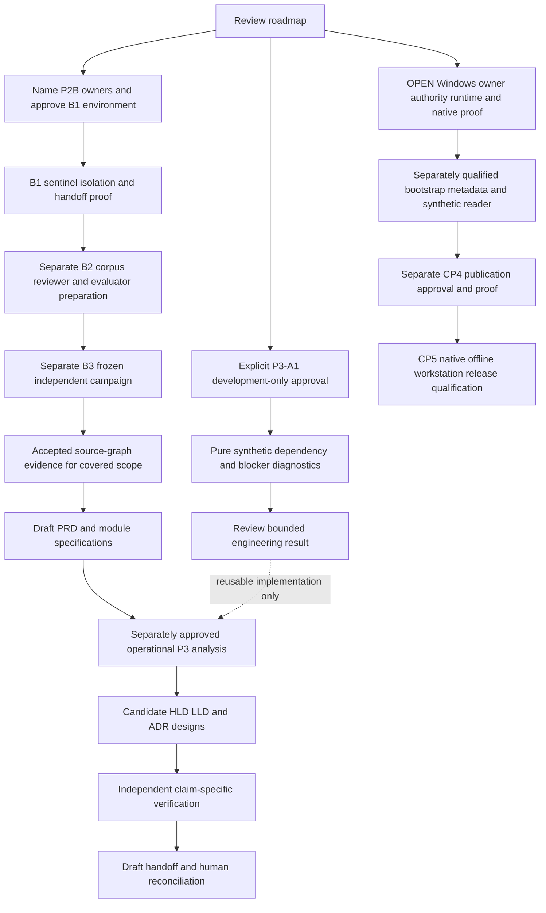

# Post-CP3D roadmap reassessment

Reviewed baseline: `d6b25d35a97290bb5c72673b9267c9d6dd3564d7`.
Prepared 2026-11-06. **Planning only.** The user accepts CP3D only within its
pure/simulated scope. No P3, P2B, native qualification, contract change, real SAS
intake or later-phase implementation is authorized by this document.

Recommend **P3-A1: synthetic dependency and blocker diagnostics** as the next
implementation approval: one private, pure module over already supplied canonical
v2 graphs, independent public graph fixtures and tests. This returns engineering
attention to the upstream planner without opening Windows paths or claiming safe
parallel execution. In parallel, obtain the human decisions needed for P2B and
Windows qualification. Keep both gates mandatory for their respective claims and
release capabilities; neither is satisfied by public graph tests.

## Evidence and current capability

The current user request controls scope. The historical phase plan remains intact.
Reviewed [AGENTS](../AGENTS.md), [README](../README.md), [SECURITY](../SECURITY.md),
[approvals](APPROVALS.md), [decisions](OPEN_DECISIONS.md),
[implementation plan](IMPLEMENTATION_PLAN.md), [P2A design](P2A_DESIGN.md),
[P2 readiness](P2_READINESS.md), [P2B readiness](P2B_READINESS.md),
[evaluation design](P2_EVALUATION_DESIGN.md), [portability plan](CROSS_PLATFORM_PORTABILITY_PLAN.md)
and CP1–CP3D design/validation reports. Read-only focused reviews covered the
current contracts/graph implementation, phase gates and portability evidence.

The specification ZIP remains SHA-256
`e3cbf3d9df6cc20c594261556c5e3ea1dfc292c9c1a30672c2d7b1a736b9718e`.
Its documents 02/03/04/06 were reviewed for workflow, parallelism, verification
and phase requirements. Document 02 controls workflow; 05 controls downstream
compatibility. Archive content is reference data, not permission to execute it.
Agent-mastery stays read-only and pinned to
`bc754e0f1204a99020c864df2a5b25983005e09c`; no receiving-side changes are proposed
for the next checkpoint.

| Evidence at the baseline | Observed capability and limit |
|---|---|
| P0/P1/P2A | Authorized synthetic inventory, original-byte identities, canonical v2 reconstruction and local append-only evidence. P2A's source checker shares reconstruction code; independent semantic acceptance remains BLOCKED |
| [CP1 report](CP1_VALIDATION.md) | Import-safe selection and early capability denial; 411 historical regressions. Native Windows interpreter qualification NOT_RUN |
| [CP2 report](CP2_VALIDATION.md) | Pure local declarations and legacy identity projection; 456 historical regressions. Native strings never authorize physical access |
| [CP3A report](CP3A_VALIDATION.md) | Additive POSIX retained-descriptor preflight; 514 historical regressions. Not integrated into legacy persistence; scoped quiescent/trusted-writer guarantees only |
| [CP3B report](CP3B_VALIDATION.md) | Private Windows reader/native seam; 596 historical regressions, Windows additions simulated/unit-only. No qualified bootstrap or public reader |
| [CP3C plan](CP3C_QUALIFICATION_PLAN.md) | Native authority, API, absence and qualification prerequisites; 20 proposed case families, not completed native tests |
| [CP3D report](CP3D_VALIDATION.md) | 667 historical regressions: 596 preserved plus 71 pure/simulated cases. Thirty sealed artifacts unchanged. Private metadata protocol and named DOS-mapping binding; native context/root/lookup/query/close remain unconditionally BLOCKED |

Counts are cumulative development regressions, not independent semantic samples.
Actual historical environments are macOS ARM64 and hosted Linux; no Windows API
was executed in CP3D. Its Linux development/wheel CI is recorded by
[run 42288844821](https://github.com/keshavnath1/sas-reverse-engineering/actions/runs/42288844821)
at the reviewed commit. Historical passes are not new executions in this planning
checkpoint and do not qualify Windows, evaluator isolation or runtime performance.

Current implementation observations:

- [`semantic.py`](../src/sas_re/semantic.py) records operation ownership/sequence,
  dataset/column reads/writes, ordered facts, control lineage, state effects,
  ordering/numeric/cardinality contracts, unknowns and contradictions. Its edge
  composition includes prior-write/later-read DATA, conditional ORDER and STATE
  dependencies. This is not a completeness proof for all side effects or hazards.
- Dataset identities are name-based, not versioned dataset instances. Overwriting
  a dataset produces `DATASET_OVERWRITE_UNSUPPORTED`. Missing write-after-read or
  write-after-write edges cannot be interpreted as permission to reorder.
- The [v2 contract](../src/sas_re/contracts/v2/evidence.schema.json) distinguishes
  DATA, STATE, ORDER, SIDE_EFFECT, RESOURCE and UNKNOWN edges. STATE self-edges
  are intentional. RESOURCE contention is not semantic precedence.
- [`contracts.py`](../src/sas_re/contracts.py) performs shape checks; it does not
  establish referential/identity integrity, source truth or freshness.
  `semantic.validate_v2()` reconstructs and accesses source: it must not be used
  inside a proposed pure graph diagnostic. `module_view()` demonstrates existing
  parent-hash/canonical-ID views without a second factual graph.
- [`cli.py`](../src/sas_re/cli.py) still leaves `analyze-parallelism`, requirements,
  ADR, handoff and evaluation commands as placeholders. No planner stage exists.
  Synthetic LOG timing text is not an authenticated execution measurement.

## Critical path and independent tracks

The original runtime order remains **independent source/graph verification PASS →
draft PRD/module specifications → parallelism analysis → candidate architectures →
independent claim checks → draft handoff → downstream human reconciliation**.
P2B is not deferred to P5, and a phase label does not advance this workflow.

P3-A1 therefore requires an **explicit development-order exception** if approved:
experimental graph diagnostics may be developed before P2B, but cannot enter or
pass the operational P3 stage. This roadmap recommends that narrow exception;
it does not grant it. P2A's earlier development split provides precedent for
separating implementation from acceptance, not authority to repeat it implicitly.



Arrows are dependencies, not approval or scheduled work. A failed or unavailable
gate stops its dependent track; pure diagnostics need no Windows access or P2B
infrastructure. A native workstation release still requires the platform track.

| Sequence / track | Work category | Entry dependency | Value and stopping point |
|---|---|---|---|
| 1. P3-A1 | Executable engineering after approval; experimental conclusions only | Explicit scope and development-order exception | Dependency/blocker report over public synthetic graphs; stop before opportunities, scheduling or integration |
| 2. P2B B1, parallel preparation | Human dependencies, then separately approved executable security proof | Named host/admin/security reviewer, exact image/policy, retention and budget | Sentinel-only isolation, positive controls and immutable handoff; no provider, hidden gold, grader or semantic acceptance |
| 3. P2B B2 | Human domain/custody decisions and evaluation preparation | Accepted B1 proof; D08-C and D09-A/B/C resolved as applicable | Independent gold author/reviewer/custodian, frozen grader, approved reviewer topology and any provider policy; stop before campaign |
| 4. P2B B3 | Separately approved experiment with mandatory acceptance gate | Frozen corpus, two-lane schedule, denominators, security evidence and budget | Execute/report the approved full campaign; incomplete/failed results cannot promote claims |
| 5. Core operational planning | Executable development plus human business decisions | Independent source/graph acceptance for the covered scope, then draft PRD/SPEC | Workload/module/stage and finer analysis, conditional opportunities and competing Spark/Ray/Dask/native designs, each in reviewed increments |
| 6. Claims and handoff | Independent verification and human decisions | Claim-specific proof, measured evidence where required, human oracle/tolerance/runtime decisions | Draft profiles, tie-out/benchmark configurations and versioned handoff; no upstream human approval or downstream writes |
| W. Native Windows | OPEN human prerequisites, then separately scoped implementation/qualification | CP3C/CP3D unresolved authority, host, API and reviewer requirements | Reader qualification, CP4 and CP5 remain distinct; no activation from roadmap or graph-test success |

No calendar, staffing availability, performance or cost estimate is asserted.
The immediate engineering blocker for P3-A1 is approval, not Windows access.
The verified-product critical path is independent semantic evidence and the
business/claim review sequence. The native workstation release has additional
security and packaging dependencies. P5 consolidates assurance; it cannot waive
earlier source/claim gates. Agent-mastery integration remains separately approved P7.

## What bounded P3 can and cannot establish

| Analysis level | Defensible first checkpoint | Deferred proof/work |
|---|---|---|
| Workload/module | Canonical-ID dependency paths, cross-module constraints, unknowns and cycles | Completeness of external effects, actual independent execution and verified workload scheduling |
| Stage/operation | Typed represented constraints and conservative shared read/write diagnostics | Executable stage boundaries, worker waves and transformation approval |
| Feature/expression | Identify disconnected represented branches and retained order/state blockers | No branch is declared independent; expression reassociation, rounding and feature fusion require separate proofs |
| Partition | Surface existing BY/MERGE/state/order preconditions | Partition keys, carry state, skew/distribution and equivalence across boundaries remain unproved |
| Algorithm/training | Report unsupported/unrepresented analysis scope | No statistical/training algorithm rewrite, runtime selection or optimizer |
| Critical path/performance | Graph topology only | No duration-weighted critical path, speedup, memory/resource estimate or benchmark claim from synthetic log strings |

P2B is mandatory for independently accepted source semantics but **not sufficient
by itself** for verified parallelism. Later claim-specific tests must cover missing
dependencies, side effects, state/order/partition counterexamples, transformations
and numerical invariants. A P2B result is scoped to its frozen subset/corpus; it
cannot certify new planner logic or arbitrary SAS. Any extension of evaluation
coverage/denominators needs separate approval, not a silent change to the proposed
36-case × two-lane × five-repetition campaign.

## Smallest proposed implementation: P3-A1

**Input:** a caller-supplied in-memory v2 Graph and an explicit expected canonical
graph digest, constructed from independently reviewed public synthetic fixtures.
No path, URI, source text, local root, source-read handle or artifact-store argument.
The synthetic profile name is a declaration, not a PII detector; this checkpoint
does not authorize private graph intake. No caller boolean grants trust.

**Processing:** reject non-JSON values, cycles in Python containers, oversized or
deep input before unbounded serialization; detach input; check the frozen v2 shape,
payload-derived IDs whose original preimages are present, uniqueness, ownership
and references using existing identity rules. Recompute only supported graph
node/operation/edge/observation identities. Inventory-derived issue IDs can survive
P2A enrichment without rehashing: preserve them as opaque references rather than
rejecting legitimate graphs through a generic issue-payload hash rule. File IDs,
source fingerprints, inventory hashes and physical citations cannot be proven
from this graph alone. Verify expected digest against the exact canonical object. Validate local
reference indexes, not source bytes or physical citations. Do not call filesystem
scope validation, reconstruction or freshness verification. Trusted bundled schema
reads may occur at import/validation; caller paths and external references may not.

The digest establishes subject consistency only, not sealing, provenance or fresh
source validation. A hand-authored, rehashed false graph can satisfy integrity;
the output must remain explicitly unverified. Preserve original array order in
the parent hash. Reordering set-like graph members can preserve analytical content
while changing the exact bound graph digest; never normalize the factual graph
to hide that change. Statement/fact/expression/operation sequence is meaningful.

**Analysis:** preserve typed canonical edges; compute deterministic represented
reachability and strongly connected components, including self-cycles. Keep RESOURCE
annotations apart from directed semantic/unknown constraints. Report DATA/STATE/
ORDER/SIDE_EFFECT/UNKNOWN meanings without treating UNKNOWN as established causal
truth. Store bounded predecessor references for witnesses, not every possible path.
Any condensation is a derived view with original IDs/edges, never a replacement DAG.

Compare read/write sets in declared operation-sequence order for shared write/read,
read/write and write/write nodes. Surface RAW/WAR/WAW-style conflicts as conservative
diagnostics and missing-proof obligations, **not new factual edges**. Resolve column
parent dataset references conservatively; distinct columns do not prove physically
independent dataset writes. Overwrites/unversioned dataset state remain blockers.
Keep global/unbound unknowns global and local unknowns attributed; carry contradictions
as explicit rejecting findings, not generic unknowns or a successful eligibility
verdict. Surface state, order, cardinality and numeric limitations without inventing
an effect-completeness proof.

**Output:** a detached, in-memory diagnostic result with algorithm identifier,
parent graph digest, supplied workspace/run/attempt/source fingerprint, canonical
IDs, typed findings, predecessor/path references, cycles and missing-proof reasons.
No canonical fact edits, duplicated editable graph, new stable operation IDs or
persisted report schema. A result may say **“no represented dependency path;
independence unproved.”** It must never emit safe concurrency, a schedule, runtime
recommendation, `VERIFIED` or human approval. Structural invalidity is distinct
from valid-but-unverified graph diagnostics; contradictions disqualify analysis
eligibility while remaining visible. No algorithm-success field is a stage PASS.

All results preserve `artifact_authority: DRAFT`, `semantic_verification:
UNVERIFIABLE`, `semantic_acceptance: BLOCKED`, `benchmark_execution: NOT_RUN`.
No public command is added; `analyze-parallelism` remains NOT_IMPLEMENTED/exit 3.
All Windows evidence commands retain their existing BLOCKED/exit 2 behavior.

Proposed finite limits for this experiment: 100 operations, eight modules, 10,000
edges, 2,000 combined dataset/column nodes, 5,000 facts, 200,000 total JSON values,
nesting depth 64 and 8 MiB canonical input. Root depth is zero; the value budget
counts every container/scalar occurrence plus every object key as one string.
Check counts/depth and bounded cumulative string/encoding size before unbounded serialization;
bound reachability/predecessor entries by operation-count squared. Use iterative
bounded graph traversal; no all-path enumeration, provider or new graph dependency.
These are proposed engineering limits, not current schema limits or measured
capacity. Exceeding a limit returns explicit refusal, not truncated success.

Proposed deliverables, only after separate approval:

- `src/sas_re/_dependency_diagnostics.py`: private pure implementation.
- `tests/dependency_vectors.py`: independently authored public graph expectations.
- `tests/test_dependency_diagnostics.py`: the named obligations below.
- `docs/P3_A1_DESIGN.md` and `docs/P3_A1_VALIDATION.md`: behavior, exact checks,
  failure history, limitations and proof boundaries.
- Necessary README/AGENTS/approval/decision/best-practice updates identifying the
  private experiment; no existing contract, parser, CLI, I/O, publisher or lock edits.

## Proposed exact tests and acceptance

These **26 named tests are proposed, NOT_RUN**. Freeze public expected results
before candidate implementation; a separate developer review is not P2B isolation.
Use literal independent graph-math oracles and reviewed hash preimages. Existing
P2A synthetic construction may supply an integration input, never its own expected
diagnostic answer. Parameterized variants below belong to the named obligation;
the future report must distinguish methods, variants and repeated platform runs.

| ID / proposed method | Exact expected assertion |
|---|---|
| A01 `test_single_operation` | One operation/no edges produces its canonical reference, empty reachability and no independence approval |
| A02 `test_data_chain_witness` | A→B→C returns A→C reachability with the original two DATA edge IDs in order |
| A03 `test_diamond` | A→B/A→C/B→D/C→D retains all four edges and deterministic predecessor selection; no execution waves |
| A04 `test_disconnected_branches` | Two disconnected branches report no represented path in either direction, always independence unproved |
| A05 `test_missing_raw_edge` | Shared producer-write/consumer-read with omitted DATA edge produces the shared-node/missing-proof finding; canonical edges unchanged |
| A06 `test_waw_conflict` | Two declared writes to one dataset produce a conflict; overwrite uncertainty is retained |
| A07 `test_war_conflict` | Earlier declared read/later write produces a conservative conflict, not a synthesized canonical dependency |
| A08 `test_dataset_column_alias` | Parent-dataset versus column accesses, including distinct columns of one written dataset, cannot establish independent writes |
| A09 `test_state_self_cycle` | RETAIN and LAG variants preserve STATE self-edges and state effects; no manufactured acyclic source graph |
| A10 `test_multi_operation_cycle` | A→B→A is one cyclic component containing both IDs and both original edges |
| A11 `test_cross_module_macro_control` | A macro STATE edge and referenced input columns with different module owners remain visible; `input_fact_indices` stay earlier facts in the same operation, never cross-operation references |
| A12 `test_order_preconditions` | SORT/BY ordering requirements and unresolved/tie-order variants remain blockers rather than scheduling permission |
| A13 `test_resource_not_precedence` | A RESOURCE-only edge is retained as contention, does not create semantic reachability and cannot prove independence |
| A14 `test_side_effect_and_unknown_edges` | Both edge types retain canonical IDs/type and block favorable opportunity claims |
| A15 `test_unknown_scope` | Operation-scoped unknown stays attributed; empty/global binding prevents a whole-scope favorable conclusion |
| A16 `test_contradiction_precedence` | A contradiction remains an explicit rejecting finding alongside unknowns; it cannot become eligible through generic BLOCKED wording |
| A17 `test_identity_integrity` | Duplicate operation/node/edge IDs and forged reconstructible payload IDs are rejected; legitimate enriched inventory issue IDs remain opaque, without invented file/source integrity checks |
| A18 `test_reference_integrity` | Dangling operation/node/module IDs and out-of-range fact/control/lineage references are rejected |
| A19 `test_version_sequence_ownership` | Unsupported schema version, invalid/duplicate operation sequence and owner mismatch are rejected; no silent conversion |
| A20 `test_rehashed_false_graph_not_verified` | Shape-valid rehashed false dependency/independence challenge remains unverified; the module cannot certify its semantics or promote a status |
| A21 `test_no_input_mutation` | Canonical input bytes/deep content identical after success, malformed input and limit failure; output mutation cannot alter input |
| A22 `test_determinism_and_order` | Identical input gives identical output; set-like member reordering preserves normalized analysis but changes parent digest as applicable; statement/order changes are not normalized away |
| A23 `test_subject_binding` | Changed operation/edge/logical content with old expected digest is rejected; new expected digest cannot reuse the old bound result |
| A24 `test_finite_bounds` | For every stated count/depth/byte bound, limit−1/limit reach that specific guard and limit+1 refuses for that bound; isolate other constraints or test a private guard when shape prevents isolation. Cyclic/non-JSON/nonfinite input refuses; no all-path expansion on a layered graph |
| A25 `test_pure_offline_operation` | During the diagnostic call, trap caller-path opens, reconstruction/source I/O, store/publisher calls, process/network/Git/SAS/provider use; permitted bundled-schema reads only. No source/store mutation |
| A26 `test_authority_and_gate_preservation` | Every result keeps DRAFT/UNVERIFIABLE/BLOCKED/NOT_RUN; existing placeholder exit 3 and public Windows I/O exit 2 occur before supplied-path access |

Acceptance additionally requires all **667 existing regressions**, unchanged frozen
hashes/identities/downstream pin, repeated P1/P2A historical artifact comparison,
development and installed-wheel checks on available qualified macOS/Linux setups,
and repository/documentation checks. Pure portability must be checked without
POSIX-only imports/process dependencies. A Windows simulation is labeled unit-only;
actual Windows execution remains BLOCKED without separately approved prerequisites.
No skipped hostile fixture or unexecuted platform is a passing qualification.
The unchanged historical regressions and artifact comparisons retain their existing
authorization to create/read disposable public synthetic fixtures and temporary
POSIX test stores. That test activity does not permit the new diagnostic module
to perform I/O or authorize any new intake/native experiment.

Stop immediately for review if the increment requires a frozen schema/identity
change, source-path access, canonical-edge mutation, a public workflow transition,
publisher/CLI integration, new dependency, real/private inputs, provider access,
unbounded analysis or weakening a security/semantic gate. Preserve failed checks
and historical records. If conservative analysis cannot classify a construct,
emit its missing-proof obligation; do not broaden the parser or claim independence.
Stop after the five proposed deliverables and their validation for explicit review.

## Windows, offline release and P2B separation

Keep CP3C-D01–D08 and CP3D-D01–D05 OPEN where unresolved. Native work needs a
named Windows 11 client x64/local fixed NTFS host owner, independent human security
reviewer, custodian/observer, authentic scoped inspection authority, physical
storage/writer policy, exact Python 3.12/PowerShell tuple and approved offline
artifact hashes. No owner or approval can be inferred from a GitHub account.

After those decisions, separately authorize completion-safe bootstrap/absence
implementation and metadata qualification, then synthetic-content qualification.
Resolve root/ancestor reparse behavior, aliases/volume identity, ACLs, actual
lookup/case/locality contracts, pending-buffer ownership, observation coverage,
negative fixtures and cleanup. CP3D's simulated protocol is not that proof.
CP4 locks/no-replace publication/privacy/crash/seal/durability and CP5 installed
release qualification require their own approvals. Reader acceptance cannot
activate full Windows workflows or change earlier POSIX persistence timing.

Eventual ordinary workstation release must run natively on approved Windows and
macOS tuples with an installed Python package, local scripts and authorized files,
offline and without Git, Docker, WSL, VMs, cloud, a particular editor or AI provider.
VS Code, Copilot and other approved assistants are optional development interfaces.
Spark/Ray/Dask candidates are later optional target designs, not core prerequisites.
JSON/YAML/Markdown/Mermaid exchange remains a release requirement; do not install
runtime engines or a diagram service merely to inspect evidence.

Current CI is Ubuntu-only. The dependency lock has macOS ARM64/manylinux x86_64
native wheels, not approved Windows or macOS Intel closure. Future CP5 must verify
offline hash-locked provisioning, installed resources, shell arguments/exit codes,
Unicode/CRLF byte identity and cross-platform artifact exchange on actual approved
hosts. Git/network-dependent `check-baseline --remote` remains optional and cannot
be a core startup/read/analysis prerequisite. Broader OS/filesystem/architecture
support stays explicitly unqualified until separately tested.

P2B's proposed dedicated Linux isolation host/VM belongs to independent evaluation,
not ordinary workstation operation. B1 uses harmless sentinels and an offline stub,
with no provider/gold prerequisite. B2/B3 require separate custody, independent
grader/reviewer and approved topology/data/budget decisions. Existing proposals
do not bind the core to an AI vendor or mandate Docker/cloud. Changing the proposed
evaluation topology also needs human review; ordinary offline use is not evidence
of evaluator isolation.

## Decisions and recommended next approval

All recommendations remain OPEN in [the decision ledger](OPEN_DECISIONS.md).
Immediate decision: whether to approve P3-A1's development-only exception and exact
scope above. Independently assign P2B and Windows owners and resolve their existing
approval dependencies; do not bundle native execution or evaluation into that approval.

Suggested next authorization, **not granted here**:

> Approve P3-A1 only from the reviewed baseline: implement the private, pure,
> in-memory synthetic canonical-v2 dependency and blocker diagnostics specified
> in POST_CP3D_ROADMAP.md, including A01–A26 and preservation checks. Approve this
> solely as a development-order experiment before P2B, not an operational P3
> transition or independent semantic acceptance. Preserve all Windows gates,
> frozen contracts/identities/history and Agent-mastery pin. The new diagnostic
> implementation must perform no source/store I/O; unchanged existing synthetic
> regression/preservation fixture I/O remains permitted for tests only. No new
> intake, public CLI, publisher, new dependency/provider, schedule, runtime
> recommendation or verified independence claim. Stop after design, implementation,
> independent public tests and validation for review; no P2B/CP4/CP5/P3 expansion.

## Checks for this planning checkpoint

Actual documentation/preservation checks are recorded below.
No proposed A01–A26 test, P3 implementation, native fixture, P2B isolation probe,
model call, private intake or SAS execution is performed by this assessment.
Historical test evidence above remains attributed to its original reports.

All local checks used the existing checkout/interpreter; no installation occurred.

| Executed check | Actual result and limit |
|---|---|
| `git status --short`; `git rev-parse HEAD` | Exit 0; clean starting checkout at exact `d6b25d35a97290bb5c72673b9267c9d6dd3564d7` |
| Read-only code/schema/archive/report review | Three focused reviews; no implementation, fixture creation or source workload execution |
| Inline Python scope/byte comparison | Exit 0; exactly three authorized Markdown changes; all 92 other baseline files byte-identical |
| Inline Markdown/plan checks | Exit 0; UTF-8/LF/final newlines, balanced fences, 80 existing local-link targets and exactly A01–A26 in the proposed test table |
| Frozen hash/pin recomputation | Exit 0; all eight hashes listed in CP3D_VALIDATION.md unchanged, including v1/v2/CP2 contracts, lock, vectors, ZIP and compatibility metadata; downstream commit unchanged |
| Staged repository guard | Exit 0; PASS, no errors. Tracked-path/selected secret rules only, not complete DLP |
| Working-tree/staged whitespace checks | Exit 0; no errors |

Commands actually executed from the repository root:

```sh
git add docs/POST_CP3D_ROADMAP.md docs/OPEN_DECISIONS.md docs/BEST_PRACTICES_ADOPTION.md
.venv/bin/python scripts/check_repository.py
git diff --check
git diff --cached --check
```

The inline Python check used `git ls-tree` at the baseline and exact
`git show <baseline>:<path>` byte comparisons outside the three allowed documents.
It asserted the exact diff/no extra untracked files, checked local links and
fences, counted proposed test IDs, recomputed SHA-256 with `hashlib` and checked
the pinned commit in `src/sas_re/data/baseline.json`.

Review corrected the diagram's candidate-design/claim-check order, graph-only
identity limits for inherited issue IDs, local fact-index ownership, bound-specific
assertions and the distinction between diagnostic purity and existing regression
fixture I/O. One exploratory review search referenced nonexistent `validation.py`
and exited 2; review continued against the actual modules. No validation check
failed. No local suite or historical artifact replay was rerun for prose changes.
Existing hosted regression CI may run on publication; any observed result is
reported separately against its exact commit/run, never counted as P3/P2B evidence.

Created only this roadmap; updated only `OPEN_DECISIONS.md` and
`BEST_PRACTICES_ADOPTION.md`. Existing implementation, contracts, tests, dependencies,
CI configuration, historical reports and native gates are unchanged. Stop for review.
