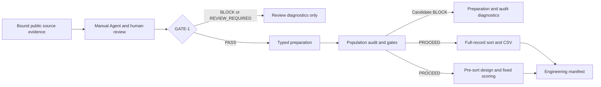

# Architecture and draft decisions

## HLD

This diagram represents the **CANDIDATE_ENGINEERING** execution design. [TRACE/MAP](TRACE_MAP.md#map) distinguishes it from SAS runtime lineage.

## LLD

- **Review boundary.** Resolve exact subject and evidence bytes, retain draft prose and unreviewed claims, then validate the final claim bytes against human approval. Revalidate inputs before dispatch. [Operator contract](../intg3a/README.md).
- **Preparation and audit.** PY-1 supplies ordered typed row diagnostics; MIG-5 retains original row order and hands eligible identifiers with multiplicity to MIG-4. Gate decisions use the ordered audit result and optional expected-count input. [R1–R3](REQUIREMENTS.md).
- **Branch adapters.** Export flattens full records, orders by ID and emits the declared candidate CSV. Scoring maps the original snapshot to ordered numeric and reference-coded categorical columns, computes the fixed dot product and applies the logistic transform. [R4–R5](REQUIREMENTS.md).
- **Publication.** Publish the allowed artifact set in a fresh destination with branch evidence and comparison reports. Validate manifests and repeat the exact inputs for byte comparisons. [R6](REQUIREMENTS.md).

## Draft ADR A — Native Python baseline

**Proposed for the bounded engineering example.** Reuse the available standard-library candidates with explicit types and preserved ordinals. This makes the run inspectable and avoids distributed setup. A single process can hit memory or I/O limits. Confirm the working set, exact value and ordering policies, typed SAS references, failure recovery and full pipeline cost before broader use.

## Draft ADR B — Distributed alternatives deferred

| Alternative | Workload assumption and operational tradeoff | Required proof |
| --- | --- | --- |
| Spark | Data exceeds the local working set and cluster deployment is available. Distributed grouping and ordering require shuffles; ordered single-file export requires an explicit merge/publication contract. | Validate missing-value, distinct-count and category behavior; preserve multiplicity, global sort and pre-sort ordinal. Measure shuffle, spill, recovery and serialization. |
| Ray | Preparation/scoring are separable tasks with enough compute per batch. Shared object-store memory and retries affect resource use. Global audit and ordering still need a coordinator. | Preserve ordinal and snapshot identity across workers and retries; prove exactly-once visible publication. Measure transfer, scheduling and object-store overhead. |
| Dask | Partitioned inputs fit worker memory and a task graph can express the work. Global distinct/grouping and ordered export add shuffle and repartition costs. | Prove partition-independent counts, missing/category consistency, global ordering and deterministic merges. Measure scheduler, shuffle and spill costs. |

No distributed runtime decision or implementation was made. These alternatives share the requirements and benchmark contracts; further design depends on workload evidence.

## Draft ADR C — Separate fixed scoring from fitting

Reuse the existing fixed-coefficient scorer for the public engineering demonstration. A fitting path would require model-event, design, eligibility, estimation and convergence contracts and attributable SAS observations. Keep fitting and ODS production outside the candidate publication until those proof obligations are addressed.
