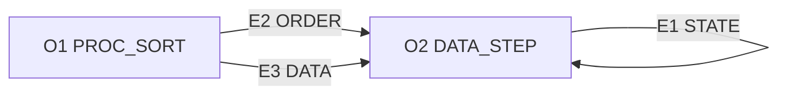

# Architecture overview

UNVERIFIED · public synthetic draft

```text
artifact_authority: DRAFT
semantic_verification: UNVERIFIABLE
semantic_acceptance: BLOCKED
benchmark_execution: NOT_RUN
```

Graph SHA-256 `385423530208b08635de832bed57698b7278490f2cb7a43f08fd754b80df9155` · preview `mvp1-draft-preview/1` · diagnostics `p3-a1-dependency-diagnostics/1`

## As-is computational flow

**OBSERVATION** [O1](EVIDENCE.md#o1) (PROC_SORT) writes `work.sorted`. Sort `work.a` into `work.sorted` by `key`, `subkey`. (fact 0)

**OBSERVATION** [O2](EVIDENCE.md#o2) (DATA_STEP) writes `work.final`. SET reads `work.sorted`. (fact 1) BY keys in declared order: `key`, `subkey` (ascending). (fact 2) Assignment: `y = (x / 2)`. (fact 3)

**OBSERVATION** Each box is an original operation ID. Edge labels identify original graph records in the [evidence index](EVIDENCE.md#edge-register). RESOURCE annotations, when present, are dotted. Arrows describe the supplied model.



## Dependencies and missing proof

**OBSERVATION** [E1](EVIDENCE.md#e1) records STATE from [O2](EVIDENCE.md#o2) to [O2](EVIDENCE.md#o2). Dataset nodes: `work.final`.

**OBSERVATION** [E2](EVIDENCE.md#e2) records ORDER from [O1](EVIDENCE.md#o1) to [O2](EVIDENCE.md#o2). Dataset nodes: `work.sorted`.

**OBSERVATION** [E3](EVIDENCE.md#e3) records DATA from [O1](EVIDENCE.md#o1) to [O2](EVIDENCE.md#o2). Dataset nodes: `work.sorted`.

**INFERENCE** Represented cycle at [O2](EVIDENCE.md#o2) via [E1](EVIDENCE.md#e1). Test state continuity across successive rows and group boundaries.

**INFERENCE** RAW conflict between [O1](EVIDENCE.md#o1) and [O2](EVIDENCE.md#o2), including `work.sorted`. 0 shared dataset group(s) lack a direct DATA edge. Physical versions and access isolation require evidence.

**INFERENCE** [O2](EVIDENCE.md#o2) → [O1](EVIDENCE.md#o1): no represented dependency path; independence unproved.

## To-be alternatives

**HYPOTHESIS** The [native Python candidate](ADR_NATIVE.md) keeps a local intermediate so order and per-row state can be inspected. The [Spark candidate](ADR_SPARK.md) would need a proven exchange and group-boundary contract. Compare both on the same behavior tests.

**ASSUMPTION** Capacity, skew, retry behavior, partition boundaries and admissible tie order require external confirmation. No execution schedule has been established.
