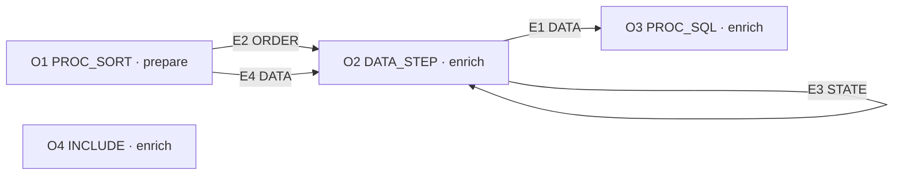

# Architecture overview

UNVERIFIED · public synthetic draft

```text
artifact_authority: DRAFT
semantic_verification: UNVERIFIABLE
semantic_acceptance: BLOCKED
benchmark_execution: NOT_RUN
```

Graph SHA-256 `19f41dea50825469a89d8fc545fee1d87f09af946d130d62de8f946d90b78017` · preview `mvp2-multimodule-preview/1` · diagnostics `p3-a1-dependency-diagnostics/1`

## As-is computational flow

**OBSERVATION** [O1](EVIDENCE.md#o1) (PROC_SORT, module `prepare`) writes `work.ordered`. Sort `work.observations` into `work.ordered` by `batch`, `sequence`. ([O1 fact 0](EVIDENCE.md#o1-fact-0))

**OBSERVATION** [O2](EVIDENCE.md#o2) (DATA_STEP, module `enrich`) writes `work.scaled`. SET reads `work.ordered`. ([O2 fact 1](EVIDENCE.md#o2-fact-1)) BY keys in declared order: `batch`, `sequence` (ascending). ([O2 fact 2](EVIDENCE.md#o2-fact-2)) Assignment: `scaled = (value / 2)`. ([O2 fact 3](EVIDENCE.md#o2-fact-3))

**OBSERVATION** [O3](EVIDENCE.md#o3) (PROC_SQL, module `enrich`) writes `work.adjusted`. FROM `work.scaled` as `s`, `work.offsets` as `r`. INNER JOIN on `s.batch = r.batch`. WHERE `s.scaled > 0`. Project `batch = s.batch`, `adjusted = (s.scaled + r.offset)`. ORDER BY `batch`. ([O3 fact 1](EVIDENCE.md#o3-fact-1))

**OBSERVATION** [O4](EVIDENCE.md#o4) (INCLUDE, module `enrich`) has no listed output node. INCLUDE literal `postcheck.sas`. Target unresolved; effects UNKNOWN. ([O4 fact 0](EVIDENCE.md#o4-fact-0))

**OBSERVATION** Each box is an original operation ID. Edge labels identify original graph records in the [evidence index](EVIDENCE.md#edge-register). RESOURCE annotations, when present, are dotted. Arrows describe the supplied model.



## Dependencies and missing proof

**OBSERVATION** `prepare` [O1](EVIDENCE.md#o1) produces `work.ordered` for `enrich` [O2](EVIDENCE.md#o2) on [E4](EVIDENCE.md#e4).

**OBSERVATION** [O4 fact 0](EVIDENCE.md#o4-fact-0) names `postcheck.sas` without a bound target. Its reads, writes and downstream effects are UNKNOWN.

**ASSUMPTION** Obtain separately authorized target evidence before treating the represented outputs as the complete workflow.

**OBSERVATION** [E1](EVIDENCE.md#e1) records DATA from [O2](EVIDENCE.md#o2) to [O3](EVIDENCE.md#o3). Dataset nodes: `work.scaled`.

**OBSERVATION** [E2](EVIDENCE.md#e2) records ORDER from [O1](EVIDENCE.md#o1) to [O2](EVIDENCE.md#o2). Dataset nodes: `work.ordered`.

**OBSERVATION** [E3](EVIDENCE.md#e3) records STATE from [O2](EVIDENCE.md#o2) to [O2](EVIDENCE.md#o2). Dataset nodes: `work.scaled`.

**OBSERVATION** [E4](EVIDENCE.md#e4) records DATA from [O1](EVIDENCE.md#o1) to [O2](EVIDENCE.md#o2). Dataset nodes: `work.ordered`.

**INFERENCE** Represented cycle at [O2](EVIDENCE.md#o2) via [E3](EVIDENCE.md#e3). Treat the STATE annotation as conservative. No independently demonstrated cross-row value dependence follows from this edge; test the specific grouping and value lineage.

**INFERENCE** RAW conflict between [O1](EVIDENCE.md#o1) and [O2](EVIDENCE.md#o2), including `work.ordered`. 0 shared dataset group(s) lack a direct DATA edge. Physical versions and access isolation require evidence.

**INFERENCE** RAW conflict between [O2](EVIDENCE.md#o2) and [O3](EVIDENCE.md#o3), including `work.scaled`. 0 shared dataset group(s) lack a direct DATA edge. Physical versions and access isolation require evidence.

**INFERENCE** For the pairs below there is no represented dependency path; independence unproved.

| From | To |
|---|---|
| [O1](EVIDENCE.md#o1) | [O4](EVIDENCE.md#o4) |
| [O2](EVIDENCE.md#o2) | [O1](EVIDENCE.md#o1), [O4](EVIDENCE.md#o4) |
| [O3](EVIDENCE.md#o3) | [O1](EVIDENCE.md#o1), [O2](EVIDENCE.md#o2), [O4](EVIDENCE.md#o4) |
| [O4](EVIDENCE.md#o4) | [O1](EVIDENCE.md#o1), [O2](EVIDENCE.md#o2), [O3](EVIDENCE.md#o3) |

## To-be alternatives

**HYPOTHESIS** The [native Python candidate](ADR_NATIVE.md) keeps a local intermediate so order and per-row state can be inspected. The [Spark candidate](ADR_SPARK.md) would need a proven exchange and group-boundary contract. Compare both on the same behavior tests.

**ASSUMPTION** Capacity, skew, retry behavior, partition boundaries and admissible tie order require external confirmation. No execution schedule has been established.
