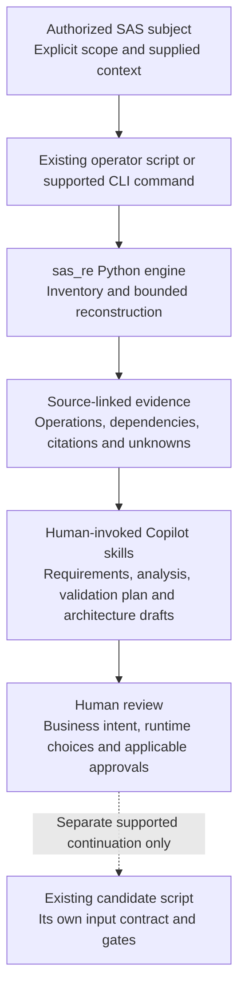
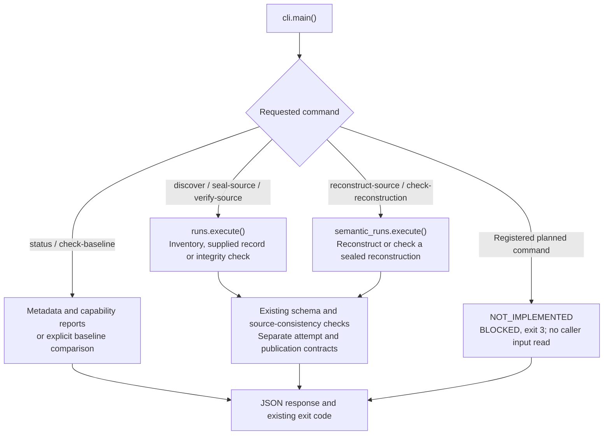
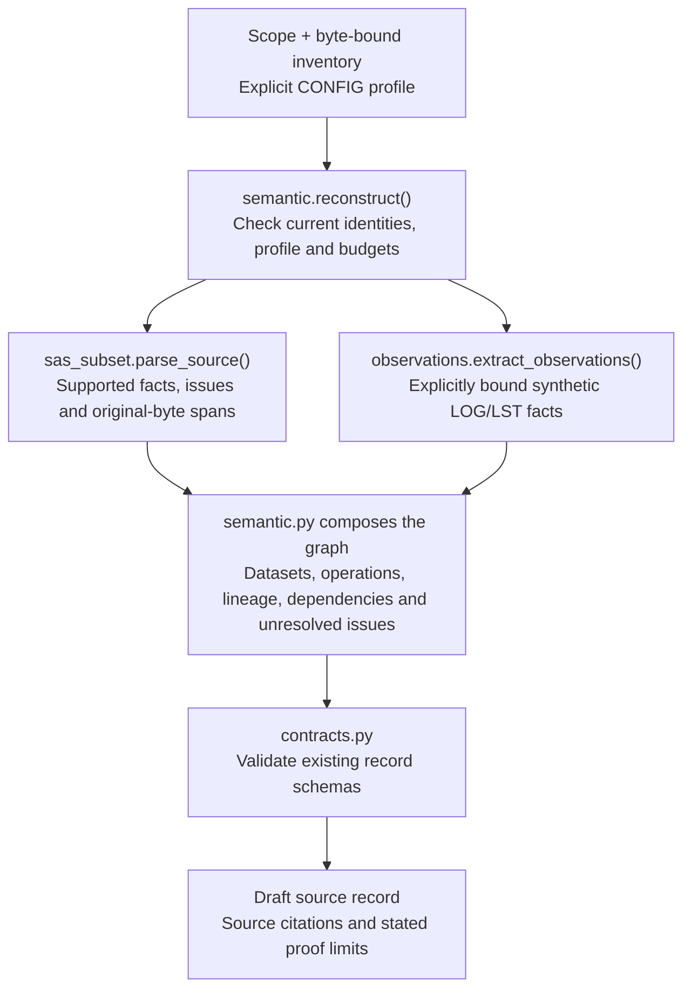
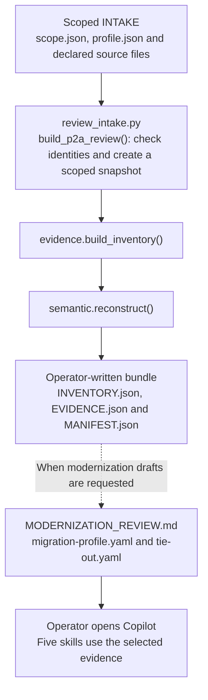

# Understanding `sas_re`: code, diagrams and execution flow

This package is the **deterministic Python engine** behind the repository's supported SAS review workflows. It records authorized source identities, reconstructs a bounded set of SAS behaviors, checks evidence consistency and manages supported evidence attempts.

The business goal is to understand what must be preserved before proposing a better Python or distributed design—not to translate every SAS line mechanically. This package provides the factual foundation; **AI skills draft requirements and architecture, and humans own decisions and approvals**.

For the business design, see the [architecture guide](../../docs/ARCHITECTURE.md). For installation and commands, use the [repository README](../../README.md). This page explains how the code connects.

## 1. Big picture: Python evidence, AI design, human decisions



This is a **responsibility and handoff diagram**, not an automatic dispatcher. The package does not launch Copilot or run all five skills. Unsupported subjects stop at the applicable review or refusal boundary; a design draft does not authorize execution.

| Layer | Where it lives | Its job |
| --- | --- | --- |
| Operator entry | [`scripts/`](../../scripts/) or [`cli.py`](cli.py) | Select the supported route and explicit inputs. |
| Python engine | This directory | Read scoped evidence, reconstruct supported facts and check consistency. |
| AI skills | [`skills/`](../../skills/) | Interpret selected evidence and draft PRD, specifications, analysis, validation obligations, HLD, LLD and ADRs. |
| Human decisions | Existing review and approval routes | Confirm intent and choices; supply the exact approval required by a supported continuation. |

## 2. Package map: which file does what?

```text
sas_re/
├── cli.py, __main__.py       Command-line entry and dispatch
├── evidence.py              Inventory, identities, citations and record checks
├── sas_subset.py            Parser for the supported synthetic SAS subset
├── semantic.py              Compose and validate the reconstructed graph
├── observations.py          Bind supported synthetic LOG/LST observations
├── contracts.py             Validate bundled JSON record schemas
├── authorization.py         Validate explicit authorization declarations
├── runs.py                  Inventory / supplied-record / integrity-check attempts
├── semantic_runs.py         Reconstruction / reconstruction-check attempts
├── safeio.py                 Public protected-I/O and attempt-store facade
├── platform_io.py            Capability checks and lazy backend selection
├── preflight.py              Separate policy-bound, read-only inspection API
├── baseline.py               Read-only downstream baseline comparison
├── _filesystem/             Private POSIX and Windows implementations
├── _review/                 Private diagnostics, draft previews and review rendering
├── _io_common.py             Shared bounds, canonical bytes and fixed errors
├── _authorization_paths.py   Pure declared-path validation
├── contracts/               Immutable JSON schemas, not Python algorithms
└── data/                    Frozen baseline metadata
```

Three root files—`_dependency_diagnostics.py`, `_draft_preview.py` and `_decision_review.py`—remain as **thin legacy import facades** for existing scripts. The actual algorithms live once, under `_review/`; the facades contain no duplicate implementation.

| Start with | Important functions or classes | Plain-language explanation |
| --- | --- | --- |
| [`cli.py`](cli.py) | `main()` | Which command did the caller request, and which existing route handles it? |
| [`evidence.py`](evidence.py) | `validate_scope()`, `build_inventory()`, `citation()`, `validate_record()` | Which files were declared, which original bytes were read, and where does each supplied fact point? |
| [`sas_subset.py`](sas_subset.py) | `parse_source()` | What supported SAS statements and issues can be recovered from supplied bytes? |
| [`semantic.py`](semantic.py) | `reconstruct()`, `validate_v2()`, `revision_map()` | How do parsed facts, source identities and explicit assumptions become a consistent graph? |
| [`observations.py`](observations.py) | `extract_observations()` | Which supported synthetic log/listing observations can be bound to source operations? |
| [`runs.py`](runs.py), [`semantic_runs.py`](semantic_runs.py) | Each module's `execute()` | How are predecessor evidence, separate attempt identities, reports and publication coordinated? |
| [`safeio.py`](safeio.py) | `secure_read()`, `AttemptStore` | How are source reads bounded and attempts kept separate from source and previous results? |
| [`contracts.py`](contracts.py) | `validate_contract()`, `validate_versioned_contract()` | Does a record have the required shape? Schema validity alone does not prove its business meaning. |

## 3. Actual CLI routing

Both the installed `sas-re` entry point and `python -m sas_re` reach `cli.main()`.



The inventory route can **check a supplied record**; it does not automatically parse all SAS. The reconstruction route uses an eligible sealed predecessor and an explicitly scoped profile. Check commands revalidate their subject and publish into a distinct attempt rather than overwriting it.

`status` is not validation. `check-baseline --remote` is an explicit network operation. Registered planned commands remain unimplemented; their names do not mean that AI drafting is available through the CLI.

## 4. Inside reconstruction: original bytes become a graph



The arrows show **data composition**, not parallel execution. The parser does not execute SAS, and the profile contains supplied assumptions rather than measured production facts. Unsupported syntax or unresolved behavior is not silently converted into proven semantics.

For example, a scoped program might create `prepared` and later sort it into `ordered`. Supported reconstruction can describe the preparation and sort operations, cite their original source spans and infer their relationship. A skill can then ask whether a target design can change this structure. It still needs evidence about ordering, state and dataset continuity before calling the change safe or faster.

### Where results appear

The calling route owns artifact filenames and publication. `semantic.reconstruct()` returns a graph; it does not write a PRD or implementation.

| Route | Typical named artifacts | Meaning |
| --- | --- | --- |
| Inventory / supplied-record attempts | `source_inventory.json`, optional `source_record.json`, `validation_report.json` | Declared file identities and checks for the selected inventory/record subject. |
| Reconstruction attempt | `source_inventory.json`, `source_record.json`, `validation_report.json` | Reconstructed graph and consistency findings. |
| Separate check attempt | `verification_report.json` | A new check of a previous subject, not replacement evidence. |

Attempt metadata and seals belong to the existing attempt-store contract. Failed routes may omit the source record, and interrupted publication may remain incomplete. A complete publication is not automatically a passing gate.

### How the team's INTAKE walkthrough calls this package

The public multi-file route in [`review_intake.py`](../../scripts/review_intake.py) calls package functions directly; it is not an alias for every CLI command above.



The wrapper owns its fresh scratch bundle. Its uppercase artifact names are different from the lowercase CLI attempt-store names in the table. `review_intake.py --inventory` instead prints an inventory/scope proposal to stdout; it does not approve scope or generate that entire bundle.

Keep **`profile.json`**—synthetic input and interpretation assumptions—separate from **`migration-profile.yaml`**—pending modernization/runtime decisions. The handoff does not automatically create approved PRDs or ADRs. The ordinary selected-span [`review_source.py`](../../scripts/review_source.py) route uses parser/rule helpers rather than always calling `semantic.reconstruct()`.

Likewise, the [running-balance script](../../scripts/run_running_balance.py) implements its own exact-identity public candidate computation and uses protected-I/O helpers. It is not code generated automatically from the graph, and its command does not perform the independent SAS comparison. Other governed continuations retain their separate approval contracts.

## 5. Review, safety and optional inspection are different concerns

The private review modules consume supplied graph/report subjects:

- [`_review/_dependency_diagnostics.py`](_review/_dependency_diagnostics.py): `diagnose()` checks the bounded graph and reports dependency constraints and blockers.
- [`_review/_draft_preview.py`](_review/_draft_preview.py): `generate_preview()` renders draft material for its supported supplied subject; it does not approve a design or select a production runtime.
- [`_review/_decision_review.py`](_review/_decision_review.py): `bind_review()` and `render_review()` bind and render the fixed public graph/report controls, not arbitrary migration approval.

For filesystem behavior, start with `safeio.py`, then `platform_io.py`, then the relevant `_filesystem/` implementation. The backend is loaded after its capability gate; availability is not platform qualification. Native Windows evidence I/O remains **BLOCKED**.

`authorization.py` validates declarations without granting physical permission or human approval. `preflight.py` is a separate, explicit-policy read-only inspection API; **the legacy inventory/reconstruction commands do not automatically call it**. Their output-attempt reservation can precede full inventory checks. Repeated source checks detect changes but do not constitute an atomic snapshot against hostile writers.

## 6. Read the code in this order

1. **See the request:** `cli.main()` or the operator command named in the walkthrough.
2. **See the evidence:** `evidence.build_inventory()` and `semantic.reconstruct()`.
3. **See the meaning:** `sas_subset.parse_source()` and the graph composition in `semantic.py`.
4. **See the checks and ownership:** `contracts.py`, the two attempt runners and `safeio.py`.
5. **Explore only when needed:** `_review/`, `_filesystem/`, authorization and policy-bound preflight.

For a concrete operator route, start with the [SAS modernization walkthrough](../../examples/sas-modernization/README.md). For supported candidate execution, use the separate [running-balance walkthrough](../../examples/running-balance/README.md). Tests are organized by responsibility in the [test guide](../../tests/README.md).

**Bottom line:** the engine makes supported source behavior and evidence traceable; skills turn that evidence into reviewable designs. Passing structural, consistency or synthetic engineering checks does not prove independent SAS equivalence, optimized performance or production readiness. Unperformed SAS reference and benchmark runs remain `NOT_RUN`, and the existing semantic acceptance boundary remains `BLOCKED`.
