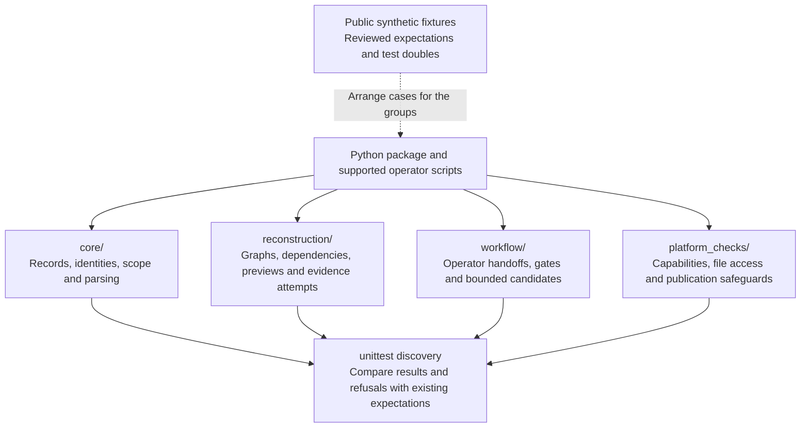
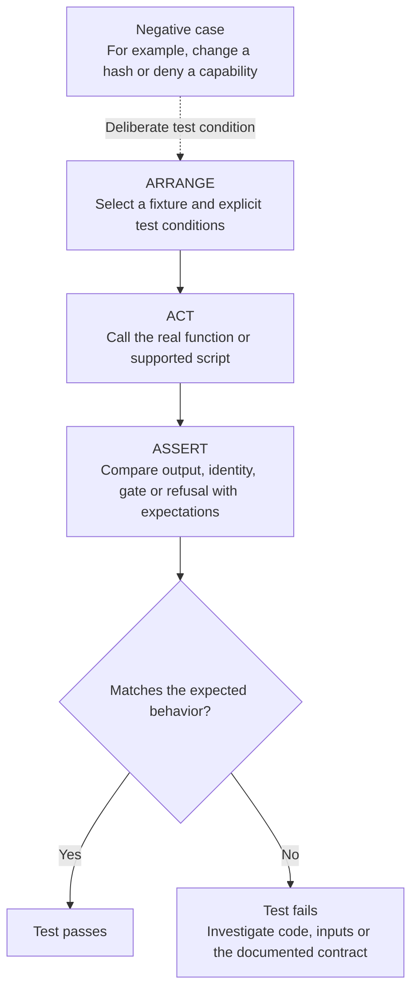
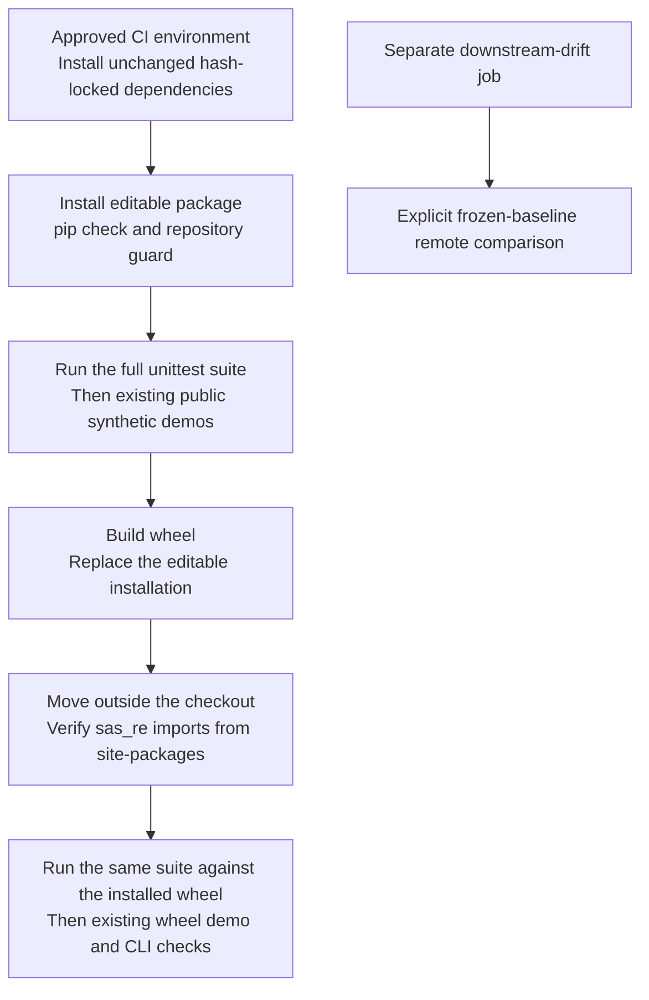

# Understanding the tests: coverage, diagrams and execution flow

The tests protect the repository's **supported reconstruction, evidence, review and candidate-execution contracts**. They check both expected results and expected refusals: accepting valid input is only half the job; rejecting stale evidence, unsafe paths or unsupported claims matters too.

This is the test companion to the [package code guide](../src/sas_re/README.md). The suite uses standard-library `unittest`, with no custom loader or additional testing framework. For environment setup, follow the [repository installation and validation guide](../README.md#install-and-validate).

## 1. Big picture: what connects to what?



The dotted arrow supplies **test inputs and comparison data**, not production configuration or approval. The diagram is a coverage map, not a requirement to execute the groups in that order.

## 2. Directory map and useful starting points

```text
tests/
├── README.md                This guide
├── core/                    Records, source identity, authorization and parser checks
├── reconstruction/          Reconstructed graphs, constraints, previews and attempts
├── workflow/                Operator routes, claim gates and supported candidates
├── platform_checks/         POSIX safeguards and simulated/private Windows protocols
├── support/                 Shared paths, independent vectors and test doubles
├── fixtures/                Immutable public synthetic sources and evidence packages
└── six preserved modules    Frozen evaluator/adaptor paths explained in support/README.md
```

| Group | Code or route it protects | Start reading here | What it checks |
| --- | --- | --- | --- |
| `core/` | `contracts.py`, `evidence.py`, `authorization.py`, `sas_subset.py`, `runs.py` and CLI/baseline boundaries | [`test_evidence.py`](core/test_evidence.py), [`test_parser.py`](core/test_parser.py), [`test_authorization.py`](core/test_authorization.py) | Record shape, original-byte citations, source identities, supported syntax, declared scope and conservative authority. |
| `reconstruction/` | `semantic.py`, `semantic_runs.py` and the private `_review/` implementations | [`test_graphs.py`](reconstruction/test_graphs.py), [`test_dependency_diagnostics.py`](reconstruction/test_dependency_diagnostics.py), [`test_behavioral_tieout.py`](reconstruction/test_behavioral_tieout.py) | Supported graph facts, dependency constraints, exact subject bindings, synthetic behavioral controls and unresolved proof obligations. |
| `workflow/` | INTAKE/source-review commands, review-to-migration gates and exact supported candidates | [`test_review_intake.py`](workflow/test_review_intake.py), [`test_review_to_migration.py`](workflow/test_review_to_migration.py), [`test_running_balance.py`](workflow/test_running_balance.py) | Operator input identities, approval/refusal boundaries, supported computations and repeatable public outputs. |
| `platform_checks/` | `safeio.py`, `platform_io.py`, `preflight.py` and private `_filesystem/` implementations | [`test_safeio.py`](platform_checks/test_safeio.py), [`test_platform_io.py`](platform_checks/test_platform_io.py), [`test_windows_native.py`](platform_checks/test_windows_native.py) | Protected file access, no-clobber publication, capability denial, descriptor ownership and fake native-call boundaries. |
| `support/` | Shared test setup rather than production algorithms | [`paths.py`](support/paths.py), [support guide](support/README.md) | Checkout/fixture location, independent synthetic vectors and memory-only test doubles. |
| `fixtures/` | Original public test subjects and accepted engineering comparison data | [fixture guide](fixtures/README.md) | Reusable source/evidence packages; these are not independent production SAS reference runs. |

For team onboarding, use the [three operator walkthroughs](../examples/README.md); fixture READMEs may preserve historical checkpoint wording and links.

## 3. How one test works



A test can pass because the application correctly returns `FAIL` or `BLOCKED`. **The test result and the application's evidence gate are different things.** Do not relax a refusal, regenerate expected data from the candidate, or change a tolerance merely to make a test green.

Examples to follow in the actual files:

- **Evidence:** `test_unauthorized_added_file_is_never_content_read` in `test_evidence.py` requires `SCOPE_ADDED_FILE` / `BLOCKED` and checks that the protected source-read function was not called. It proves the tested rejection occurs before content reading, not just that an error eventually appears.
- **Candidate behavior:** read how `test_running_balance.py` compares bounded public engineering outputs and checks source/evidence bindings. This does not mean the command ran SAS or performed an independent SAS tie-out.
- **Platform refusal:** read how `test_platform_io.py` and `test_windows_native.py` use simulated conditions and fake native calls. Those checks do not qualify native Windows evidence I/O.

`test_behavioral_tieout.py` uses frozen hand-computed synthetic expectations and deliberately faulty probes. A modeled `FAIL` can be the expected result of a successful negative test. These are not observed SAS output rows, and unresolved full-workflow obligations remain blocked.

## 4. Run the existing suite

Use the prepared **Python 3.12 environment** from the repository guide. The locked dependencies are environment-specific; do not bypass their hashes or alter the lock to force an unqualified platform to install.

From the repository root:

```sh
python -m unittest discover -s tests -v
```

For a focused check, keep the discovery root as `tests` and select a file pattern:

```sh
# Original-byte evidence and citations
python -m unittest discover -s tests -p 'test_evidence.py' -v

# Public running-balance candidate
python -m unittest discover -s tests -p 'test_running_balance.py' -v

# Synthetic behavioral comparison controls
python -m unittest discover -s tests -p 'test_behavioral_tieout.py' -v

# Backend selection and refusal boundaries
python -m unittest discover -s tests -p 'test_platform_io.py' -v
```

These quoted patterns match filenames and select files recursively through the category packages. Keep `-s tests`; switching to a category as the discovery root can break preserved root helpers and `support.*` imports. A focused pass is not a full regression pass. Read skipped tests and their platform conditions; a skip is not evidence that the skipped behavior works.

### Why the imports and names matter

Unittest places `tests/` on its import path. Shared helper imports therefore use `support.*`, and cross-test imports use category-qualified names such as `workflow.test_review_workflow`. Category initializers are empty. Do not add root aliases, shim packages or a custom loader.

The platform group is named **`platform_checks/`**, not `platform/`, to avoid shadowing Python's standard-library `platform` module. `support.paths` locates checkout artifacts without inserting checkout `src` into `sys.path`. Existing script integration tests may import checkout `scripts/`; installed-package checks must still exercise the installed `sas_re`.

Security tests patch the **owning implementation** under `sas_re._filesystem` or `sas_re._review`. Patching a root review facade instead could miss the real function's globals and make a negative test ineffective.

## 5. How CI checks source and packaging

The existing [GitHub Actions workflow](../.github/workflows/foundation.yml) runs the suite against both an editable installation and the built wheel:



The second pass detects packaging/import problems that an editable checkout can hide. It does not duplicate independent SAS evidence or establish a performance benchmark.

After building and installing the wheel using the repository procedure, an outside-checkout discovery command is:

```sh
CHECKOUT=/absolute/path/to/checkout
cd /tmp
python -c 'import sas_re; print(sas_re.__file__)'
python -m unittest discover -s "$CHECKOUT/tests" -v
```

The printed path must identify installed `site-packages`, not checkout `src`. This example uses POSIX shell syntax; it is not a new Windows qualification or installation recipe.

## 6. Preserve comparison truth and report the right claim

Six root modules retain their original paths and bytes: `p2a_expectations.py`, `mvp2_expectations.py`, `mvp3_cases.py`, `p2a_support.py`, `mvp2_fixture.py` and `fixture_support.py`. The [support guide](support/README.md#purposeful-legacy-exceptions) explains their frozen evaluator and historical script-adaptor roles. Keep these files and `fixtures/` unchanged during ordinary refactors; legacy checkpoint identifiers inside contracts are not cosmetic naming mistakes.

| A passing check can support | It cannot establish by itself |
| --- | --- |
| A supported record matches the schema and checked identities. | Its business meaning is approved or the original SAS execution was correct. |
| Reconstruction matches the reviewed synthetic case and consistency rules. | Complete SAS semantics, actual execution order or safe distributed independence. |
| A supported candidate matches its public engineering expectations. | Independent SAS equivalence, full-population parity or production readiness. |
| A fake-native or injected platform test meets its test obligations. | Native Windows/macOS qualification or broader filesystem support. |
| The wheel imports and its tested routes work in the reported environment. | All other OS, Python, dependency or deployment combinations are supported. |

Keep the existing `DRAFT`, `UNVERIFIABLE`, `BLOCKED` and unperformed `NOT_RUN` boundaries. Report the tested commit, environment, command, actual result and skips. **Passing tests protect the documented engineering contract; they do not authorize a migration or prove optimization benefits.**
